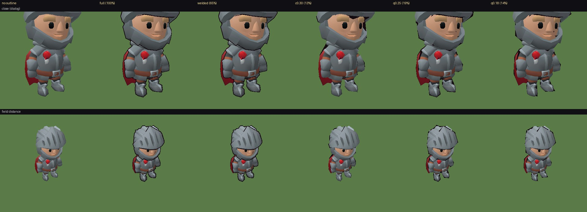
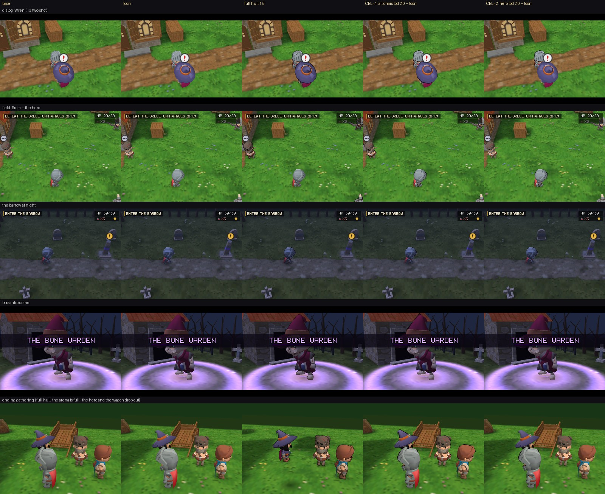
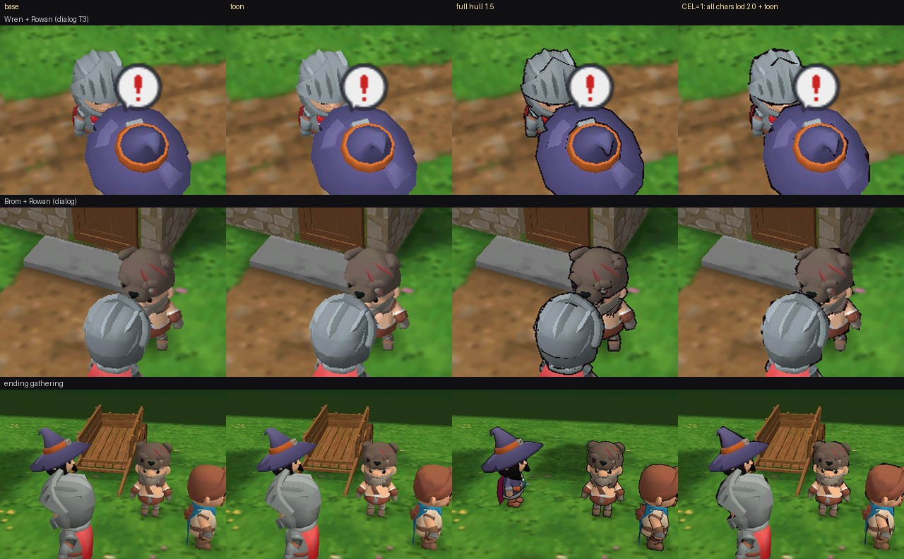
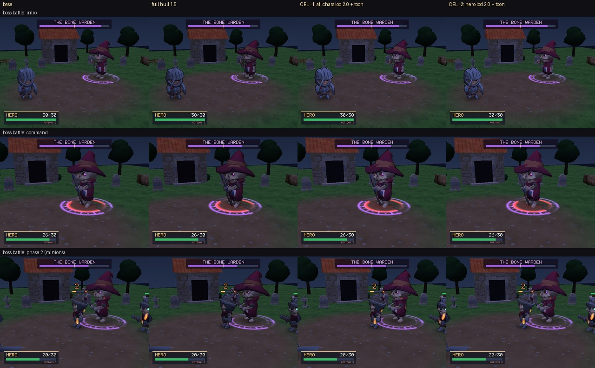
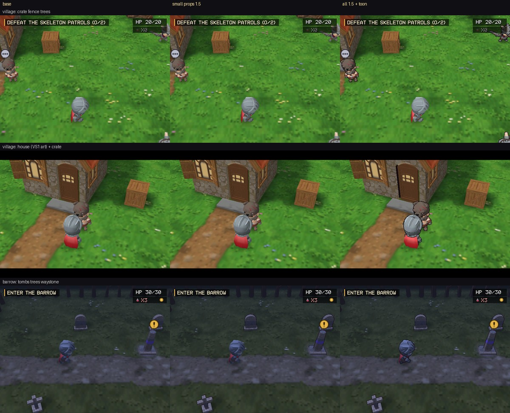

# Feasibility study: cel shading (toon lighting + model outlines) on the Dreamcast

> **Status:** study complete; prototype in the tree behind switches (the default build draws exactly as before: all
> five suites green). Nothing here has run on a Dreamcast yet: every number is a host measurement plus the
> project's calibrated SH4 estimate (`tests/dialog/sh4_model.py`). The decisive check is the hardware run of §7.

**Question.** Can the game add a cel-shaded look - toon lighting and ink outlines around the models - and still
run at 60 fps within the Dreamcast's limits? Which models can take it, and is it worth it?

**Short answer.**

* **Capability: yes.** Both halves map onto what the PowerVR and our CPU pipeline already do. Toon lighting snaps
  n.l to three bands where lighting is computed (baked per yaw bucket for characters, at load for props): **zero
  per-frame cost**. Outlines use the **inverted hull**: the model drawn a second time, pushed out along its normals,
  in one dark colour, with the PVR's per-polygon culling set to cull *front* faces, so only the rim behind the
  silhouette shows. No render-to-texture or post-process (the PVR has neither) is needed.
* **Performance: only with dedicated hull meshes.** A full-resolution hull doubles a character's cost. With it,
  even the hero alone breaks both frame budgets in the village and the battles, and outlining every character fills
  the vertex arena, so scenery - and in the ending the hero himself - drops out of the frame. Decimated hull meshes
  (Blender quadric collapse to 18 %, 8-13 KiB each, **12-16 % of the full cost**) bring it nearly within budget: every
  scene fits except the 3-skeleton squad battle (3-6 % of its frames, up to +7 %), the four-character ending
  gathering (vertex count only) and one village tile. **Hero-only outlines fit everywhere** except 1-3 frames of the
  squad battle that touch the line. No configuration with decimated hulls drops anything.
* **Which models: characters only.** Weapons, small props, the VS1 houses and the night scenes are poor candidates
  (§4).
* **Worth it: in close-ups, yes; at field distance, marginal.** Outlines make the characters pop in dialog two-shots,
  the boss intro and the ending; at the diorama camera they are a 1-2 pixel rim. The toon banding is barely visible
  under the current (soft, high-ambient) light presets.
* **Recommendation: conditional go** - characters only, decimated hulls, a per-frame hull budget - **after the
  hardware timing run** of the two test builds (`make CEL=1`, `make CEL=2`, §7). The frame budgets used here
  (18,000 written vertices, 1.60 M estimated instructions) are deliberately conservative estimates; the hardware run
  decides whether the remaining overruns are real.

Contents: §1 what was built · §2 the technique on this hardware · §3 performance · §4 which models · §5 the visual
check · §6 recommendation and a slice outline · §7 the hardware test · §8 risks · §9 how to reproduce.

---

## 1. What was built (all behind switches; the default build is unchanged)

| Part | Files | What it does |
|---|---|---|
| Outline hull pass | `src/render3d.*` (`CelParams`, `cel_hull_next`, the hull pass in `draw_model_in` and `draw_static`, `emit_hull_strips`) | after a model's normal emission: its vertices again, offset along welded normals by `outline_px` pixels at the model's depth, one colour, strips copied into one arena batch with the hull material; optional depth push (`zpush`) |
| Welded normals | `render3d.cpp` `weld_normals` | at load (only when outlines are on): the normal averaged over all vertices at one position, written into each DMF vertex's 4 unused pad bytes - no extra RAM, same cache line as the position - so hard edges do not crack the hull |
| Decimated hulls | `romdisk/models/hull/*.dmf` (7 files, 79 KiB), `src/models.cpp` `load_hull` | each character's hull mesh: same skeleton, drawn with the character's bone matrices instead of the full model when `cel().lod` is on; loaded only when outlines are on |
| Toon lighting | `render3d.cpp` `cel_ndl` | n.l snapped to 0 / 0.5 / 1 at thresholds 0.12 / 0.55 before ambient + diffuse, in the per-frame path and both bakes |
| Engine | `src/engine.h` `MAT_CULL_FRONT`, `platform/kos/main.cpp` (`PVR_CULLING_CCW`) | the hull material: untextured, opaque, front faces culled |
| Hooks | `src/field3d.cpp`, `src/battle3d_draw.cpp` | which draws get outlines: characters (and the hero alone with `chars = 2`), props, weapons; not while a character fades out |
| Tunables | `--tune cel_outline_px=2 cel_chars=1 cel_props=0 cel_toon=1 cel_lod=1 cel_zpush=0.05 cel_weapons=0 cel_rgb=... cel_band_lo/hi=...` | host: any combination without a rebuild |
| Hardware test builds | `makefile`: `make CEL=1` (every character), `make CEL=2` (the hero only) | toon + 2 px outlines from the decimated hulls; `CEL_DEFAULT` in `render3d.cpp` |
| Preview | `tools/battle3d/raster.c` (cull mode 2), `tools/render_frame.py` | the host rasteriser culls front faces for `MAT_CULL_FRONT` |
| Study tools | `tools/cel/study.py` (cost matrix), `sheet.py` (comparison sheets), `hull_lab.py` + `bpy_decimate.py` (hull meshes: cost, previews, `--write`), `make_hulls.sh`, `tile_load.py` (PVR binning estimate) | §9 |

Verified: 0 warnings in the host build and in the KOS backend against the stub KOS headers (default, `CEL_DEFAULT=1`,
`CEL_DEFAULT=1 BATTLE_DIAG=1`); all suites green with the prototype in the tree (§9); the hull files rebuild byte
for byte.

## 2. The technique on this hardware

The Dreamcast has no vertex shaders, no stencil tricks worth the cost, and no post-processing; what it has is a fast
tile renderer with per-polygon depth and culling modes, and a CPU that does all transform work. That rules the
options:

| Technique | On the Dreamcast | Verdict |
|---|---|---|
| **Inverted hull** (second copy, pushed out, front-culled, dark) | exactly the PVR's per-polygon culling (`PVR_CULLING_CCW` in the polygon header); costs CPU transforms + TA vertices | **used** |
| Screen-space edge detection (depth/normal discontinuities) | needs render-to-texture + a filter pass: no shader hardware; a CPU pass over 640x480 is far too slow | no |
| CPU silhouette edges (find edges between front and back faces, draw them as lines/quads) | per-frame edge classification of ~2,000 triangles per character on the SH4, plus line quads | costlier than a decimated hull, uglier at joints |
| Rim darkening (darken vertices facing away from the camera) | cheap per vertex, but soft and smudgy at this polygon count; not an ink line | not tested; a fallback for far LODs |
| **Banded lighting** (toon) | our lighting is already computed on the CPU (per frame or baked): snap n.l | **used**, free |
| Ramp texture (per-pixel bands) | needs a second textured pass (the PVR has one texture per polygon): doubles the fill and the vertices | no |

**The hull in this renderer.** After a model's strips are copied into the vertex arena, the hull pass re-runs the
skinning loop (one FTRV per vertex, two passes for two-bone groups, FSRRA for the divide) on position + welded normal
x k, where k puts the offset at `outline_px` pixels at the model's depth, writes the vertices into the transform
scratch buffer in the hull colour, and copies the opaque batches' strips (off-screen strips skipped) as one more arena
batch. The **depth push** (`zpush`, world units: z = 1/(W + d), one extra FSRRA) lets a coarse hull sit slightly
behind the surface without poking through it (black blotches), at the price of a slightly thinner rim.

**Decimated hulls.** A hull needs no UVs, colours or hard edges, so its vertices can be welded by position and the
mesh simplified: `hull_lab.py` welds the character, Blender's quadric edge collapse (`bpy_decimate.py`) reduces it to
18 % of its triangles with the skin weights carried as vertex groups (two largest kept), and the result is re-stripped
with the project's stripifier and written as a skinned DMF with the same bones. Vertex clustering (the first attempt)
reached the same cost but broke the rim far more (the `c0.30` column of the lab sheet).


*`tools/cel/hull_lab.py knight`: the knight with no outline, the full hull (100 % of the cost), the welded hull (65 %),
vertex clustering (13 %) and Blender's quadric collapse at 25 % and 18 % of the triangles (19 % and 14 % of the cost),
2 px, close and at field distance (2x crop). The quadric hulls keep a continuous rim; clustering breaks it.*

## 3. Performance

### 3.1 The budget matrix

Every scenario the suites use for budgets, per configuration: the worst frame's written vertices (limit 18,000; the
arena holds 20,480 - beyond that batches drop) and the SH4 estimate in M instructions (limit 1.60). **Bold** = over a
limit; **drops** = the arena was full and geometry was missing from the frame. "full" hulls include the battle
weapons; "lod" = the decimated hulls, weapons without outlines.

| Scene | base | toon | small props | all props+chars | full: all chars | full: hero | lod: all chars | lod: hero |
|---|---:|---:|---:|---:|---:|---:|---:|---:|
| Village, hero on every tile | 15,797 / 1.56 | 15,797 / 1.56 | 16,145 / 1.56 | 20,477 / 2.50 **drops** | 20,477 / 2.14 **drops** | **19,297 / 1.83** | **16,874 / 1.66** | 16,377 / 1.60 |
| Barrow, hero on every tile | 10,592 / 0.94 | 10,592 / 0.94 | 13,394 / 1.28 | **19,212 / 1.74** | 16,410 / 1.40 | 14,092 / 1.21 | 11,518 / 1.00 | 11,172 / 0.98 |
| Title orbit | 9,833 / 0.99 | 9,833 / 0.99 | 10,697 / 1.07 | **17,643 / 1.92** | 9,833 / 0.99 | 9,833 / 0.99 | 9,833 / 0.99 | 9,833 / 0.99 |
| Credits flyover | 9,093 / 1.01 | 9,093 / 1.01 | 10,733 / 1.13 | **15,966 / 1.85** | 9,093 / 1.01 | 9,093 / 1.01 | 9,093 / 1.01 | 9,093 / 1.01 |
| Playthrough: field | 16,131 / 1.43 | 16,131 / 1.43 | 16,155 / 1.44 | 20,479 / 2.28 **drops** | 20,479 / 2.12 **drops** | **19,631 / 1.70** | 17,082 / 1.53 | 16,711 / 1.47 |
| Playthrough: dialog/cutscenes | 16,633 / 1.41 | 16,633 / 1.41 | 17,329 / 1.50 | 20,479 / 2.12 **drops** | 20,475 / 1.77 **drops** | 19,975 / 1.66 **drops** | **18,863 / 1.56** | 17,213 / 1.45 |
| Playthrough: map change | 10,243 / 0.91 | 10,243 / 0.91 | 14,398 / 1.31 | **19,159 / 1.69** | 16,664 / 1.41 | 13,743 / 1.17 | 11,115 / 0.98 | 10,823 / 0.94 |
| Battle: patrol (2 skeletons) | 15,442 / 1.42 | 15,442 / 1.42 | 16,941 / 1.53 | 20,480 / 2.14 **drops** | 20,480 / 1.99 **drops** | **19,398 / 1.72** | 16,764 / 1.51 | 16,022 / 1.46 |
| Battle: squad (3 skeletons) | 17,434 / 1.57 | 17,434 / 1.57 | **18,978 / 1.68** | 20,480 / 2.20 **drops** | 20,480 / 2.01 **drops** | 20,480 / 1.79 **drops** | **19,047 / 1.68** | **18,014 / 1.60** |
| Battle: the Bone Warden | 14,609 / 1.29 | 14,609 / 1.29 | 16,558 / 1.46 | 20,480 / 2.02 **drops** | 20,480 / 2.00 **drops** | **18,565 / 1.60** | 16,233 / 1.41 | 15,189 / 1.33 |

How often the lod configurations break a limit (frames over / frames in the scenario):

| Configuration | Scenario | Over 18,000 vertices | Over 1.60 M | Drops |
|---|---|---:|---:|---:|
| lod: all chars | squad battle (two bot runs) | 139 / 2,247 and 63 / 1,105 | 86 and 29 | 0 |
| | playthrough battles | 75 / 7,352 | 42 | 0 |
| | playthrough dialog (the ending's gathering, four characters close) | 443 / 1,376 | 0 | 0 |
| | village sweep | 0 / 1,063 | 4 | 0 |
| lod: hero | squad battle, playthrough battles | 1 each | 2-3 each | 0 |

Reading: the **scenes that were already closest to the limits** (the squad battle at 1.57 M, the village's worst tile
at 1.56 M, the close-up gathering at 16.6k vertices) are the ones pushed over. Everything else has room.

### 3.2 Cost per character

From `hull_lab.py` (xf = vertices transformed, out = vertices written; the estimate is 1.52 x (40 xf + 24 out)):

| Model | Vertices / triangles | Full hull: xf / out / M est | Welded | **Quadric 18 %: xf / out / M est (share)** | Hull file |
|---|---|---|---|---|---:|
| knight (Rowan) | 2,280 / 2,053 | 2,280 / 3,500 / 0.266 | 65 % | **280 / 580 / 0.038 (14 %)** | 12.7 KiB |
| wren | 2,047 / 2,152 | 2,047 / 3,376 / 0.248 | 75 % | **301 / 582 / 0.040 (16 %)** | 13.3 KiB |
| brom | 1,903 / 1,827 | 1,903 / 3,053 / 0.227 | 69 % | **273 / 497 / 0.035 (15 %)** | 12.3 KiB |
| corwin | 1,929 / 2,074 | 1,929 / 3,260 / 0.236 | 75 % | **289 / 571 / 0.038 (16 %)** | 12.9 KiB |
| skel_warrior | 2,007 / 1,371 | 2,007 / 2,561 / 0.215 | 55 % | **208 / 371 / 0.026 (12 %)** | 10.0 KiB |
| skel_rogue | 1,580 / 1,181 | 1,580 / 2,213 / 0.177 | 56 % | **165 / 316 / 0.022 (12 %)** | 8.5 KiB |
| skel_mage (also the Warden) | 1,671 / 1,304 | 1,671 / 2,318 / 0.186 | 59 % | **177 / 346 / 0.023 (13 %)** | 8.9 KiB |

The estimate counts a hull vertex like a lit skinned vertex (40 instructions); a hull vertex has no lighting but one
more FSRRA (the depth push), so the figures are, if anything, slightly high. Welding alone (no decimation) saves only
25-45 %: the characters' strips are short, so the written vertices dominate.

### 3.3 The PowerVR side

| Limit | Today | With outlines (lod, all characters) | Note |
|---|---|---|---|
| Vertex arena / TA vertex buffer | arena 20,480 vertices (640 KiB) in a 1 MiB TA buffer | peak 19,047: **no drops** (full hulls: the arena fills) | the arena is the hard cap; raising it costs 32 B/vertex of RAM and TA buffer VRAM |
| Tile binning (object lists, `tools/cel/tile_load.py`, an estimate) | squad battle's worst frame: 7,998 OP pointers, busiest tile 259, 711 16-word blocks | 9,002 pointers, busiest tile 296, 779 blocks (+10 %) | full hulls: 920 blocks (+29 %). The OPB is sized by `platform/kos/main.cpp` (16-word bins, overflow x3); the new TA error counter (plan 3D-7 task 0C) would prove it on hardware |
| Fill / ISP | hull polygons are opaque and mostly hidden behind the model: the ISP rejects them per pixel (tile-based HSR, no overdraw shading) | a few % more ISP work around characters | not measurable on the host: the hardware run's `frame_rate` must stay 60.0 |
| Polygon rate | ~10k triangles per frame at worst | +~1.5k | far below the PVR's throughput |

### 3.4 Memory and load time

* Hull meshes: 79 KiB on the romdisk (in every build: one romdisk) and 79 KiB of the model arena when loaded
  (1,592 -> 1,671 of 1,792 KiB; only in CEL builds).
* Welded normals: 0 bytes (the DMF vertex pad).
* Load: `weld_normals` sorts each model's vertices once at boot when outlines are on (a few ms per model on the SH4,
  under the boot's load); the hull files are read with their characters.
* Materials: +1 (the hull material). Texture VRAM: 0.

## 4. Which models

| Model class | Examples | Outline result | Cost | Verdict |
|---|---|---|---|---|
| **Characters** | Rowan, Wren, Brom, Corwin, the skeletons, the Warden | clean silhouette lines; inner folds (hood, hat brim) get lines with the full hull; the decimated hull keeps the silhouette with a thinner, sometimes broken line | full: +0.18-0.27 M each; **decimated: +0.02-0.04 M each** | **yes, with decimated hulls** |
| Weapons | sword, shield, skeleton blade/shield | small, inside the character's silhouette most of the time; adds lines across the body | full hulls are ~200-400 written vertices each, ~1.5k per battle | **no** (off by default: `cel_weapons`) |
| Small KayKit props | trees, fences, tombs, waystone, crypt, bushes | a 1 px line at the diorama distance: barely visible | 300-2,800 vertices per frame for all of them | **no** (low value) |
| VS1 prelit props | houses, wagon, crates, boulders | **artifacts**: these are double-sided open shells (walls, frames), the hull shows as black slivers (the door frame in `props.jpg`); 2,000-3,400 vertices each | +3-7k per frame | **no** |
| Ground, glows, billboards, UI | - | not meshes with volume | - | n/a |
| Night scenes (the barrow, the boss arena) | all of the above | a dark line on a dark scene: hardly visible | same | outline colour per light preset (a lighter, blue-grey line at night) - a data change if pursued |

## 5. The visual check

All frames are host renders of the real frame dumps (`tools/render_frame.py`, the PVR-like rasteriser: culling,
fog and depth emulated; no anti-aliasing, no TV). The hardware and a TV will soften every 1-2 px line.


*Whole frames from the playthrough: base, toon only, full hulls 1.5 px on every character, `CEL=1` (decimated hulls,
2 px, toon, every character) and `CEL=2` (the hero only). Row 5: with full hulls the ending's arena overflows - the
hero and the wagon are missing; the decimated hulls keep the whole frame.*


*Close-ups (2x): the dialog two-shots and the gathering. The full hull (1.5 px) gives the crispest line and inner
detail lines; `CEL=1`'s decimated hull (2 px) keeps the silhouettes at a seventh of the cost, a little thinner and
broken in places. Toon alone is hard to see under the day light.*


*The boss battle: base, full hulls, `CEL=1`, `CEL=2`. At night the dark line barely reads; in phase 2 (minions) the
full hulls overflow the arena and tombstones drop out (left of the crypt).*


*Props: base, small props outlined, everything outlined (full hulls). Small props gain almost nothing at this
distance; the VS1 house shows a black sliver on its door frame (an open double-sided shell).*

**Verdict by eye.** Worthwhile where the camera is close (dialog, the boss intro, the ending, the title if characters
appear there later): the characters read as "drawn", the look fits the KayKit style. At the field camera the effect
is a thin dark rim - pleasant, not transformative. The toon banding needs art direction to be seen: the current
presets light characters with a high ambient (0.55) and a soft diffuse, so the bands span 0.55-1.0; a real cel look
wants a lower ambient and a harder light, i.e. new light presets (data, `romdisk/maps/lights.txt` and the built-in
`day`), tuned on hardware.

## 6. Recommendation, and a slice outline if it goes ahead

**Conditional go**, in this order:

1. **Hardware run first** (§7): `make CEL=1 DIAG=1` and `make CEL=2 DIAG=1` against the default `make DIAG=1`, same
   playthrough. If `CEL=1`'s worst CPU frame stays under ~15 ms everywhere (the estimate limit of 1.60 M is about
   8 ms of game code: there may be real headroom), outline every character. If not, outline the hero always and the
   other characters only in close-ups (dialog, cutscenes), or the hero only (`CEL=2` fits the current budgets).
2. **A per-frame hull budget** in the production version: hulls drawn last, after the scene, each only if the frame
   still has room (vertices written so far + the hull's cost under the limit; the hero first, then the speaker, the
   boss, the nearest). That makes the squad battle and the gathering safe by construction instead of by measurement.
3. **Art direction**: outline colour per light preset (night: lighter), line width per camera (2 px field, 2.5 px
   close-ups), and - only if the toon banding is wanted - light presets with a lower ambient.

A slice for it would contain (sizes as in the GDD):

| Task | Size | Content |
|---|---|---|
| C1 | M | production hull pass: hulls deferred to the end of the frame with the budget governor; per-preset outline colour and width; the `cel` switches become data (`lights.txt` / a `style` line) |
| C2 | S | `tools/cel/make_hulls.sh` in the asset pipeline (every new character gets a hull; a rebuild check in a suite); the hull DMF flagged as such |
| C3 | S | tests: a `cel` suite - budgets of §3.1 with the governor (0 frames over), float == double with outlines, the default build pixel-identical to today, the hull files reproducible |
| C4 | S-M | art pass: presets, widths, the toon bands (if wanted), QC sheets |
| C5 | - | hardware sign-off: DIAG over the playthrough, TV legibility, the checklist of §7 |

Definition of done for such a slice: every budget scenario of §3.1 with 0 frames over 18,000 vertices / 1.60 M (or
the hardware-restated limits) and 0 drops; 0 TA errors and 60.0 fps in the hardware run; the default look unchanged
unless the style is switched on; the outlines legible on a TV at the field camera.

## 7. The hardware test (the user's next step)

```
make clean && make DIAG=1          # baseline
make clean && make CEL=1 DIAG=1    # every character outlined (decimated hulls) + toon
make clean && make CEL=2 DIAG=1    # the hero only
```

Play the same route on each (title -> village -> a patrol -> the squad if reachable -> the barrow -> the boss ->
the ending) and compare the DIAG reports (`worst CPU frame ... us`, `frames over 16.7 ms`, the arena peak and drops,
`fps`).

| # | Check | Expected |
|---|---|---|
| H1 | Outlines appear as dark rims around the characters, not as black characters | if the characters turn black, the culling mode is the wrong way round on hardware: swap `PVR_CULLING_CCW` to `PVR_CULLING_CW` for `MAT_CULL_FRONT` in `platform/kos/main.cpp` |
| H2 | No black blotches on faces or bodies at the dialog camera | else raise `zpush` (0.05 -> 0.1) in `render3d.cpp` |
| H3 | `worst CPU frame` per scene vs the baseline | the difference is the real cost of the outlines; compare with §3.1's estimate deltas (+0.03-0.3 M) |
| H4 | `frames over 16.7 ms`, `fps` | 0 and 60.0 in both CEL builds = feasible as measured |
| H5 | `arena peak`, `drops` | peak < 20,480, drops 0 (host: 19,047 / 0) |
| H6 | On a TV (composite/S-video) at the field camera | is the 2 px line visible? worth it? |
| H7 | The barrow at night | the line's contrast (expected: poor; a lighter colour would be the fix) |

## 8. Risks and unknowns

| Risk | Mitigation |
|---|---|
| The SH4 estimate is not a measurement (calibrated on slice 3D-4's qemu run); hull vertices may cost less (no lighting) or more (cache misses on a second pass over the vertices) | the hardware run (§7) |
| PVR culling direction on hardware (set by reasoning from the project's winding convention, not observed) | H1 and a one-line swap |
| Object-list overflow in very busy tiles (the estimate says +10 %) | the TA error counter (plan 3D-7 task 0C); the OPB bin size / overflow count in `main.cpp` |
| Decimated hull quality on future models (thin parts: capes, staffs, hair) | `hull_lab.py` previews per model; the ratio is per model |
| Outlines on translucent (fading) models look wrong (an opaque rim around a see-through body) | already excluded (no hull while a character fades) |
| Deterministic traces: the hull pass changes only presentation | verified: the suites run unchanged with the prototype in the tree; a float == double check with outlines on belongs in the slice's suite |

## 9. How to reproduce

```
make host                                                   # the harness
python3 tools/cel/study.py                                  # §3.1 (all configurations; ~4 min with 4 jobs)
python3 tools/cel/study.py --configs "base,chars lod,hero lod"
python3 tools/cel/sheet.py docs/cel/closeups.jpg --ticks 510,4595,11700 \
    --crops "190,170,240,180;150,150,240,180;100,60,480,360" --configs "base,toon,full hull 1.5,CEL=1: all chars lod 2.0 + toon"
python3 tools/cel/hull_lab.py knight --cells 0.3 --quadric 0.25,0.18 --zpush 0.1 --px 2 --sheet docs/cel/hull_lab_knight.jpg
tools/cel/make_hulls.sh                                     # rebuild romdisk/models/hull (needs BLENDER_PY with bpy)
python3 tools/cel/tile_load.py DUMP/frame_00800.txt         # PVR binning estimate of a frame dump
./build/battle_trace_f32 - /dev/null --sweep --tune cel_outline_px=2 --tune cel_lod=1   # any single run
```

Suites run with the prototype in the tree (default switches): `tests/barrow` 37/37, `tests/dialog` (quick) 32/32,
`tests/run_tests.sh` 54/54, `tests/battle3d` 19/19, `tests/vs1art` 13/13.
