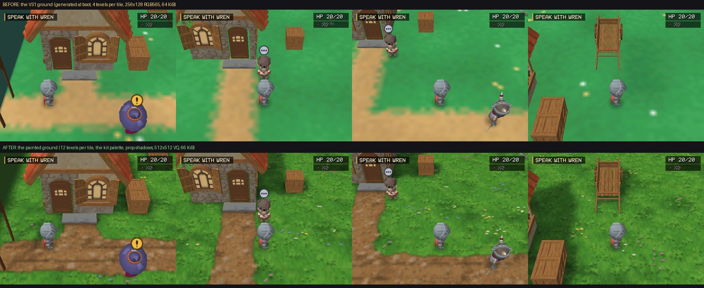
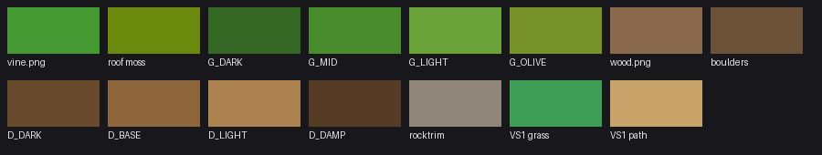
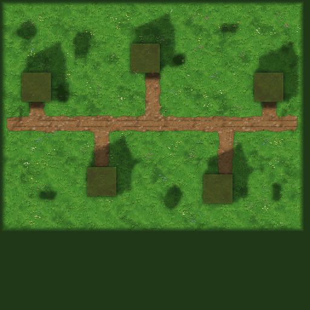
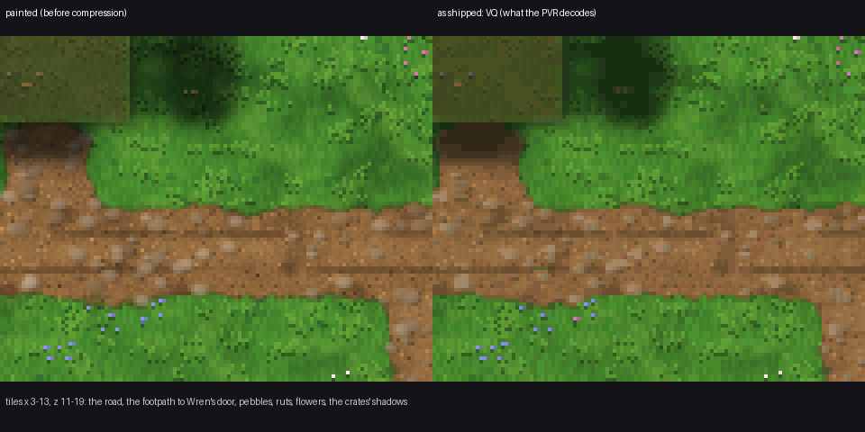

# Art pass: the village ground

**Brief:** the village's ground looks washed out and empty next to the characters and the rest of the village. Correct
it, and colour it more like the village.

*Host renders of the field at four spots (hero on tiles (2,15), (21,12), (24,14), (10,10)); top: the VS1 ground,
bottom: the painted ground. Same camera, same frame cost.*

## Summary

* **Why it looked washed out.** The VS1 ground (adopted in [SLICE_VS1_ART.md](SLICE_VS1_ART.md)) is generated at
  boot at **4 texels per tile**. At the field camera a tile is ~66 pixels wide, so one texel covered ~16 pixels and
  the bilinear filter smeared everything: no detail at all next to the 128x128 textures of the houses and
  characters (~4-5 pixels per texel). Its colours were two flat tones: a **mint green** (hue 134 degrees; the kit's
  greens are yellow-green, 74-110) and a **pale sand** road (C9A46A) that none of the kit's textures use.
* **Now:** the ground is **painted offline** for the whole map at **12 texels per tile** (~5 pixels per texel, the
  density of the props and characters), in the **kit's own palette** (greens from the houses' vines and roof moss,
  dirt browns from the wood and the boulders, stones from the rock trim), with the kit's own terrain noise
  (`T_Noise_Terrain`) for the grass's large patches. Detail: grass blades and tufts, clover, flowers in clusters,
  dirt roads whose edges wander off the tile grid, wagon ruts along the main road, trodden footpaths, grit and
  pebbles, a worn band where the grass thins. And the props are anchored: every house, crate, boulder, the wagon,
  the fences and the arch cast a **soft shadow** along the same light VS1 baked into them, with contact darkening
  at their feet.
* **Cost: nothing per frame.** The same ground grid and vertex count (every frame-cost figure of
  [SLICE_VS1_ART.md](SLICE_VS1_ART.md) §6 is unchanged: field worst 15,761 written vertices). The 512x512 texture is
  stored **VQ-compressed** - the PVR's native 2 bits per texel - in **66 KiB of VRAM**, 2 KiB more than the VS1
  ground's 256x128 RGB565. Boot reads a 66 KiB file instead of generating 32k texels.
* **Measured against the VS1 ground** (same tiles; `tests/vs1art/check_gnd.py`): detail per tile **98 vs 18**
  (mean luma step between neighbouring texels x texels per tile), saturation 0.65 vs 0.61, luma spread 21.6 vs
  16.5; mean grass (68,120,41), **10 degrees** of hue from the kit's greens (VS1: 24); mean dirt (125,95,57),
  **3 degrees** from the kit's browns (VS1: 11).

## 1. What is painted, and from what

`tools/ground/paint_ground.py` reads the map (tiles and `prop` lines), the prop models in `romdisk/models/` and the
kit's terrain noise (`assets/ground/T_Noise_Terrain.png`, CC0), and paints a 512x512 image: the map's 40x30 tiles at
12 texels each, plus a one-tile margin (the camera shows up to ~0.7 tile past the map at the gate and the east end).

*The palette: the kit's colours (vine, roof moss, wood, boulders, rock trim), the ground's, and VS1's two.*

| Layer | How |
|---|---|
| Grass colour | three greens around the kit's vine green plus an olive from the roof moss; large patches from the kit's terrain noise (one repeat per 9 tiles), mid patches from its second channel (3.2 tiles), small ones from fbm |
| Grass detail | per-texel blade jitter stretched vertically (the 45-degree camera reads blades as short strokes); ~2,600 tufts of 3-6 blades, dark at the root and light at the tip; clover patches in a bluer green |
| Paths | the `=` tiles, blurred, then **domain-warped** (up to ~0.25 tile, with a finer ragged wobble) and thresholded: edges that wander off the tile grid; a worn band where grass thins into damp soil, and a darker line at the edge |
| Dirt | the wood and boulder browns, varied by the terrain noise's third channel and fbm, per-texel grain |
| The main road | two wagon ruts (damp soil) that meander and fade in and out along its length, a lighter crown between them; footpaths get a lighter trodden centre instead |
| Grit and pebbles | specks a shade off the soil; round pebbles in the rock-trim greys mixed half with the soil (dusty), lit from the upper left with a shadow to the lower right, anti-aliased edges |
| Flowers | clusters on the map's `,` tiles (white, yellow, pink, blue, in the kit's accent colours), a few wild ones elsewhere, with a shaded stem texel |
| Prop shadows | every triangle of every prop, placed as the field places it, projected onto the ground along VS1's bake light (-0.38, 0.82, 0.43): an anti-aliased mask, softened twice (a tight and a wide penumbra), darkening 40 % with a slightly blue tint |
| Contact darkening | around the feet of houses and crates (whole footprint) and of the open props (only where their triangles touch the ground); under a house a packed-earth floor, seen only through its see-through ghost |
| Margin | the map's edge fades over one tile into the outer ground (1E381C); the field's clear colour follows the file |

Everything is seeded: the file rebuilds byte for byte (`--check`).

## 2. The texture and its compression

*The shipped texture, decoded (512x512: the map, its margin, and the flat outer colour the border tiles sample).*

**VQ:** 256 codes, each a 2x2 block of RGB565 texels; every 2x2 block of the texture is one index byte. The encoder
(`vq_encode`) is k-means on the 12 values of each block, luma-weighted, seeded with k-means++, 24 iterations, then
the codebook is rounded to RGB565 and every block re-assigned against the rounded codes. **PSNR 35.5 dB** against
the painting in RGB565. File `romdisk/maps/village.gnd`: a 32-byte `GND1` header (texture size, texels per tile,
margin, map size, outer colour) and the payload exactly as the PVR reads it: the 2 KiB codebook, then the 256x256
index map in the KOS twiddled order (texels of a code in twiddled order too: (0,0) (0,1) (1,0) (1,1)).

*Ten tiles around Wren's footpath, the painting and the shipped VQ at 4x: flowers lose a little contrast, edges
get 2x2 steps the bilinear filter hides at game scale.*

## 3. Runtime

| File | Change |
|---|---|
| `src/engine.h` | `eng::texture_create_vq(data, bytes, w, h)`; `eng::vq_decode()` (the layout, as code) |
| `platform/kos/main.cpp` | the VQ upload: `pvr_txr_load` of the payload as is, `PVR_TXRFMT_RGB565 \| PVR_TXRFMT_VQ_ENABLE \| TWIDDLED`; `make GROUND_NO_VQ=1` decodes it at boot and uploads plain RGB565 (512 KiB) instead - the fallback if it shows scrambled blocks; boot checks `/rd/maps/village.gnd` |
| `platform/host/host_engine.cpp` | decodes it (frame dumps, renders); VRAM counted as the PVR holds it |
| `src/field3d.cpp` | `load_painted_ground()`: a map named `<name>` with `/rd/maps/<name>.gnd` (header checked against the map) uses it - texels per tile, margin and outer colour from the file; otherwise the generated VS1 ground as before (`test_field`). UVs include the margin; tiles beyond it sample the flat outer area; the clear colour is the outer colour |
| `tools/ground/paint_ground.py` | the painter and VQ encoder |

The ground is still one texture over one grid: draw cost, vertex counts and the sweep's numbers are unchanged.

## 4. Budgets

| | Before (VS1 ground) | Now |
|---|---:|---:|
| Texels per tile | 4 | **12** |
| Texture | 256x128 RGB565, 64 KiB | 512x512 VQ, **66 KiB** (2,048 + 65,536 bytes) |
| VRAM, all textures | 914 KiB | **916 KiB** (limit 1 MiB) |
| Texture slots | 26 | 26 |
| RAM | 64 KiB texel buffer | + 66 KiB file buffer (the generated ground's buffer stays for other maps) |
| Romdisk | 2,379,658 bytes | **2,447,274** (+67,616; limit 2.5 MB) |
| Boot | 32k texels generated | one 66 KiB file read |
| Per frame | - | unchanged |

## 5. Verification

| Check | Result |
|---|---|
| The file rebuilds byte for byte | `paint_ground.py --check` |
| The game draws exactly that texture: the host's decode (`eng::vq_decode`) == an independent decode (numpy, VS1's `pvrtex` twiddle) | 262,144 texels identical |
| Art targets vs the VS1 ground: more detail per tile (x2 at least), more saturation and contrast, grass and dirt closer in hue to the kit | 98 vs 18; 0.65 vs 0.61; 21.6 vs 16.5; 10 vs 24 degrees; 3 vs 11 degrees |
| Maps without a painted ground keep the VS1 generator, bit for bit | `test_field` |
| Frame cost on every walkable tile, camera, layout, props, characters | unchanged (`tests/vs1art/run.sh`, 14/14 with `VS1PY=`) |
| The game on it: routes, dialog UI, budgets (VRAM 916 KiB), the KOS backend against stub headers (four flavours, one now with `GROUND_NO_VQ`) | `tests/dialog/run.sh` |

## 6. On hardware

* `FOUND: /rd/maps/village.gnd` at boot; in DIAG builds `texture_create_vq(512x512, 67584 bytes)`.
* The ground looks like `ground/before_after.jpg` (bottom row). **Scrambled 2x2 blocks or a stripe pattern** mean
  the PVR reads the VQ layout differently than assumed (codebook texel order or index twiddling):
  `make clean && make GROUND_NO_VQ=1` uploads the same picture as plain RGB565 (512 KiB of VRAM instead of 66) -
  report which build looked right. TRIAGE has the line.
* Flycast: VQ textures are supported; the same check applies.

## 7. Open

(The next slice, [NEXT_SLICE_BARROW.md](NEXT_SLICE_BARROW.md), paints the Barrow's ground with this tool and reuses the
VQ texture slot across maps.)

* The battle arena's grass and dirt are still their own (`ground.png`, `dirt.png`). The painter could make the
  arena's ground from the same palette and noise, so the battle clearing matches the village road.
* Characters cast blob shadows; only the props' shadows are painted (they never move).
* A second painted map in one session falls back to the generated ground (no texture can be freed yet).
