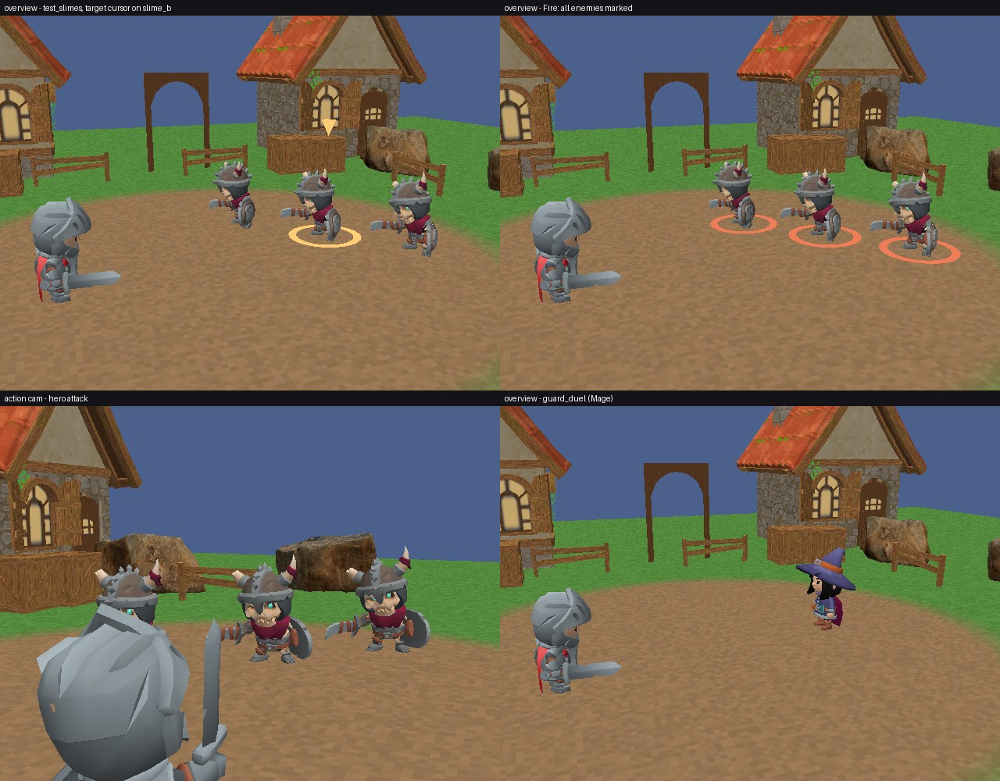

# Next vertical slice (3D-4): 3D combat

> **Status:** implemented (with the GDD's Bone Warden added). What was built, decided and measured: `docs/SLICE_3D_BATTLE.md`.

**Goal:** the battle becomes 3D, like the overworld:
* one new **village arena**, reused by every encounter in the village;
* **enemies as 3D models**: skeletons and the Mage, the same files as on the field;
* a **selection system with 3D effects**;
* an **animated sequence for every action**: attacks, Fireball, Guard, hits, burn, death,
  intro, victory and defeat.

**Rule:** the battle *rules* stay exactly as they are. Only presentation and pacing change, and
that is proven by a turn-by-turn equivalence test against today's sprite battle (§7, stage 0).

This document has ten parts:
* §1: today's battle engine;
* §2: prototypes and findings;
* §3: design;
* §4: architecture;
* §5: budgets;
* §6: asset list;
* §7: stages and tasks;
* §8: definition of done;
* §9: decisions needed from you;
* §10: risks.


*Mock-up rendered from the real assets: village kit and boulders for the arena, the converted
characters posed with pack animations, and weapons attached to the hand bones. Top: the overview
shot, targeting one skeleton (gold ring and arrow) and Fire marking all of them. Bottom: the action
camera at the start of the hero's attack, and the Mage duel. The ground and rings are placeholders;
the real ones are textured decals. Script: `battle3d/proto/arena.py`.*

---

## 1. Today's battle engine (what constrains the plan)

| Piece | Today | Consequence |
|---|---|---|
| Rules | `battle.cpp` state machine (command → resolve → animate → turn_advance, one state per tick), `skills.cpp` (Attack, Fireball + Burn, Guard), `status.cpp`, `turn_system.cpp` (agility order), `targeting.cpp`. Deterministic, no randomness in the rules | **Untouched.** The 3D layer reads it, the way `field3d` reads the field |
| Presentation | `present()` hooks push 2D lunges, recoils and flashes (`presentation.cpp`). `Animate` waits ≥ 12 ticks **and** until those are done: about **0.2 s per action** | 3D sequences take 1–3 s. The state machine must wait for them (a presentation "busy" gate), or it will resolve the next action mid-swing |
| Burn damage | happens at the start of the burning actor's turn, inside `TurnAdvance`, which does not wait for anything | a burn tick needs its own short sequence, and `Command` must wait for it |
| Win/Lose | checked at the top of every tick, so the banner appears the moment the last HP is gone | the banner and its "press A" must wait for the killing blow's sequence |
| UI | `ui.cpp`: ring (Attack / Fire / Guard), single target (◀▶, A, B back, entry lock), Fire confirm (all enemies). 2D icons at actor positions | the same input states, drawn in 3D. L/R must follow left→right **on screen**, so the formation slots are chosen to make actor order = screen order |
| Layout | actors at 2D pixel positions (`encounters.cpp`: hero 180,240; enemies around 460–500) | 3D needs **formation slots** in the arena (data, per enemy count) |
| Cosmetic RNG | `fx` float-text drift uses `eng::random01()` | 3D particles get a separate RNG, so cosmetics can never shift anything the rules might use later |
| Tests | the d-pad goldens (`tests/slice3d/pre3d`) hold **tick-exact battle states**; the older 138-run battle suite is not in this repository | tick timing *will* change. Tests move to **turn-level** equivalence (same actor, skill, targets, damage, HP and statuses per turn), recorded from today's build **before** any change |
| Legacy rule bug | Guard is applied for 1 turn and expires at the end of the guarding actor's own turn, so it **never reduces damage** (REPORT §5) | a visible 3D shield that vanishes before any enemy swings makes this obvious. Decision D1 |

---

## 2. Prototypes and findings (done for this plan)

All of these were rendered or measured with the existing tool chain. Scripts: `docs/battle3d/proto/`.

1. **Every character shares one skeleton exactly.** Knight, Skeleton_Warrior, Mage, Barbarian and
   Rogue have the same 24 bones, identical rest transforms (difference 0.0000) and the packs' T-pose.
   A clip's keys are therefore the same for every character, so **one animation library can serve
   them all**. Today each DMF carries its own copy.
2. **The packs cover almost everything.** There are 71 clips (plus a T-pose in each file) in the
   five `Rig_Medium_*` files (inventory in §6). Contact sheets of the candidates on our characters, with weapons:
   [hero](battle3d/clips_hero.jpg), [skeleton](battle3d/clips_skeleton.jpg), [Mage](battle3d/clips_mage.jpg).
   * Highlights: `Skeletons_Death` collapses the skeleton into a pile of bones;
     `Skeletons_Awaken_Standing` and `Skeletons_Spawn_Ground` make a battle intro;
     `Melee_Block`, `Melee_Blocking` and `Melee_Block_Hit` make Guard.
   * Missing: a **spellcast** (Fireball), a **victory** pose and a **Mage weapon**. `Throw` works
     as a stand-in cast.
3. **Weapons attach cleanly.** The rig has `handslot.r` / `handslot.l` bones, and the weapon FBXs
   are modelled grip-at-origin in the characters' units. `sword_1handed` + `shield_badge_color` for
   the hero and `Skeleton_Blade` + `Skeleton_Shield_Large_A` for skeletons look plausible in the
   contact sheets with no offsets (to be confirmed by the attachment sheets in B2). `Skeleton_Staff` in the Mage's hand needs an offset (it is held sideways); a per-weapon
   offset table is planned. They use the characters' own texture atlases: **no extra VRAM**.
4. **Impact timings measured from the clips** (weapon-tip speed peak and lowest point), to seed
   the sequence table. The converter will store them as clip events:

   | Clip | Length | Impact / release |
   |---|---:|---|
   | Melee_1H_Attack_Chop | 1.07 s | 0.60–0.67 s |
   | Melee_1H_Attack_Slice_Diagonal | 1.00 s | 0.40–0.47 s |
   | Melee_1H_Attack_Slice_Horizontal | 1.37 s | 0.20–0.27 s |
   | Melee_1H_Attack_Jump_Chop | 1.33 s | 0.73 s |
   | Melee_2H_Attack_Chop (Mage with staff) | 1.60 s | 0.80–0.87 s |
   | Throw (cast stand-in) | 1.37 s | release 0.73–0.80 s |
   | Melee_Unarmed_Attack_Punch_A | 1.17 s | 0.47–0.53 s |

5. **Clips move the body.** `Skeletons_Death` slides the hips back 1.1 m, `Death_A` 0.3 m, and
   `Skeletons_Spawn_Ground` starts 1.7 m underground. Consequences:
   * the culling box must cover every clip, so it is computed per clip;
   * blob shadows fade during these clips;
   * the ground must hide the spawn, which the depth test does.
6. **Arena from existing art works** (the mock-up above): two houses, the arch, the wagon, fences,
   crates and three boulders around a dirt clearing.
   * Its props total 12.3k triangles as laid out. That is **too heavy**: the arena gets its own
     camera-cone culling and a lighter backdrop, target ≤ 4k visible triangles (§5).
   * Trees and bushes would help the most visually; the village kit has none (§6).
7. **Shot framing** (projected heights at 640×480):
   * On the field a character is ~77 px tall.
   * At the battle overview (3.2 m up, 40° FOV) the enemies are 94–109 px and the hero, in the
     foreground, 135 px. Faces show, which justifies last slice's face work.
   * The action camera shows the target at 140–160 px. The same models hold up there: no
     separate battle LOD is planned.

---

## 3. Design

### 3.1 The village arena (`romdisk/arenas/village.txt`)
* **Where:** a trampled dirt clearing at the edge of the village, about 10 m across, in grass.
* **Backdrop:** a house façade (camera side only), the arch as a gateway, a wagon, fences,
  crates, 2–3 boulders and, if supplied, trees and bushes to close the horizon (§6).
* **Stage, not theatre-in-the-round:** every camera stays inside a ±60° yaw cone looking north, so
  only that half needs a backdrop. The same camera-cone culling as the village then removes
  everything those cameras can't see.
* **Data file**, like a map: props (reusing `props.py` prefabs plus an arena cone), ground texture,
  light, formation slots and camera shots. Encounters stay as they are; the map says
  `arena village`, so every village encounter uses it.
* **Formation slots** (metres, hero on the west facing east):
  * hero at (−2.6, 0.9);
  * 1 enemy at (2.3, −0.2);
  * 2 enemies at (1.6, −1.0) and (3.0, 0.6);
  * 3 enemies at (1.1, −1.5), (2.3, −0.2) and (3.5, 1.1).

  Slot order is left→right on screen, so ◀▶ on the target cursor moves the way it looks.

### 3.2 Cameras
| Shot | Use | Notes |
|---|---|---|
| overview | command selection, most impacts | mock-up top-left |
| target lean | single target | overview eased 25 % toward the target |
| pull-back | Fire confirm | frames all enemies |
| action | melee attacks | over the attacker's shoulder toward the target (mock-up bottom-left) |
| cast | Fireball wind-up | hero three-quarter front |
| enemy focus | enemy turn | eases toward the acting enemy |
| intro sweep | battle start | high establishing shot → overview, 1 s; A skips |
| victory orbit / defeat push-in | results | slow moves |

All shots ease (no hard cuts except on impact). Camera shake and hit-stop (2–4 frames of frozen
animation) are used on impacts.

### 3.3 Sequences (one per action; 60 ticks = 1 s)
| Action | Sequence | Length |
|---|---|---:|
| **Attack** (hero → one enemy) | action cam; `Running_A` to 1 m in front of the target (24 t); `Melee_1H_Attack_Chop`, impact at 0.60 s: **hit-stop 4 t, blade-tip spark burst, target white flash, target `Hit_B`, damage number, HP bar drains, small shake**; `Dodge_Backward` and a hop back to the slot (24 t); idle crossfade | ~112 t (1.9 s) |
| Attack on a kill | as above; the target plays its death clip instead of `Hit_B`. Skeleton: `Skeletons_Death` (collapses into bones), then fades out with dust. Mage: `Death_B`, then fades | +60 t |
| **Enemy attack** (skeleton → hero) | enemy focus; run in; `Melee_1H_Attack_Slice_Horizontal` (impact 0.27 s) or `Chop`, alternating per enemy for variety; hero `Hit_A`, or `Melee_Block_Hit` with a shield ripple when guarding (D1); run back | ~100 t |
| **Mage attack** (guard duel) | no approach: `Throw` (or a spellcast, §6), and at release an **arcane bolt** (glow billboard + trail) flies 20 t to the hero; impact as above. The rule stays the physical Attack; only the look differs | ~90 t |
| **Fireball** (hero → all) | cast cam; `Throw` (or a spellcast); fire charges on the right hand; at release one fireball per enemy, 4 t apart, each flying an arc for 24 t; each impact: flash, embers, a scorch ring decal, `Hit_B`, damage number, **BURN** label; then **burning flames stay attached** to each burned enemy | ~110 t |
| **Guard** | `Melee_Block` (trimmed to 30 t) then `Melee_Blocking` **held while the Guard status lasts**; a translucent blue shield dome fades in, with a blue ring decal and a "GUARD" label | ~40 t |
| **Burn tick** (start of a burned actor's turn) | flame burst on the actor, `Hit_A`, orange number | 30 t |
| **Intro** | intro sweep; skeletons `Skeletons_Awaken_Standing` staggered 8 t apart (`Spawn_Ground` rises out of the dirt, 3.6 s: option); Mage `Spawn_Air`; A skips | ~90 t |
| **Victory** | last death finishes; victory orbit around the hero; hero victory clip (§6; stand-in `Jump_Full_Short`); "VICTORY!" banner | 120 t |
| **Defeat** | hero `Death_A` → hold the pose; skeletons `Skeletons_Taunt`; slow push-in; "DEFEAT..." | 120 t |

**Pacing:** battles get about 8–10× longer in wall time (2 s per action instead of 0.2 s). Holding
A during a sequence plays it at 2× (D4).

### 3.4 Selection with 3D effects
| UI state | 3D presentation |
|---|---|
| **Home** (Attack / Fire / Guard) | three command billboards (sword, flame, shield) on a ring around the hero at chest height. The ring **rotates** (10-tick ease) to bring the selected one to the front; it is scaled 1.4× over a glow, the others dimmed. Fire highlighted → small red rings under every enemy (preview, as today) |
| **Target** (Attack) | a rotating gold **rune ring decal** under the target; a bobbing gold **3D arrow** above its head; the target's rim **pulses** (PVR offset colour), the other enemies are dimmed; the camera leans toward it. A name label and HP bar show. ◀▶ moves in screen order; B goes back; A confirms (entry lock unchanged) |
| **TargetAll** (Fire) | red-orange rune rings under every enemy, all pulsing; a wide circle on the ground with rising embers; camera pull-back; "ALL ENEMIES" |
| Enemy turn | red chevron above the acting enemy, red ring under it, enemy-focus camera |
| Prompt bar | unchanged (A / ◀▶ / B / Y glyphs) |

### 3.5 HUD
* Small HP bars **above the enemies' heads**, projected from 3D.
* A bottom-left hero panel: name, HP bar and number, status icons.
* Damage numbers and status words rise from the projected head positions.
* Optional: a turn-order strip of 24 px portraits, rendered offline from the DMFs (no new art).

### 3.6 Transitions
* **Field → battle:** keep the 24-tick fade, then the intro sweep.
* **Battle → field:** fade, as today.
* The field models are reused, so nothing loads.

---

## 4. Architecture

```
battle.cpp (rules, unchanged logic)
   │  Resolve: skill->resolve() -> SkillResult  ──►  battle3d_on_action(user, skill, result)
   │  Animate: waits for pres_done() && !battle3d_busy()
   │  Command: waits while battle3d_busy()          (burn ticks, deaths, intro)
   │  Win/Lose: result_ticks count only once !battle3d_busy()
   ▼
battle3d.cpp (presentation, read-only on BattleCtx, like field3d)
   ActorView per actor: slot, position, yaw, Animator, shown_hp, flash, status FX, alpha
   Sequencer: timeline of events (MoveTo, Play clip, Impact, Projectile, Camera, HitStop, Wait)
   SequenceTable: (skill × actor type) -> builder, timings from clip events
   Selection visuals (ring, decals, arrow, tint), HUD (projected bars, numbers), camera rig
anim.cpp      shared animation library (.dma) + Animator (crossfades, one-shots, hold last pose)
particles.cpp fixed pool (256 billboards), additive/alpha, flipbooks, own RNG
arena.cpp     arena file loader + draw (static prelit props, ground decal)
```

* **Logic-neutral gates.** The only rules-side edits are three "wait while busy" conditions. They
  change *when* the next state happens, never *what* happens. The turn-level equivalence test
  proves it.
* **Shown HP vs rules HP.** The rules change HP at Resolve, as today; the bars and numbers follow
  at the impact event.
* **`BATTLE_2D` build flag** keeps today's sprite battle for A/B and for recording the equivalence
  baseline, like `FIELD_2D` for the field.
* **Data-driven.** The sequence table, arena file and clip events are data. Adding a skill means
  a rule plus a sequence entry (HOWTO).

---

## 5. Budgets

**Frame, worst battle view** (test_slimes overview: hero + 3 skeletons, weapons, arena, FX):

| Item | Triangles | Submitted vertices |
|---|---:|---:|
| Characters (today's models) | 9,769 | 17.0k (13.2k skinned) |
| Weapons (hero sword + shield, 3× blade + shield: 3.8k source, decimated target) | ~1,700 | ~2.2k (rigid) |
| Arena (target) | ≤ 4,000 | ~5k (prelit direct path) |
| Particles (≤ 200 billboards) | 400 | 800 |
| **Total** | | **~25k** |

* The field's worst view is 26.5k and **still unmeasured on hardware**. The battle must not be
  designed blind: stage 0 gets the Flycast `DIAG` numbers from the slice 3D-3 build.
* Levers if needed, in order:
  1. the SH4 fast path (`ftrv` transforms, store-queue submission), which this slice is likely
     to need anyway;
  2. mixed skeleton squads (Warrior + Rogue + Mage skeletons: −1.1k triangles, and variety; D2);
  3. an arena at ≤ 3k triangles;
  4. culling actors outside the action camera (automatic).

**RAM** (model arena, `DMF_ARENA_BYTES`):

| | Now | With the battle |
|---|---:|---:|
| Field characters and village | 929 KiB | 929 KiB, minus ~112 KiB of per-model clips moved to the library |
| Animation library: 24 clips, 493 frames, shared | – | 115–160 KiB (16-bit quaternions) / 324 KiB as floats |
| Arena | – | 250–350 KiB |
| Weapons (6) | – | ~40 KiB |
| **Total** | | **~1.3–1.4 MiB → raise the arena to 2 MiB** |

**VRAM:** 564 KiB today. Added: arena ground 32 KiB, FX atlas 128² ARGB4444 32 KiB, command
icons 64² 8 KiB. **~640 KiB**; weapons and arena props reuse textures already loaded.

---

## 6. Asset list

### Have (uploaded)
| Asset | Use in battle |
|---|---|
| Knight, Mage, Skeleton_Warrior (converted); Skeleton_Rogue, Skeleton_Mage, Barbarian, Ranger, Rogue(_Hooded) (unconverted) | combatants; variants for squads and future party members |
| `Rig_Medium_General` (14 clips): Idle_A/B, Hit_A/B, Death_A/B (+ poses), Spawn_Air/Ground, Throw, Use_Item, Interact, PickUp | idles, hits, deaths, Mage intro, stand-in cast |
| `Rig_Medium_CombatMelee` (21): 1H Chop / Slice ×2 / Stab / Jump_Chop, 2H ×5, Block / Blocking / Block_Hit / Block_Attack, dual-wield ×3, unarmed | every melee attack, Guard |
| `Rig_Medium_MovementBasic` (10) / `Advanced` (12): Running_A/B, Dodge ×4, Walking_Backwards, jumps | approach, retreat, victory hop |
| `Rig_Medium_Special` (14): Skeletons_Idle / Walking / Awaken ×3 / Spawn_Ground / Death (+ pose, resurrect) / Taunt ×2 | skeleton intro, death, taunt |
| Weapons: sword_1handed, sword_2handed_color, shield_badge_color, Skeleton_Blade, Skeleton_Shield_Large_A, Skeleton_Staff | hero and skeleton arms |
| Village kit (19 pieces) + 2 boulders | arena backdrop |

### Needed (with the stand-in used until it arrives)
| # | Asset | Why | Suggested source | Stand-in |
|---|---|---|---|---|
| N1 | **Spellcasting clips** for `Rig_Medium` (cast / shoot / raise) | Fireball; the Mage's attack | KayKit Character Animations 1.1, the pack our five `Rig_Medium_*` files come from. I believe the full pack (free or EXTRA tier) has a ranged/magic file that wasn't in the upload, but I can't check from here. Any FBX on this rig works with no retargeting | `Throw` |
| N2 | **Victory / cheer clip** (`Rig_Medium`) | victory | same pack (or a Mixamo cheer: the retarget path exists) | `Jump_Full_Short` or `Skeletons_Taunt` |
| N3 | **Mage weapon**: staff or wand (+ spellbook optional) | the Mage's look and attack | KayKit Adventurers full pack (same style as the Mage) | unarmed / `Skeleton_Staff` |
| N4 | **Particle textures**: flame (flipbook), smoke puff, spark/star, soft glow, magic/rune circle, shockwave ring, dust | fire, hits, selection rings, shield | Kenney "Particle Pack" (CC0), or similar | procedural glow, ring and spark (generated by a tool script); flames and smoke need art |

### Recommended (quality)
| # | Asset | Why |
|---|---|---|
| R1 | **Trees, bushes and grass tufts** in the kit's style (e.g. a Quaternius stylized nature kit, CC0, same author as the village kit) | closes the arena's horizon; the village has no vegetation |
| R2 | A stylized **dirt / path ground texture** | the clearing's floor (today's ground is procedural) |
| R3 | **64×64 command icons** (sword, flame, shield) | the 16 px pixel-art icons look blocky as 3D billboards |
| R4 | A distant-hills or sky **backdrop strip** | beyond the props |

### Not in this slice, worth collecting
* Sound effects (swing, hit, fire, explosion, shield, bones collapsing, victory sting): the game
  has no audio path yet.
* A stun/dizzy loop: no skill applies Stun today.
* Party-member animations when the party grows.

---

## 7. Stages and tasks

Sizes: **S** ≤ 1 day, **M** 2–3 days, **L** ~1 week.

### Stage 0: prerequisites and safety nets (before any battle change)
| # | Task | Size |
|---|---|---|
| 0.1 | **Hardware numbers:** Flycast `make DIAG=1` run of slice 3D-3 near the wagon (the field's worst view). Sets the battle budget (**you**) | – |
| 0.2 | **Turn-level battle log and bot driver** in the host harness (`--bot` policies: attack target k, fire, guard, mixed, seeded random). Record baselines from today's build for all 3 encounters × ~15 policies, win and lose | M |
| 0.3 | `BATTLE_2D` build flag (today's sprite battle, kept for A/B and the baseline) | S |
| 0.4 | Decide D1–D8 (§9) | – |

### Stage A: runtime features
| # | Task | Size |
|---|---|---|
| A1 | **Shared animation library** (`.dma`, DMF spec addendum): Rig_Medium clips stored once; one-shot clips (end frame kept, clamped, `LOOP` flag honoured); **clip events** (impact, release); 16-bit quaternion keys; per-clip culling boxes. Field characters move to it | L |
| A2 | **Animator:** crossfade between any clips, one-shot → back to idle, hold last pose, time scale (hit-stop, 2× skip) | M |
| A3 | **Attachments:** bone world matrices; rigid weapon DMFs at `handslot.*` with a per-weapon offset table; lit (not prelit) | M |
| A4 | **Hit flash / pulse** through the PVR offset colour (`oargb`, specular enable in the header). Emulate it in softpvr/kossim | M |
| A5 | **Particles:** fixed pool, billboards in the TR list, additive and alpha blend modes (engine `PolyMode` blend field → KOS header), flipbooks, own RNG. softpvr/kossim gain additive blending | M |
| A6 | **Decals and projection:** ground rings (TR, lifted a few mm), `r3d_project()` for HUD anchors | S |
| A7 | **Camera rig:** shots, eased blends, shake, yaw cone | S |
| A8 | **SH4 fast path** if 0.1 says so: `ftrv` skinning and transforms, store-queue submission | L |

### Stage B: content pipeline
| # | Task | Size |
|---|---|---|
| B1 | `tools/dmf/anims.py`: builds the library, auto-detects impact/release frames (weapon-tip speed) with an override table, makes contact sheets; C++ == Python crosscheck extended to library clips | M |
| B2 | Weapons: decimate, then QC with `qc.py` pieces. Attachment sheet for every character × weapon | S |
| B3 | **Arena builder** (`tools/dmf/arena.py` on `props.py`): layout, battle camera cone, ground texture, `romdisk/arenas/village.txt`. Prefab QC through the battle cameras; ≤ 4k visible triangles | M |
| B4 | FX atlas tool (procedural + supplied textures → 128² ARGB4444), preview sheet | S |
| B5 | Optional: skeleton variants for squads (D2): convert Rogue/Mage skeletons, QC them, face review | S |

### Stage C: battle presentation
| # | Task | Size |
|---|---|---|
| C1 | `battle3d.cpp`: ActorViews in their slots, idles, shadows, arena draw, camera; hooked into `battle_draw` | M |
| C2 | **Sequencer + sequence table** (§3.3): attack, enemy attack, Mage bolt, Fireball + burn flames, Guard, burn tick, deaths, intro, victory, defeat | L |
| C3 | **Logic gates** (§4): Animate / Command / result wait for `battle3d_busy()`; shown HP | S |
| C4 | **Selection visuals** (§3.4) | M |
| C5 | **HUD** (§3.5): projected bars, numbers, status words, hero panel | M |
| C6 | Transitions and intro skip; 2× speed while A is held (D4) | S |

### Stage D: verification and docs
| # | Task | Size |
|---|---|---|
| D1 | **Turn-level equivalence:** 3D build vs the 0.2 baselines, every policy, float == double. The d-pad goldens keep tick-exact field lines and switch battle lines to turn level | M |
| D2 | UI checks on the 3D build: B goes back one step, entry lock, Fire needs the confirming A, ◀▶ = screen order | S |
| D3 | Render checks: kossim battle tours (0 TA stream errors, images), arena QC, attachment sheets, per-frame cost over whole battles (`preview --stats` every frame → worst frame) | M |
| D4 | Flycast/hardware pass: look (flash, additive FX, decals, shield), `DIAG` frame times in the worst battle | – (you) |
| D5 | Docs: `SLICE_3D_BATTLE.md`, HOWTO (add a skill sequence, an enemy model, a weapon, edit the arena), DMF/DMA spec, TRIAGE | S |

**Order:** 0.1–0.3 → A1 → A2 → B1 → C1 → C3 → C2 (attack first, as a thin vertical slice inside
the slice) → A3/B2 → A4/A5/B4 → C2 (rest) → C4/C5 → B3 → C6 → D. A8 moves up if 0.1 shows the
field is already tight.

**Rough total:** 5–6 weeks for one developer at these sizes; about 4 without A8 and B5.

---

## 8. Definition of done

### Functional
| ID | Criterion | Verified by |
|---|---|---|
| F1 | Every village encounter (test_slimes, slimes_2, guard_duel) plays in the 3D village arena with 3D enemies in screen-ordered slots | kossim tours + Flycast |
| F2 | Attack, Fireball and Guard, enemy attacks, the Mage's attack, burn ticks, deaths, intro, victory and defeat each have their sequence (§3.3), with impacts synchronised to the clips' events | renders/GIF per sequence + Flycast |
| F3 | Selection: the 3D ring rotates to the selected command; single target has ring + arrow + pulse + camera lean; Fire marks every enemy; B/A/◀▶ behave exactly as today | UI checks + Flycast |
| F4 | Damage numbers, HP bars and status words appear at impact, not at resolve | sequence renders |
| F5 | **Rules unchanged:** every turn (actor, skill, targets, damage, HP, statuses) equals today's build for every baseline policy | turn-level equivalence |
| F6 | Field ↔ battle transitions, win → foe removed, lose → game over: unchanged | existing field invariants |
| F7 | Intro skippable with A; sequences 2× while A is held (if D4) | test |

### Technical
| ID | Criterion |
|---|---|
| T1 | Worst battle frame within the budget set in 0.1 (submitted vertices and `DIAG` frame time at 60 fps) |
| T2 | 0 TA stream errors in kossim across full battles; no dropped batches |
| T3 | No heap allocation per frame: fixed pools for particles, sequences and animators |
| T4 | RAM and VRAM within §5 (arena ≤ 2 MiB) |
| T5 | Animation library: C++ == Python within 1e-4 for every clip; per-clip culling boxes cover 400 random poses |
| T6 | Host build 0 warnings; ASan/UBSan clean over full battles |
| T7 | All existing slice 3D-1…3 checks still pass; the pipeline rebuilds byte-identically |

### Process
* HOWTO and TRIAGE sections.
* Asset licences recorded: KayKit, Quaternius and Poly Haven are all CC0 (from their licence
  files), plus any new pack.
* Flycast sign-off list.

---

## 9. Decisions needed from you

| # | Question | Options (recommendation first) |
|---|---|---|
| D1 | **Guard's legacy bug** (expires before enemies act, so it never reduces damage) | **fix it** (Guard lasts until the hero's next turn starts; a rule change, with the baseline re-recorded for Guard runs only) · keep it, and the shield visibly does nothing |
| D2 | Multi-enemy squads | **mixed skeletons** (Warrior + Rogue + Mage skeleton: variety, −1.1k triangles) · three Warriors |
| D3 | Fireball/Mage cast | **get N1** (spellcast clips) · ship with `Throw` |
| D4 | Pacing | **hold A = 2× speed** + skippable intro · fixed speed |
| D5 | Camera style | **eased shots + action cams** (as §3.2) · fixed overview only (cheaper, less cinematic) |
| D6 | HUD | **enemy bars above heads + hero panel** · all bars in a bottom panel |
| D7 | Weapons on the field too? | **battle only for now** (field budget) · also on the field (+~1k triangles per skeleton on screen) |
| D8 | Which recommended assets (R1–R4) you can supply | R1 has the biggest visual impact |

---

## 10. Risks

| Risk | Mitigation |
|---|---|
| SH4 cost with 4 skinned characters + weapons + arena + FX (~25k vertices), unmeasured | stage 0.1 first; A8; D2; arena budget |
| PVR offset colour and additive blending untested on hardware | A4/A5 emulated in kossim first; early Flycast check with a minimal test scene |
| Logic coupling through the new gates | turn-level equivalence (0.2 / D1); gates only delay |
| Longer battles feel slow | D4; sequence lengths are data and tuned per playtest |
| Clip root motion (deaths, spawn) breaks culling or shadows | per-clip boxes (A1); shadow fade during those clips |
| Spellcast/victory clips not supplied | stand-ins listed per asset; nothing blocks |
