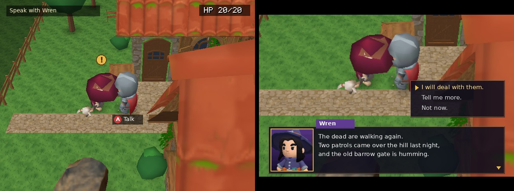
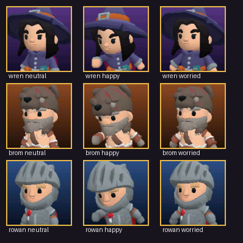
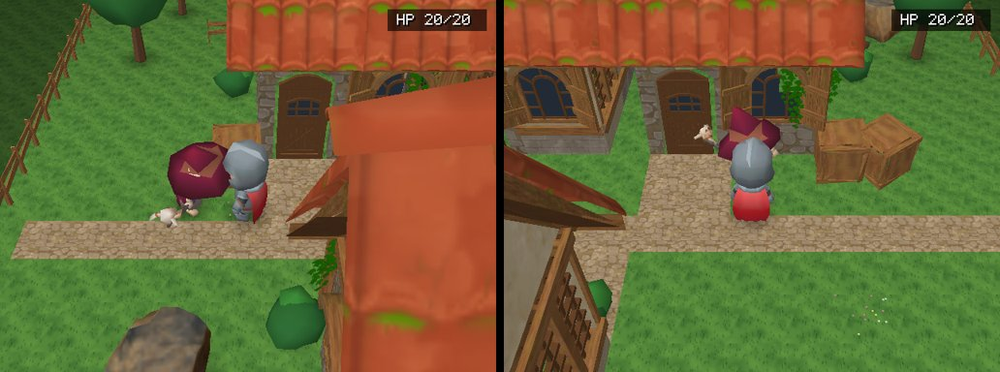

# Next vertical slice (3D-5): "Talk to Wren": dialog, portraits and the village quest

> **Status:** plan, decisions D1–D7 taken (§13), D8–D11 on the recommendations. Slice 3D-4 runs on
> Dreamcast hardware and Flycast (stage 0.1 done). Builds on slice 3D-4 (`docs/SLICE_3D_BATTLE.md`). GDD: `docs/GDD_Horizontal_Slice.pdf`
> (v1.0). Section numbers such as "GDD 7.1" refer to that document.

**Goal:** one complete, production-quality loop of the GDD's village half, end to end:

> Rowan walks up to **Wren**. A gold **!** hangs over her head and an **A Talk** prompt appears.
> Letterbox bars slide in and the camera eases to the two of them. Wren's **portrait** and the
> typewriter text tell him the dead are walking. He **chooses** "I will deal with them", learns
> **Fireball** (it was greyed out with a lock in the battle ring until now), and the **objective HUD**
> reads *Defeat the skeleton patrols (0/2)*. **Brom**, the smith, gives him three potions and, later,
> a rest. With both patrols beaten, Wren gives him her **token and blessing** (max HP 30). The
> **Bone Warden** then rises on the east road.

In GDD milestone terms this is **H2 (text and dialog) + H3 (scripts and portraits) + the village
part of H4 (quest)**, cut to the two villagers that need no second map. It turns slice 3D-4's
stand-ins into the real mechanics: "Wren's blessing" (the encounter's max-HP-30 setup) and the
potions (the encounter's "at least 3") now come from the quest.

This document has 13 parts:
* §1: scope and GDD traceability;
* §2: starting point;
* §3: prototypes and findings;
* §4: player flow;
* §5: design;
* §6: architecture;
* §7: data formats;
* §8: content;
* §9: budgets;
* §10: stages and tasks;
* §11: tests;
* §12: definition of done;
* §13: decisions and risks.


*Mock-up over a real host-rendered village frame (`docs/dialog/proto/mockup.py`).*

*Left: the field, with:*
* *the objective HUD;*
* *the gold `!` over the quest giver;*
* *the `A Talk` prompt.*

*Right: dialog, with:*
* *36 px letterbox bars;*
* *a camera push-in (standing in for the T3 dialog shot);*
* *the 592×118 box at (24,318), α 0.88;*
* *a 104×104 portrait in a 2 px gold frame;*
* *the name plate and three lines of text;*
* *the advance marker;*
* *a 3-option choice box.*

*Stand-ins: DejaVu Sans for the CC0 font (decision D1), and the Skeleton_Mage field model for Wren
(her model is converted in task F1).*

---

## 1. Scope and GDD traceability

### 1.1 In scope (every item is traced to the GDD)

| # | Deliverable | GDD | Milestone |
|---|---|---|---|
| S1 | **Talk interaction.** An NPC has `talk <script>` instead of an encounter, and touching an NPC no longer starts a battle. The `A Talk` prompt shows within 1.3 tiles and 60° of the hero's facing; the nearest NPC wins. On A: the NPC turns to the hero, the hero turns to the NPC, and the NPC plays `Interact` once | 7.2, 15.2 | H2 |
| S2 | **Dialog box.** 592×118 at (24,318), TR, α 0.88. Name plate in the speaker's colour. Portrait 104×104 with a gold frame that slides in over 8 ticks. 3 lines of at most 420 px. Advance marker. HUD hidden | 7.1 | H2 |
| S3 | **Typewriter.** 1 character per tick; A completes the page, then A advances; hold B for 4× speed; pauses of 6 ticks after `. ! ?` and 3 after `,` | 7.1, 7.5, 4 | H2 |
| S4 | **Choices.** Up to 3 options, first pre-selected, d-pad or stick to move, A picks, B picks the `cancel` option if there is one. A "no" branch always says how to come back | 7.3 | H2 |
| S5 | **T3 / T4.** Letterbox 36 px in 12 ticks, camera ease of 20 ticks; the box appears once the bars are in; on exit, input returns at once | 6 (T3, T4) | H2 |
| S6 | **Input rules.** The A that closes a dialog never starts a new talk on the same tick. A fresh press is required after any transition | 4 | H2 |
| S7 | **Proportional 16 px font.** About 95 glyphs from a CC0 TTF in a 256×128 ARGB4444 atlas (64 KiB), with per-glyph widths. The 5×7 font stays for numbers | 7.5, 16.2 A2 | H2 |
| S8 | **Script language and compiler.** Plain text in `romdisk/scripts/`, compiled at load into fixed arrays (no heap, no per-frame parsing). The in-scope command set is in §7.2 | 7.4, 15.1 | H3 |
| S9 | **Script lint** (run by the tests). Checks labels and references, that every flag read is set somewhere, unreachable pages, page fit with the real font metrics, speakers and portraits, 1–3 options per choice, and a branch walk that finds no dead end | 7.4, 17 | H3 |
| S10 | **Portraits.** Rendered from the 3D models by a pipeline tool: 3/4 view at 25°, head and shoulders, gradient background, 128×128 RGB565 (`/rd/portraits/*.dtx`). Variants: neutral, happy, worried. At most 2 in VRAM (the speaker and the hero). Characters: **Rowan, Wren, Brom** | 8 | H3 |
| S11 | **Wren** (the human Mage). Quest giver: stage-based dialog, request with a choice, Fireball at S1, token + blessing (max HP 30, full heal) at S3. Idles, walks a short loop, faces the hero within 3 tiles. `guard_duel` is retired from the map | 9.1, 19 G7 | H3/H4 |
| S12 | **Brom** (the Barbarian). First talk gives 3 potions. Later talks offer a rest (full heal + checkpoint) and refill the potions once, at stage ≥ 3 | 9.2 | H3/H4 |
| S13 | **Progress struct** (< 64 bytes, copied whole by checkpoints). Holds the stage, flags, potions, max HP and the objective | 10.1 | H4 |
| S14 | **Quest stages S0–S3** and the Warden's defeat, with order independence: the patrols can be beaten before talking to Wren | 10, 10.2 | H4 |
| S15 | **Objective HUD** (top left, hidden in dialog and battle), following Appendix B (S0–S3) | 10.2, App. B | H4 |
| S16 | **Markers.** Gold `!` means the quest needs you; grey `...` means optional talk. Bobbing 3D billboards. **Emotes** (`!`, `?`, `...`, sweat, anger) use the same billboard | 7.2, 8, 16.2 A4 | H4 |
| S17 | **Checkpoints in RAM.** C0 at new game, C1 on accepting (S1), C2 at the report (S3), and Brom's rest. A lost battle retries from the last checkpoint (the screen stays "GAME OVER / PRESS A TO RETRY"; see out of scope) | 10, 10.2, 15.4 | H4 |
| S18 | **Rule addition: learned Fireball.** Fire is greyed with a lock until `skill_fire` is set. Potions and max HP 30 now come from the quest. Legacy rules keep every skill unlocked | 11.1 | H4 |
| S19 | **Conditional entities** (`if <cond>` on map entities). Used to gate the Warden on `has_token` | 15.2 | H4 |
| S20 | **Tests:** dialog lint, dialog UI checks, order variations, checkpoint restore, legacy rules equivalence, budgets | 17 | H2–H4 |

### 1.2 Adaptations (where the village we have differs from the GDD's)

| # | GDD says | This slice does | Why |
|---|---|---|---|
| AD1 | Map 40×30; Wren at (6,17); Brom at (21,10) | Our village is 36×28. **Wren at (4,13)**, by the first house, north of the road's west end. **Brom at (28,12)**, in front of the stone house, by its crates | (21,10) is inside our plaster house's footprint. At (6,17) the pair is hidden behind the south house's roof from the diorama camera (§3, finding 4). Both new spots are walkable and framed cleanly by the field camera (checked with renders) |
| AD2 | Wren is "the existing Mage entity… `npc guard`" | The `guard` entity is a **Skeleton_Mage** in our build. Wren is the human `Mage.fbx`, newly converted. New looks: `mage` (Wren) and `smith` (Brom) | `guard` keeps meaning the skeleton mage (the Warden uses it) |
| AD3 | Corwin and the gate stand between S3 and the Barrow (S4) | **The Warden appears on the east road once `has_token` is set** (S3). Today he appears after both patrols | Corwin, the gate and the barrow map are out of scope (§1.3). The token keeps its meaning ("you may pass") and the boss stays reachable |
| AD4 | Wren's lines and the S3 objective mention Corwin | Rewritten for this slice (3 lines, §8), marked `# slice 3D-5` in the script | There is no Corwin yet |
| AD5 | Appendix A: at stage 0 with both patrols beaten, Wren jumps straight to `report` | The branch also does `give skill fireball` with its `sys:` line | **A GDD script bug found here:** as written, that route never teaches Fireball |
| AD6 | S6 ("Warden beaten") starts the ending | A win sets `warden_down`. The `after_battle` script sets stage 6 and shows a `sys:` line. Wren's closing line (the GDD's stage 7 line) plays from stage 6 | The ending is out of scope |
| AD7 | The Death screen (§13) with retry / title | The existing GAME OVER screen, but **retry restores the last checkpoint** instead of resetting everything | Without this, one loss would wipe the quest. The presentation (T9, §13) is out of scope |
| AD8 | Speaker ids "map to name, colour and portrait"; markers "! / ..." | Small data directives: `@speaker`, `@flags`, `@marker` (§7.2). The lint checks them | The GDD leaves open where these mappings live. Data, not code (decision D8) |

### 1.3 Out of scope (with the GDD reference and the milestone it belongs to)

| Not in this slice | GDD | Milestone |
|---|---|---|
| Boot splash, title flyover, menu, attract demo, cleared crest | 3, 5 | H1/H6 |
| Transitions T1, T2, T5 (iris), T6–T11; the transition catalogue as one function | 6 | H1 |
| Intro and ending cutscenes; `cam`, `move`, `battle`, `map`, `light`, `namecard`, `card`, `credits`, `results`, `title`, `transition` and parallel `cmd \| cmd` script commands (the compiler rejects them with "not in this slice") | 7.4, App. A | H1/H6 |
| Corwin, the road block trigger, the east exit, trigger rectangles, map exits, the barrow map, fog / night | 9.3, 15.2 | H4/H5 |
| Stages S4, S5, S7; checkpoint C3 (waystone) | 10 | H5/H6 |
| Death screen presentation (slow motion, tint, menu) | 13 | H6 |
| Completion sequence, credits, results | 14 | H6 |
| VMU save | 15.4 | stretch |
| Audio (text blips and so on) | 16.3 | separate track |
| Portraits of Corwin, the Warden and the skeleton; alternate face textures (R3) | 8, 16.3 | H3 (rest) |
| Pause menu | 4 | stretch |

---

## 2. Starting point (what the code does today, and the gap)

| Area | Today | Gap for this slice |
|---|---|---|
| Game modes (`game.cpp`) | `Field, ToBattle, Battle, ToField, GameOver, Error`. Fades are `T_FADE_OUT` 24 and `T_FADE_IN` 12. GameOver resets the party and the field | Add a `Dialog` mode; retry from a checkpoint; a post-battle script hook |
| Field logic (`field.cpp`) | Touching **any** entity starts its encounter (`field_take_contact`). The hero's logic facing is the 4-way `Hero.dir`, from the move delta (L336–338). Entities: `id, kind (Enemy/Npc), sheet, Walker, encounter, patrol, after[2]/dormant` | NPCs block instead of starting a battle; `talk`, `if`, `win`, new looks; a facing **vector** for the 60° test; talk target selection |
| Field view (`field3d.cpp`) | `slime` → skel_warrior, everything else → skel_mage. Clips are the ones embedded in each model (`clips_of`: idle/walk/run). Lighting is baked per yaw bucket. Houses and trees that hide the hero fade (`FADE_ALPHA` 55) | New models with library clips (idle / walk / interact); NPC turn-to; a dialog camera; markers; the fade test should include the speaker |
| Animation library (`anim.*`, `rig_medium.dma`) | 28 clips, including `idle_a`, `interact`, `use_item`, `hit_a`. **No forward walk** (only `walk_back`) | Add `walk` (Rig_Medium_MovementBasic `Walking_A`; checked present in the pack) |
| Text (`font.*`) | 5×7 bitmap, 47 glyphs, upper case only, 6 px advance, one sprite per glyph (the engine queues sprites per texture, so one header per texture) | A new `text` module: proportional font, measure and wrap, colours |
| UI atlas (`ui_icons.png`) | 16 of 16 icons used. `ICON_PAD_A` exists (for the prompt) | No room: emotes, markers, the lock and the choice cursor go in the font atlas's free half (§3, finding 1) |
| Engine (`engine.h`) | `texture_create` (KOS: `pvr_mem_malloc` + twiddled load; pointer kept). 19 of 32 texture slots. **No texture update or free** | `texture_update(Sprite, texels)` to reuse 2 portrait slots |
| Party (`party.h`) | `hero_hp, hero_hp_max, hero_stats, potions` | Max HP and potions come from Progress |
| Encounters | The `warden` encounter carries the stand-ins `hero_max_hp 30` and `potions 3` (`apply_encounter_setup`) | Move them to `--battle-test` only (the balance tests stay unchanged); the field boss uses the quest's values |
| Battle UI (`ui.cpp`, `battle3d_draw.cpp`) | 4-command ring. The Potion is greyed at 0 (A does nothing) | The same treatment for a locked Fire, plus a lock glyph |
| Host harness (`trace_main`, `battle_bot`) | `--walk-to`, `--bot`, `--bot-battles`, `--record-inputs`, `--view` (V/B/U lines), turn logs | A story driver (waypoints with `talk` / `chase` actions, choice policy); `Q` (progress) and `G` (dialog) trace lines; a bot fallback for greyed commands |
| Tests | `tests/battle3d/run.sh` 19/19. The older `tests/run_tests.sh` has 33 pass / 21 fail (pre-existing: field goldens from before the village map) | A new `tests/dialog/run.sh`. Triage the old suite (stage 0) |
| Hardware | 3D-4 built and run on a **physical Dreamcast** and on Flycast: works on both; it looks better on hardware than on Flycast | Hardware is the visual reference (P3); Flycast is for convenience only |

---

## 3. Prototypes and findings (done for this plan)

All scripts are in `docs/dialog/proto/`.

1. **The font fits in half the atlas** (`font_fit.py`, measured with DejaVu Sans as a stand-in).
   * At 14–15 px, all 95 ASCII glyphs (32–126) with a 1 px gutter pack into **256×64**: half of the
     GDD's 256×128 ARGB4444 atlas.
   * The **free 256×64 half** takes the markers and emotes (`!`, `?`, `...`, sweat, anger), the
     advance marker, the choice cursor, the **lock** for Fire and a 9-slice box frame. No new
     texture slot, and the full UI atlas is untouched.
   * Every in-scope GDD page wraps to **≤ 2 lines** of 420 px (≈ 49–53 characters per line; the
     GDD's estimate is ~42). The widest choice is 156 px. The shipped font is "Home Video" (D1);
     these numbers are re-measured on it in task B1.
   * Line pitch is 22 px (ascent + descent is 17–18 px).
2. **Portraits from the models work, but render them from high-detail conversions**
   (`portraits.py` → [`dialog/portraits_proto.png`](dialog/portraits_proto.png)).
   * The field DMFs (≈ 800–1,500 triangles, 64² textures) look crude at 128². The same converter
     at `--tris 9000 --tex-size 512` (no real decimation) gives clean faces.
   * These conversions exist only at build time: **no runtime cost**, still "on-model", and they
     update automatically with the source (decision D10).
   * Variants from library poses: neutral = `idle_a`@0.5 s, happy = `interact`@0.55 s,
     worried = `hit_a`@0.3 s (head tilted away). `hit_b` was tried and rejected (the head is thrown
     back). Faces are painted on the texture, so the variants are subtle; GDD R3 (alternate face
     textures) is the real upgrade.

   
3. **NPC model budget.** The field's runtime characters are Knight 1,490 triangles and skeletons
   ≈ 790, each with a 64² texture. `convert_model.py` gives **Mage 1,492 triangles / 61 KB** and
   **Barbarian 1,498 / 69 KB** at `--tris 1500` (both convert without errors, hats following the head).
   The target is **≤ 1,200 triangles each**. The two NPCs are 24 tiles apart, so they are never on
   screen together.
4. **Where NPCs can stand.** The diorama camera looks north from 10.5 units at 45°.
   * At GDD-like spots south of the road, the south houses' roofs come between the camera and the
     pair. (4,13) and (28,12), north of the road, frame cleanly (mock-up above).
   * A lower, closer dialog camera (pitch 40°, distance 8.5) **put the eye inside a house roof** at
     the (6,17) spot: the whole frame filled with roof.
   * So the dialog shot must be checked against prop bounds (test T-CAM) and fall back to the field
     camera when it fails.

   
   *The proposed spots from the field camera, with the skeleton-mage field model standing in for
   the NPC: Wren's (4,13), by the first house, with the hero beside her; Brom's (28,12), at the
   stone house's door by the crates, with the hero approaching from the road. The second frame
   shows why the two-shot turns the camera (§5.3): the hero's back hides the speaker.*
5. **Balance findings that the quest changes** (host bots, sprite view, rules as in 3D-4):
   * **The 3-skeleton squad (`test_slimes`) cannot be won without Fire.** Every Attack / Guard
     policy loses (`cycle:A`, `GA`, `AAG`). With 3 potions, `cycle:AAAP` wins with 8/20 HP left.
     `slimes_2` is winnable without Fire (`cycle:A`: 6 HP left). Order independence therefore
     depends on Brom's potions (decision D7).
   * **The boss needs potions.** With max HP 30 and **0 potions**, the "good" bot wins **0/30**; with
     3 potions it wins 29/30 (96 %; GDD target ≥ 95 %). Potions must be reachable before the boss:
     Brom's first talk, plus his refill once at stage ≥ 3. Wren's stage-3 line points to him (§8).
   * **The battle bot stalls** when its policy picks a greyed command (Potion at 0: the run ends
     with `outcome=none`). With a locked Fire this becomes common, so a fallback is task 0.3.
6. **Clips.** `Walking_A` is in `Rig_Medium_MovementBasic.fbx` (checked with bpy), so field NPCs
   can move to the shared library.

---

## 4. Player flow

```
S0  (objective "Speak with Wren"; ! over Wren; ... over Brom)
 ├─ Wren: "Oh! A knight..."  choice: [I will deal with them.] [Tell me more.] [cancel: Not now.]
 │    ├─ Tell me more → lore pages → back to the choice
 │    ├─ Not now → "Come back before they reach the houses. Please." (stays S0)
 │    └─ I will → S1: skill_fire, "Rowan learned FIREBALL.", checkpoint C1
 │         objective "Defeat the skeleton patrols (n/2)"; Fire unlocks in the battle ring
 ├─ Brom (any stage, first talk): 3 potions, talked_brom. Later: Rest (fade, full heal, checkpoint;
 │    from S3 a one-time refill to 3)
 ├─ patrol A (slime_a, 2 skeletons) / patrol B (slime_b, 3 skeletons), any order, before or after Wren
 │    win → flag patrol_a / patrol_b; after_battle: at S1 with both down → S2 "Report to Wren", ! over Wren
 │    at S0 with both down → Wren's first talk jumps to the report (AD5: teaches Fire too)
 └─ Wren at S2 → S3: token (has_token), max HP 30 + full heal, checkpoint C2,
        objective "Face what waits on the east road"; the Warden appears at (33,14)
             └─ Warden win → warden_down → stage 6, sys line; Wren: "Hollowmere sleeps easy tonight."
 Lose any battle → GAME OVER → A → last checkpoint (progress, defeated foes, hero tile; full HP)
```

**Order variations the tests must cover** (GDD 17):
1. Canonical: Wren → A → B → Wren → Brom → Warden.
2. Patrols before Wren: Brom → A → Brom's rest → B → Wren → Warden.
3. Skip Brom: reach S3. The Warden appears; the fight is not asserted (0 potions, finding 5).
4. Talk to everyone twice at every stage, then the Warden.
5. "Not now" and "Tell me more" loops, then accept.
6. Lose the squad at S1, then retry from C1.

---

## 5. Design

### 5.1 Talk rules (logic; deterministic, integer math, in `field.cpp`)

| Rule | Specification |
|---|---|
| Facing | New `Hero.fx_dir, fy_dir` (ints): the last non-zero requested velocity `(vx, vy)`, initialised from the spawn direction. The 4-way `dir` stays for traces |
| Range | From the hero's feet-box centre to the NPC tile centre, in 1/16 px. `d² ≤ (1.3 × 512)²`, i.e. `d² ≤ 443 023`. 1 tile = 32 px × 16 = 512 sub-pixels |
| Angle | `dot(f, d) > 0` **and** `4·dot² ≥ |f|²·|d|²` (cos 60° = ½), in `int64` |
| Choice | Nearest wins; on a tie, the lower entity index. Dormant or hidden NPCs are skipped. Computed every field tick; `field_talk_target()` returns it or −1 |
| Blocking | NPC boxes (`ENT_BOX`) block the hero like a wall (he slides). No contact, no encounter |
| Start | A **press edge** while a target exists. In the same tick: mode → Dialog, the field logic freezes, and the NPC's `Walker.dir` is set toward the hero (4-way) |
| Wren's loop | `patrol 1 0 2`. The patrol **pauses** while the hero is within 3 tiles (Chebyshev, logic), and the NPC faces him (GDD 9.1). The pause also keeps her from walking out of range mid-approach |

### 5.2 Dialog UI (`dialog_ui.cpp`)

**Layout at 640×480** (matches GDD 7.1; checked in the mock-up):
* letterbox bars: 0–36 and 444–480;
* box: (24,318) 592×118;
* portrait: (31,325) 104×104 inside a 2 px gold (`E8B848`) frame;
* text: x = 150, lines at y = 334, 356 and 378, width ≤ 420;
* name plate: (144,300), 96×22, in the speaker's colour;
* advance marker: (601,421), bobbing 3 px over a 30-tick period;
* choice box: right-aligned at x = 616, its bottom edge 24 px above the box, width 236, rows 26 px;
* `sys:` pages: no portrait and no plate; text centred in the box, gold `FFCD75`.

**Depth layers** (larger z = nearer; the engine contract in `engine.h`):

| Item | List | z |
|---|---|---|
| 3D scene, markers, emotes (billboards) | OP / TR | 1/w < 1 |
| Field HUD: objective, HP (hidden in dialog) | TR | 2.0–2.2 |
| Talk prompt | TR | 2.3 |
| Dialog box | TR rect | 3.0 |
| Portrait frame, then portrait | OP rect / OP sprite | 3.1 / 3.2 (hide the box behind them) |
| Name plate, text shadow, text | TR | 3.3 / 3.4 / 3.5 |
| Choice box and its text | TR | 3.6–3.8 |
| Letterbox | OP rect | 8.0 |
| Fade (`fade out/in`, the existing game fade) | TR rect | 9.0 |

**Behaviour** (ticks at 60 Hz):

| Rule | Specification |
|---|---|
| Typewriter | +1 glyph per tick, spaces included. Hold B: +4 per tick. A pause of 6 ticks after `.`, `!` or `?` and 3 after `,` (with B held: ÷4, rounded up). A run such as `...` pauses once, after its last character. No pause at the end of a page |
| A | While typing: reveal the whole page. When complete: next command. The press is **consumed** (cleared for the rest of the tick) |
| Advance marker | Shown when the page is complete and the next command is not a choice |
| Choices | Shown once the preceding page is complete (or immediately, if the choice is the first command). The first option is pre-selected. Up / down on the d-pad press edge or the stick crossing ±64; no wrap. A picks. B picks the `cancel` option if there is one, else nothing; **B must be a fresh press after the choice appeared** (B held for speed must not cancel) |
| Portraits | Slot 0 holds the NPC (or whoever speaks, other than Rowan); slot 1 holds Rowan. The variant file loads when its page starts. On a speaker change the portrait slides in from the left over 8 ticks |
| Inline colour | `{gold}…{/}`, `{red}…{/}`, `{grey}…{/}`: zero width, skipped by the typewriter |

### 5.3 T3 / T4 and the dialog camera (`field3d.cpp`)

* **T3** (tick 0 = the A press):
  * bars slide in over ticks 0–11 (ease-out);
  * the camera eases over 0–19 (smoothstep) from the follow camera to the **two-shot**;
  * the box and the first page appear at tick 12;
  * at tick 0 the NPC plays `interact` once (then idle), and both characters turn at `TURN_RATE`.
* **Two-shot:**
  * look-at: the midpoint of hero and NPC, at 1.0 unit height;
  * yaw: the field's (camera to the south, looking north), turned 25° so that the hero is not
    between the camera and the speaker. The camera orbits to the side *opposite* the hero's x offset
    from the NPC (+ when they are level): with the hero south-east of the NPC, the camera swings
    west and the hero moves to the right of the frame;
  * pitch 38°, distance 8.0, fov 40° (starting values, tunable as `dlg_pitch`, `dlg_dist`,
    `dlg_fov`);
  * a vertical offset puts the pair's heads at y ≈ 150–200, above the box.
* **Validity:** if the eye is inside any prop's box (+0.3 margin), use the field camera instead.
  The see-through fade also tests the **speaker's** screen box during dialog.
* **T4:**
  * box off at tick 0; bars out over 12 ticks; the camera eases back over 20;
  * **the mode is Field from tick 0**: the hero can move while the camera eases;
  * the closing A is consumed, and the next talk needs a new press.
* **Scripts with no NPC** (`after_battle`): a script with no page or choice runs instantly inside
  the tick and never enters Dialog mode. One with pages uses the letterbox but keeps the field
  camera.

### 5.4 Markers and emotes

* They are 4-vertex TR strips textured from the font atlas's icon half, at head height + 0.45 units,
  bobbing ±0.06 over 48 ticks. Their depth is the model's, so houses hide them.
* **Marker rules** are data (`@marker`, §7.2), evaluated when Progress changes:
  * Wren shows `!` when `stage == 0 || stage == 2`;
  * Brom shows `...` when `!talked_brom || stage >= 3 && !brom_refill`.
* While the talk prompt targets an NPC, its marker is replaced by the prompt (`ICON_PAD_A` + "Talk"
  in the new font, anchored to the NPC's head), so the player sees *who* will answer.
* **Emotes** (`emote actor !|?|...|sweat|anger`) show for 60 ticks on the same billboard.

### 5.5 Objective HUD

Top left, on a plate at (16,14), new font, TR. Hidden in Dialog mode, in transitions and in battle.

* The text is set by the `objective "..."` command and stored as a string id in Progress, so
  checkpoints restore it.
* `{patrols}` is replaced at draw time by `patrol_a + patrol_b`, giving "Defeat the skeleton
  patrols (1/2)".
* The HP panel (top right, 5×7 font) is unchanged.

### 5.6 Progress, checkpoints, retry (`progress.cpp`)

```cpp
struct Progress {                 // GDD 10.1; static_assert(sizeof(Progress) <= 64)
    uint8_t  stage;               // 0..7 (this slice uses 0, 1, 2, 3, 6); only moves forward
    uint8_t  potions;             // 0..3
    uint8_t  max_hp;              // 20, 30
    uint8_t  objective;           // string id in the compiled script pool (0 = none)
    uint32_t flags;               // bit i = flag i of @flags (max 32)
    uint16_t defeated;            // bit i = village entity i beaten (field_defeat)
    uint8_t  cp_x, cp_y, cp_dir;  // hero tile and facing when the checkpoint was taken
    uint8_t  cp_id;               // 0 = C0, 1 = C1, 2 = C2, 9 = Brom's rest (traces)
};
```
* **New game = C0:** spawn (17,22) facing up, stage 0, potions 0, max HP 20, objective "Speak with
  Wren".
* `checkpoint` copies Progress and records the hero's current tile (already walkable, next to the
  speaker).
* **Retry** (GameOver + A) restores the copy:
  * Progress, as saved;
  * entities: alive unless the bit is set in `defeated`; dormant and `if` states recomputed;
  * the hero on `cp_x, cp_y` facing `cp_dir`;
  * **full HP** (GDD 10).
* `PartyState` keeps `hero_hp` and stats. `hero_hp_max` and `potions` are **read from Progress**
  (one source of truth), and battle results write the potions back to Progress.

### 5.7 Battle rule additions (GDD 11.1)

* `Rules.learned_skills` (new; `true` in the game, `false` under `--rules legacy`). When true and
  `skill_fire` is not set:
  * Fire is greyed in the ring with the lock glyph;
  * A on it does nothing (as the empty Potion);
  * the Y shortcut is unaffected.
  * Both views: the 3D ring (`battle3d_draw.cpp`) and the sprite view's ring.
* `BattleCtx` gains `skills` (a bitmask copied from Progress at `battle_begin`).
* **Stand-ins removed** from the `warden` encounter. `--battle-test warden` applies a "boss-ready"
  party instead (max HP 30, 3 potions, Fire learned), so the balance tests and the 60 legacy
  baselines do not change.

### 5.8 Characters

| | Wren | Brom |
|---|---|---|
| Source | `KayKit/Characters/Mage.fbx` + `mage_texture.png` | `Barbarian.fbx` + `barbarian_texture.png` |
| Runtime model | `romdisk/models/wren.dmf`, ≤ 1,200 triangles, 64² RGB565, hat rigid to the head | `brom.dmf`, ≤ 1,200 triangles, 64², bear hat rigid to the head |
| Map | `entity wren npc mage 4 13 down talk wren_main patrol 1 0 2` | `entity brom npc smith 28 12 down talk brom_main` |
| Clips (library) | `idle_a`, `walk` (new), `interact` (greeting), `use_item` (giving) | `idle_a`, `interact`, `use_item` |
| Portraits | neutral, happy, worried | neutral, happy, worried |
| Name plate colour | `6038A0` (purple) | `A0502A` (rust) |

Rowan: portraits neutral, happy and worried, plate colour `3A6EA8`.

---

## 6. Architecture

| Module | Responsibility | Notes |
|---|---|---|
| `src/progress.{h,cpp}` | Progress struct; the flag table (from `@flags`); `progress_new_game()`, `checkpoint_save()`, `checkpoint_restore()`; condition evaluation; objective text with `{patrols}` | No dependency on rendering |
| `src/script.{h,cpp}` | **Compiler** (at load): `romdisk/scripts/*.txt` + `speakers.txt` → fixed arrays. **VM:** one running script, a 4-deep call stack, runs commands until a blocking one | Pools: 32 scripts, 1,024 ops (8 bytes each), 12 KiB of strings, 128 labels, 1 KiB of condition bytecode |
| `src/text.{h,cpp}` | Loads `/rd/fonts/dialog.fnt` + the atlas; `text_width`, `text_wrap` (used by the compiler), `text_draw` (colour codes, clipping at N glyphs for the typewriter) | One sprite per glyph through the existing queue. Metrics identical to the Python tool (parity test) |
| `src/dialog_ui.{h,cpp}` | Box, plate, portrait slots (load and slide), typewriter, choices, advance marker, letterbox, in-dialog fades | Reads the VM's current page and choice; emits "done" and "picked k" |
| `src/portrait.{h,cpp}` | Two slots (`eng::texture_update`); reads `.dtx` into one static 32 KiB buffer | Loads at script start (in T3) and when a variant or speaker changes |
| `src/field.cpp` (changes) | Parser (`talk`, `if`, `win`, looks `mage` / `smith`); NPC blocking; facing vector; talk target; patrol pause; `win` flag on `field_defeat`; conditional entities | — |
| `src/field3d.cpp` (changes) | NPC models via the anim library (binding, an Animator per entity, bake per yaw bucket as for enemies); turn-to; two-shot camera and T3/T4 ease; markers / emotes / prompt; objective HUD; see-through test for the speaker | `field3d_dialog_begin(npc)`, `field3d_dialog_end()` |
| `src/game.cpp` (changes) | `GameMode::Dialog`; A → dialog; `after_battle` after ToField; retry from the checkpoint; Progress ↔ Party; the battle-test boss setup | — |
| `src/ui.cpp`, `battle3d_draw.cpp`, `skills` (changes) | Fire lock (logic + drawing); `BattleCtx.skills` | Legacy switch |
| `src/engine.h` + `platform/kos/main.cpp` + `platform/host/host_engine.cpp` | `void texture_update(Sprite s, const uint16_t* texels)`. KOS: `pvr_txr_load_kimg` into the same VRAM block, same size and format. Host: replace the texels and re-dump | Boot checks for `/rd/fonts/*`, `/rd/portraits/*`, `/rd/scripts/*` |
| `tools/dialog/make_font.py` | TTF → `romdisk/fonts/dialog.png` (256×128 ARGB4444: glyphs in the top half, icons in the bottom) + `dialog.fnt` (metrics) + `dialog_font.json` (for the lint) + a preview sheet | Icons drawn procedurally, in `make_assets` style (A4 stand-in) |
| `tools/dialog/make_portraits.py` | From `proto/portraits.py`: high-detail conversion (bpy) → pose → render → RGB565 `.dtx` + QC sheet | Deterministic; rebuilt by `build_assets.sh` |
| `tools/dialog/lint.py` | The §7.2 grammar, every check in GDD 7.4 + AD8 directives; `--dump` (the compiled form, for parity) | Run by `tests/dialog/run.sh` |
| `platform/host/trace_main.cpp` (changes) | `--story` (Q / G trace lines); `--walk-to` actions `talk`, `chase:<id>`, `choice:<k>`; `--choices first\|last\|cancel\|k,k,..`; `--dump-scripts`; `--probe-talk` (prompt geometry sweep) | Battle bot fallback for greyed commands; a `smart` policy (potion < 10 HP, Fire vs ≥ 2 enemies if learned, else Attack) |

**Tick order in Dialog mode:**
1. `input_update`;
2. `script_tick` (runs until a blocking command: a page, a choice, `wait`, `fade`);
3. `dialog_ui_tick` (typewriter, choice input);
4. `field3d_tick` (cosmetic only: turning, idles, the camera ease).

`field_update` is **not** called: the world is frozen and patrols hold position.

---

## 7. Data formats

### 7.1 Map additions (`romdisk/maps/village.txt`)

```
entity <id> npc   <look> <x> <y> <facing> talk <script> [patrol dx dy len] [if <cond...>]
entity <id> enemy <look> <x> <y> <facing> <encounter> [patrol dx dy len] [after a [b]] [win <flag>] [if <cond...>]
   looks: slime (skel_warrior), guard (skel_mage), mage (Wren), smith (Brom)
   if: the rest of the line is a condition (§7.2 syntax); false = hidden and untouchable
   win: the flag set when this entity's battle is won
```
The village becomes:
```
entity slime_a enemy slime 12 14 down slimes_2 win patrol_a
entity slime_b enemy slime 21 14 left test_slimes patrol 1 0 4 win patrol_b
entity wren    npc   mage   4 13 down talk wren_main patrol 1 0 2
entity brom    npc   smith 28 12 down talk brom_main
entity warden  enemy guard 33 14 left warden win warden_down if has_token
# guard (24,6) guard_duel: retired (GDD G7); the encounter stays for the battle tests
```

### 7.2 Script language (the subset this slice implements)

File `romdisk/scripts/village.txt`, one per map. `#` starts a comment. Indentation is free.

| Form | Meaning | Status |
|---|---|---|
| `@flags a b c ...` | Declares flags; bit order = declaration order (≤ 32). Code looks up `skill_fire`, `has_token`, `patrol_a`, `patrol_b` and `warden_down` by name at boot, and boot fails if one is missing | AD8 |
| `@speaker id "Name" RRGGBB portrait_base` (in `speakers.txt`) | Name, plate colour, portrait files `<base>_<variant>.dtx` | AD8 |
| `@marker npc_id !\|... <cond>` | Marker rule | AD8 |
| `@script name` … | A script runs until `end`. Falling off the end is a lint error | GDD |
| `speaker[(variant)]: text` | One page. `\|` forces a break. Wrapped at compile time to ≤ 3 lines × 420 px; overflow is an error (no automatic split) | GDD |
| `sys: text` | System page | GDD |
| `choice "A" -> l \| "B" -> l [\| cancel "C" -> l]` | 1–3 options. A line starting with `\|` continues the previous line | GDD |
| `@if c` / `@elif c` / `@else` / `@end` | Compiled to jumps. **Labels are global**: `goto` may enter a branch body (as `goto report` does). The end of a branch body jumps to its `@end` | GDD |
| `:label`, `goto label`, `end`, `call script` | Flow. `call` returns after the callee's `end` | GDD |
| `set stage N` · `set max_hp N` | Stage only moves forward (a backwards set is a lint error and a runtime no-op). `max_hp` sets the maximum, without healing | GDD |
| `flag f` · `unflag f` | — | GDD |
| `give potions N` · `take potions N` · `give skill fireball` · `give token` | Potions are capped at 3. `fireball` → `skill_fire`; `token` → `has_token` | GDD |
| `heal` · `checkpoint` · `objective "text"` | `{patrols}` is allowed in the objective | GDD |
| `face actor dir\|actor` · `anim actor clip` · `wait n` · `emote actor kind` | Actors: `rowan` or an entity id. `anim` does not block | GDD |
| `fade out n` · `fade in n` · `letterbox on\|off` | `fade` blocks for n ticks and hides the box | GDD |
| `cam`, `move`, `battle`, `map`, `light`, `namecard`, `card`, `credits`, `results`, `title`, `transition`, `cmd \| cmd` | Error "not in this slice" (compiler and lint) | out of scope |

**Conditions:** integers and flags (0 or 1), with `stage`, `potions`, `max_hp` and flag names as
operands. Operators `+ - == != < <= > >= ! && ||` and parentheses, with C precedence. They compile
to a small RPN byte code (≤ 32 bytes each).

**Compiled form:** `Op { uint8 code, a; uint16 b, c, str; }`. Pages are stored pre-wrapped (`\n`
at the break points) with their glyph count. The compiler and the lint produce the same dump
(parity test).

### 7.3 Font and portraits

* **`dialog.fnt`:** header `FNT1`, line height, baseline, 96 entries of `{u, v, w, h, advance,
  x_off}` as `uint8`, and an icon table of 16 × `{u, v, w, h}`.
* **`.dtx`:** 32-byte header (`DTX1`, `w`, `h`, `fmt` = 1 RGB565, `flags`) + linear texels. The KOS
  backend twiddles them on upload, like the PNGs; pre-twiddling is an optimisation for later.
* **Files:** `romdisk/portraits/{rowan,wren,brom}_{neutral,happy,worried}.dtx`, 9 × 32 KiB.

---

## 8. Content

`romdisk/scripts/village.txt`. The GDD Appendix A lines are kept verbatim except the lines marked
`# slice 3D-5` (AD4, AD5, AD6).

```
@flags patrol_a patrol_b skill_fire has_token talked_brom brom_refill warden_down
@marker wren ! stage == 0 || stage == 2
@marker brom ... !talked_brom || stage >= 3 && !brom_refill

@script wren_main
@if stage == 0 && patrol_a + patrol_b == 2
  wren(worried): You fought them already? Both patrols? Then you know.
  give skill fireball                                     # slice 3D-5 (AD5)
  sys: Rowan learned FIREBALL.                            # slice 3D-5 (AD5)
  goto report
@elif stage == 0
  wren: Oh! A knight. A real one. Thank the stars.
  wren(worried): The dead are walking again.|Two patrols came over the hill last night,
  wren(worried): and the old barrow gate is humming.
:ask
  choice "I will deal with them." -> accept | "Tell me more." -> lore
         | cancel "Not now." -> later
@elif stage == 1
  wren: Skeletons left: the counter says it all. Fire burns them, and burning keeps going.
  end
@elif stage == 2
:report
  wren(happy): Both patrols? You're quicker than my kettle.
  wren: Take this token - the old ward on the east road will let you pass. And hold still...   # slice 3D-5 (AD4)
  give token
  set max_hp 30
  heal
  sys: Wren's blessing! Max HP +10, fully healed.
  set stage 3
  objective "Face what waits on the east road"            # slice 3D-5 (AD4)
  checkpoint
  end
@elif stage >= 3 && stage < 6                              # slice 3D-5 (AD6: 7 -> 6)
  wren: Something old walks the east road now. See Brom for potions before you go.   # slice 3D-5 (AD4)
  end
@else
  wren(happy): Hollowmere sleeps easy tonight. Thanks to you.
  end
@end
:lore
  wren(worried): Long ago a guardian was bound under the barrow.|The Bone Warden. He keeps the dead asleep.
  wren(worried): Something cracked his seal.
  goto ask
:accept
  set stage 1
  give skill fireball
  wren(happy): Then take this. Burn the bones, not the barns.
  sys: Rowan learned FIREBALL.
  objective "Defeat the skeleton patrols ({patrols}/2)"
  checkpoint
  end
:later
  wren: Come back before they reach the houses. Please.
  end

@script brom_main                                         # GDD Appendix A, unchanged
@if !talked_brom
  brom: Ho! A knight, and a rusty one. Here - three potions. Mind the cork, it bites.
  rowan: ...Thank you.
  brom: Don't thank me. Come back alive and buy a new helmet.
  give potions 3
  flag talked_brom
  end
@else
  brom: Need a rest? My fire's warm and my stew is only slightly alarming.
  choice "Rest (full heal)" -> rest | cancel "Later." -> bye
:rest
  fade out 20
  heal
  @if stage >= 3 && !brom_refill
     give potions 3
     flag brom_refill
     sys: Potions refilled.
  @end
  checkpoint
  fade in 20
  brom: Good as new. Well. Good as used.
:bye
  end
@end

@script after_battle                                      # slice 3D-5: run after every won battle
@if stage == 1 && patrol_a + patrol_b == 2
  set stage 2
  objective "Report to Wren"
  sys: Both patrols are down. Report to Wren.
@elif warden_down && stage < 6
  set stage 6
  objective ""
  sys: The Bone Warden is at rest. The barrow is quiet.
@end
  end
```

**Objective by stage** (Appendix B, adapted):

| Stage | Objective | Marker | Checkpoint on entry |
|---|---|---|---|
| S0 | Speak with Wren | Wren `!`, Brom `...` | C0 |
| S1 | Defeat the skeleton patrols (n/2) | — | C1 |
| S2 | Report to Wren | Wren `!` | — |
| S3 | Face what waits on the east road | Brom `...` until refilled | C2 |
| S6 | — | — | — |

---

## 9. Budgets (GDD 15.3; the numbers are from slice 3D-4)

| Resource | Now (3D-4) | This slice adds | Limit / target |
|---|---|---|---|
| Field frame, SH4 instructions (qemu) | median 0.95 M, worst 1.33 M | Wren / Brom replace or add one character on screen; 2D dialog overlay | **worst ≤ 1.40 M**; dialog frames ≤ the field's worst; overlay ≤ 80 k |
| Field vertices submitted, worst | 13,957 | one NPC ≤ 1,200 triangles | ≤ 15,000 |
| Portrait upload (variant change) | — | 32 KiB twiddle + copy | frame ≤ 1.40 M instructions |
| VRAM textures | 512 KiB | font 64 + portraits 2 × 32 + NPC textures 2 × 8 | ≤ 660 KiB |
| Texture slots | 19 / 32 | font 1, portraits 2, NPCs 2 | ≤ 24 / 32 |
| Materials | 124 / 256 | about 6 | ≤ 140 |
| Model arena | 756 / 1,024 KiB | Wren + Brom ≈ 100 KiB | ≤ 900 KiB |
| Animation library | 252 KiB (384 KiB arena) | `walk` ≈ 8 KiB | ≤ 384 KiB |
| Scripts (RAM) | — | compiled pools | ≤ 24 KiB, static |
| Romdisk | 1.45 MB | portraits 288 KiB, models ≈ 130 KiB, font + scripts ≈ 40 KiB | ≤ 2.0 MB |
| Heap per frame | 0 | 0 | 0 (host allocation counter) |

---

## 10. Stages and tasks

Sizes: **S** ≤ 1 day, **M** 2–3 days, **L** about a week.

### Stage 0: carry-overs and safety nets
| # | Task | Size |
|---|---|---|
| 0.1 | ~~DreamSDK build + Flycast run of 3D-4~~ **done**: runs on hardware and Flycast. Still useful from you: a `DIAG=1` frame-time log at the village's worst view and in the boss fight, to replace the qemu model numbers in §9 with measurements | – (you, optional) |
| 0.2 | Old suite triage: re-record the field goldens that predate the village map, or retire them with a written reason, so `tests/run_tests.sh` is **green** | S |
| 0.3 | Battle bot: greyed command → fallback (Potion at 0 → Attack; locked Fire → Attack); `smart` policy | S |
| 0.4 | Story driver in the host harness: waypoint actions (`talk`, `chase:<id>`, `choice:<k>`), `--choices`, `--story` Q / G trace lines, `--record-inputs` for qemu replays | M |

### Stage A: logic
| # | Task | Size |
|---|---|---|
| A1 | `progress` module: flags from `@flags`, conditions, checkpoints, objective | S |
| A2 | Map grammar (`talk`, `if`, `win`, looks); NPC blocking; `win` → flag | S |
| A3 | Talk target (facing vector, range, angle, nearest); patrol pause and face-to | S |
| A4 | `GameMode::Dialog`, `after_battle` hook, retry from the checkpoint, Progress ↔ Party, battle-test boss setup | M |

### Stage B: text
| # | Task | Size |
|---|---|---|
| B1 | `make_font.py` (TTF → atlas + `.fnt` + JSON + icons + preview) | S |
| B2 | `text` module: metrics, wrap, draw, colour codes; C++ == Python wrap parity | S |

### Stage C: scripts
| # | Task | Size |
|---|---|---|
| C1 | Compiler: lexer, directives, pages (wrap), choices, `@if` chains, labels, conditions → RPN, pools | M |
| C2 | VM: blocking semantics, call stack, every in-scope command | M |
| C3 | `lint.py`: every GDD 7.4 check, the branch walk, `--dump`; negative fixtures | M |

### Stage D: dialog presentation
| # | Task | Size |
|---|---|---|
| D1 | `dialog_ui`: box, plate, typewriter + pauses + B speed, advance marker, choices, `sys` pages, fades | M |
| D2 | T3 / T4: letterbox, two-shot camera + ease + prop-bounds fallback, speaker see-through, input consumption and edges, HUD hiding | M |

### Stage E: portraits
| # | Task | Size |
|---|---|---|
| E1 | `make_portraits.py` (from the prototype): high-detail conversions, 3 variants × 3 characters, `.dtx`, QC sheet | S |
| E2 | `eng::texture_update` (host + KOS), portrait slots, load at T3 and on page start | S |

### Stage F: characters
| # | Task | Size |
|---|---|---|
| F1 | Convert Wren and Brom (≤ 1,200 triangles, 64²), `qc_model` sheets, face review at field distance | S |
| F2 | Field NPCs on the shared library: add `walk` to `build_anims` `CLIPS`; an Animator per NPC; `interact` greeting; bake per yaw bucket | M |
| F3 | Markers, emotes, the talk prompt (billboards, `@marker` evaluation) | S |

### Stage G: quest wiring
| # | Task | Size |
|---|---|---|
| G1 | Fire lock: `Rules.learned_skills`, `BattleCtx.skills`, ring grey + lock (3D and sprite), bot | S |
| G2 | Content: `village.txt` scripts, `speakers.txt`, the map changes, the objective HUD, encounter stand-ins removed | S |

### Stage H: verification and docs
| # | Task | Size |
|---|---|---|
| H1 | `tests/dialog/run.sh` (§11) | M |
| H2 | SH4 budgets: qemu replay of the story route (field, dialog and portrait-swap frames); vertex, VRAM and RAM report | S |
| H3 | Render QC images (prompt, T3 mid-ease, page typing, choice, `sys`, Brom's fade, T4, Fire lock); `docs/SLICE_DIALOG.md`; HOWTO (add an NPC, a script, a quest stage, a portrait); TRIAGE; licences (font) | S |
| H4 | Flycast / TV legibility and hardware checklist | – (you) |

**Order:** 0.2–0.4 → A1–A3 → B1–B2 → C1 → C3 (lint early: the content is written against it) →
C2 → A4 → D1 → E1–E2 → D2 → F1–F3 → G1–G2 → H. The thin vertical slice inside the slice comes
first: Wren's `stage == 0` branch with one page and the choice, in flat colours, with no portrait,
before any polish.

**Rough total:** 4–5 weeks for one developer. The GDD's own sizing of H2 + H3 + H4 is about
3 weeks. This subset drops Corwin, triggers and exits, but adds the stage-0 carry-overs and the
story-test infrastructure that the GDD assumes already exists.

---

## 11. Tests (`tests/dialog/run.sh`, in the style of `tests/battle3d/run.sh`)

| Check | How |
|---|---|
| Build | `src/` builds with 0 warnings (`-Wall -Wextra -Wshadow`); ASan / UBSan run over the story routes |
| Lint | `lint.py romdisk/scripts` is clean. **Negative fixtures** (`tests/dialog/lint_bad/*.txt`: missing label, unset flag, unreachable page, overflowing page, unknown speaker or variant, 4-option choice, out-of-scope command, backwards stage, loop with no exit) each fail with the expected message |
| Parity | C++ `--dump-scripts` == `lint.py --dump` (ops, wrapped pages). C++ `text_width` == Python for every page and choice |
| Prompt geometry | `--probe-talk`: the hero on a 1/8-tile grid × 16 facings around each NPC; the prompt target equals a Python model of §5.1 (range 1.3, 60°, nearest, ties) |
| Dialog UI | `check_dialog.py` on the `G` lines of scripted inputs: 1 glyph per tick; 4× with B held; 6 / 3 tick pauses; A completes, then advances; A consumed (no talk restarts on the closing tick); A needs a new press after T4; the choice pre-selects the first option; up / down clamp; B = cancel only with a cancel option and only on a fresh press; T3 bars 12 t, box at tick 12, camera 20 t; T4; HUD hidden in Dialog; the prompt hidden in Dialog |
| T-CAM | For every NPC spot and every walkable talk position: the two-shot eye is outside all prop boxes, or the fallback is used and reported |
| Order variations | Routes 1–6 of §4 (story driver + `--bot-battles smart`), float == double. Routes 1, 2 and 4 end with the **same quest state**: stage 6, max HP 30, and `patrol_a`, `patrol_b`, `skill_fire`, `has_token`, `warden_down` all set. Each route file lists its expected `talked_brom`, `brom_refill` and potions. Route 3 reaches S3 with the Warden visible and 0 potions. Each route asserts its mode and stage sequence and the tick ranges of T3 / T4 |
| Checkpoints | Route 6 and one forced loss per stage (S0, S1, S2, S3): after the retry, Progress == the snapshot byte for byte, the hero is on `cp_x, cp_y`, HP is full, entity states match `defeated` |
| Rules | The 60 legacy baselines still equal (`--rules legacy`, f64 + f32). New turn-log tests: Fire locked (A on Fire ignored, ring state) and unlocked; potions from Progress; the field boss fight uses max HP 30 from the blessing. `check_rules.py` unchanged. Boss balance (`boss_balance.sh`, 50 seeds): good ≥ 95 %, naive 30–60 % (unchanged setup) |
| Budgets | SH4 (`SH4=1`): field tour past Wren and Brom, dialog pages, portrait swap (§9 limits). Host: vertices, VRAM / texture slots / materials / arena from the `D` lines; 0 heap allocations after init (malloc counter in the host engine) |
| Assets | `build_assets.sh` rebuilds the font, portraits and NPC models **byte-identically** (with `BPY`) |
| Old suites | `tests/battle3d/run.sh` 19/19; `tests/run_tests.sh` green after 0.2 |

---

## 12. Definition of done

### Functional
| ID | Criterion | Verified by |
|---|---|---|
| F1 | Wren (Mage model) at (4,13) and Brom (Barbarian model) at (28,12) idle, Wren walks her loop, and both face the hero within 3 tiles. Touching them never starts a battle. `guard_duel` is not on the map | story route 1 trace + render QC |
| F2 | `A Talk` shows exactly when §5.1 holds (1.3 tiles, 60°, nearest, ties → lower index) and never in Dialog or battle | prompt geometry test |
| F3 | T3: bars 36 px in 12 ticks, camera ease 20 ticks, box from tick 12, NPC `interact` + turn-to. T4: bars out in 12, camera back in 20, the mode is Field from tick 0 | dialog UI check + render QC |
| F4 | Box, plate, portrait and text match §5.2 (positions, sizes, α 0.88, colours, layer order) | render QC image diff against the layout spec (±1 px) |
| F5 | Typewriter: 1 glyph per tick, 4× with B, 6 / 3 tick pauses; A completes, then advances; the advance marker bobs | dialog UI check |
| F6 | Choices: ≤ 3, first pre-selected, d-pad / stick, A picks, B cancels only where allowed and on a fresh press; every "no" branch says how to come back | dialog UI check + lint |
| F7 | The closing A never starts a new interaction on the same tick; every transition needs a fresh press | dialog UI check |
| F8 | Portraits: 3 characters × 3 variants, rendered by the tool, 128² RGB565, shown 104² in a gold frame; ≤ 2 resident; variant switches at page start | QC sheet + VRAM report + trace |
| F9 | Quest S0 → S1 → S2 → S3 → (Warden) → 6 works in every order of §4. Objective HUD texts per §8; markers per `@marker` | order-variation routes |
| F10 | Fire is greyed with a lock and unusable until `skill_fire`; learned at S1 (or at the S0 report, AD5); legacy rules unchanged | rules tests + render QC |
| F11 | Brom: 3 potions on first talk; rest = fade 20 + full heal + checkpoint; one refill at stage ≥ 3; potions never exceed 3 | routes 2 and 4 |
| F12 | The blessing gives max HP 30 + a full heal; the field boss battle uses the quest's HP and potions (the encounter stand-ins are gone) | route 1 turn log |
| F13 | The Warden appears on the east road only once `has_token` is set; winning sets stage 6 and Wren's closing line plays | routes 1 and 3 |
| F14 | A lost battle → GAME OVER → A restores the last checkpoint exactly (Progress, foes, tile, full HP) | checkpoint tests |
| F15 | The field HUD (HP, objective) is hidden in dialog; the objective shows `{patrols}` live | dialog UI check + render QC |

### Technical
| ID | Criterion | Verified by |
|---|---|---|
| T1 | The §9 budgets hold: SH4 field worst ≤ 1.40 M instructions; dialog and portrait-swap frames ≤ the field's worst; overlay ≤ 80 k; vertices ≤ 15,000 | `SH4=1` run + host `V` lines |
| T2 | VRAM ≤ 660 KiB, texture slots ≤ 24, materials ≤ 140, model arena ≤ 900 KiB, romdisk ≤ 2.0 MB, compiled scripts ≤ 24 KiB static | `D` lines + size report |
| T3 | No heap allocation per frame; every script and dialog pool is fixed size; overflow is a load-time error, never a crash | host allocation counter + lint fixtures that overflow the pools |
| T4 | Deterministic: float == double traces for every story route; the VM and dialog logic use only ticks and integers | `run.sh` |
| T5 | Lint clean on the shipped scripts; every negative fixture rejected; C++ == Python parity (ops, wraps, widths) | `run.sh` |
| T6 | 60/60 legacy rule baselines; boss balance within 12.6 with the boss-ready test party | `run.sh` + `boss_balance.sh` |
| T7 | 0 warnings; ASan / UBSan clean over routes 1–6 | `run.sh` |
| T8 | `tests/battle3d/run.sh` 19/19 and `tests/run_tests.sh` green (after 0.2) | both suites |
| T9 | Assets rebuild byte-identically (font, portraits, Wren, Brom, the library with `walk`) | `BPY=… run.sh` |
| T10 | KOS backend: `texture_update` implemented; boot checks for the new files; compiles under DreamSDK (after 0.1) | DreamSDK build (you) |

### Process
| ID | Criterion |
|---|---|
| P1 | `docs/SLICE_DIALOG.md` (what was built, measured, decided); HOWTO: add an NPC, a script, a quest stage, a portrait; TRIAGE entries (dialog stuck, prompt missing, portrait garbage, lint errors) |
| P2 | Font licence recorded: "Home Video", CC0 (the TTF and its licence file in `assets/fonts/`, new directory: source assets that are not shipped on the romdisk); KayKit CC0 noted for the new models |
| P3 | Hardware / TV checklist delivered and run by you (**hardware is the reference**; Flycast is known to look worse): legibility of the 14–16 px text on a CRT / TV, box opacity, portrait colours, letterbox, frame time at a dialog (`DIAG`) |
| P4 | Every adaptation (AD1–AD8) is marked in the data (`# slice 3D-5`) and listed in `SLICE_DIALOG.md` |

---

## 13. Decisions and risks

### Decisions

| # | Question | Decision |
|---|---|---|
| D1 | **Font source.** GDD A2 requires a CC0 TTF | **Decided: "Home Video" (CC0), supplied by you.** Task B1 first runs `proto/font_fit.py` on it. If it is a pixel font, rasterise it at its native size (or an integer multiple), without anti-aliasing, nearest filtering, and tune the line pitch. The lint's page-fit check decides whether any line needs rewording |
| D2 | NPC positions (AD1) | **Decided: Wren (4,13), Brom (28,12)** |
| D3 | Warden gating (AD3) | **Decided: `if has_token`** |
| D4 | Retry semantics (AD7) | **Decided: restore the last checkpoint** |
| D5 | Retire `guard_duel` from the map (GDD G7) | **Decided: yes.** (The alternative was keeping the skeleton-mage duel as an optional fight at another spot; the GDD drops it because Wren, the quest giver, replaces the Mage NPC.) The `guard_duel` encounter stays in the encounter table for the battle tests and `--battle-test` |
| D6 | The 3 rewritten lines + objective that mention Corwin (AD4) | **Decided: as in §8** |
| D7 | Squad before Wren without Fire (finding 5) | **Decided: accept** (winnable with Brom's potions and a rest; route 2 proves it) |
| D8 | `@flags`, `@speaker` and `@marker` directives (AD8) | Recommendation adopted unless you object: data directives, checked by the lint |
| D9 | Field NPC animation | Recommendation adopted: the shared library (+`walk`) |
| D10 | Portrait source | Recommendation adopted: high-detail conversion of the same FBX |
| D11 | Brom's refill threshold | Recommendation adopted: stage ≥ 3 (Appendix A) |

### Risks

| Risk | Mitigation |
|---|---|
| Text legibility on a CRT / TV at 640×480 (GDD 19) | 14–16 px with a shadow, α 0.88 box; an early Flycast + TV check (P3) with the font tool's preview sheet; the font size is one tool flag |
| Dialog camera clips props or hides the pair | The T-CAM test over every talk position; fallback to the field camera; the see-through fade includes the speaker |
| Portrait upload hitch on the SH4 | Uploads only at page start and during T3; measured (T1); pre-twiddled `.dtx` if needed |
| Scope creep in scripting (GDD 19) | A fixed command set (§7.2); out-of-scope commands are hard errors |
| Story routes are brittle (patrols move; battles are long) | Closed-loop driver (`chase:<id>`, waiting for mode changes); the bot plays battles; asserts on stage and mode sequences, not raw ticks (except T3 / T4) |
| KOS changes untested until built | 3D-4 runs on hardware, so the base is sound; this slice's KOS changes are small (`texture_update`, boot checks) and get a hardware run at the end of stage E |
| The supplied font's metrics differ from the DejaVu stand-in (e.g. a wide pixel font) | `font_fit.py` on it before B2; the page-fit lint catches every overflow; the font size and pitch are tool flags |
| Balance drift (HP carry-over, skipping Brom) | Routes 2 and 3 are in the suite; Wren's stage-3 line points to Brom; boss balance is re-run on every change |

---

### Appendix: prototype scripts (`docs/dialog/proto/`)

| Script | What it shows |
|---|---|
| `font_fit.py <ttf> [px…]` | Atlas packing, characters per 420 px, worst page lines, widest choice |
| `portraits.py out.png name=model.dmf …` | The portrait renderer (framing, variants, RGB565), with high-detail conversions made by `convert_model.py --tris 9000 --tex-size 512` |
| `mockup.py field.png portraits_dir out.jpg` | The GDD 7.1 layout over a host-rendered frame (`trace_main --dump` + `tools/render_frame.py`) |
