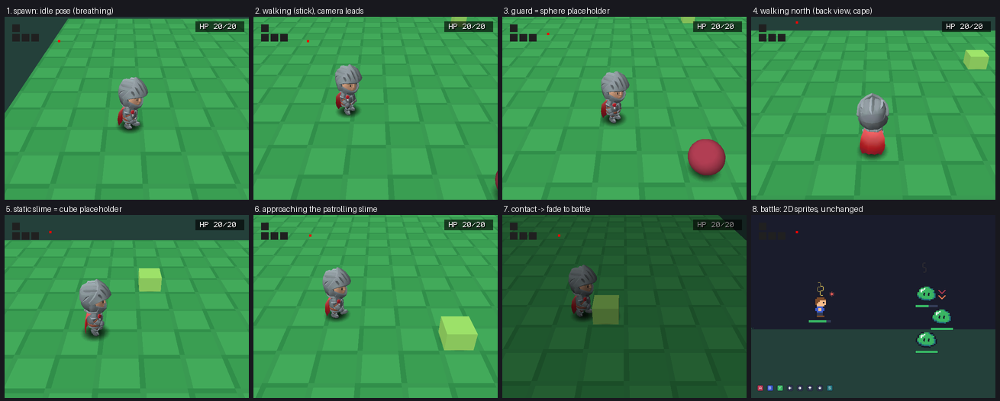

# Slice 3D-1: 3D overworld (vertical slice 1)

> **Superseded in part by slice 3D-2** ([SLICE_3D_VILLAGE.md](SLICE_3D_VILLAGE.md)):
> * the boot map is now `village.txt`;
> * the camera is now 9 m up and 9 m back with a 32° FOV (pitch 45°), aimed 1.5 m ahead and
>   clamped to the map;
> * the ground is natural grass and dirt instead of a checker;
> * DMF is at v2, and the KOS vertex arena holds 32k vertices.
>
> **And by slice 3D-3** ([SLICE_3D_NPCS.md](SLICE_3D_NPCS.md)):
> * the cube and sphere placeholders are gone: slimes are KayKit skeletons and the guard is the
>   KayKit Mage, both animated with the packs' own clips;
> * the hero is converted with an error bound (`--max-error 0.025`, head 0.005) instead of a
>   2,000-triangle target: his eyes had become slits. `tools/dmf/build_characters.sh` builds all
>   three characters.
>
> The hero pipeline, analog movement and verification described below still apply.

**Goal (from the brief):** replace the 2D field with 3D.
* A KayKit hero converted to a Dreamcast-friendly `.dmf`, animated, walking across a plane with the
  analog stick.
* Placeholder cube and sphere for the slimes and the guard.
* **Combat untouched** (2D sprites as-is).


*Frames from the real Dreamcast backend (`platform/kos/main.cpp`) running in the kossim harness
(§5). The top-left squares and red dot are the existing debug input overlay. The moving version
is `docs/slice3d_walk.gif`; the model sheet is `docs/hero_dmf.png`.*

## Summary

* **Boot → 3D field.** The Knight walks on a ground plane with the **analog stick**: free
  direction, speed proportional to deflection, dead zone. The d-pad still works exactly as before.
  A follow camera at ~34° leads the hero in his direction of travel.
* **Placeholders.** Slimes are lime **cubes** that squash when idle and hop on patrol steps. The
  guard is a red **sphere** that bobs. Each has a blob shadow. Touching one starts **the same
  encounter** as before.
* **Combat, game over and fades are unchanged:** identical draw calls, byte for byte (§5).
* **Hero:** KayKit **Knight**, 5,800 → **2,000 triangles**, 2,555 vertices, 24 bones, 128×128
  RGB565 texture (32 KiB VRAM). Clips: `walk` (the supplied Mixamo *Walking.fbx*, retargeted onto
  the KayKit rig, root motion stripped, feet planted) and `idle` (generated, since the rig's rest
  pose is a T-pose).
* **Frame cost:** ~2,600 vertices skinned/lit/projected, ~3,800–4,400 vertices submitted in 7–9
  PVR batches. The SH4 estimate is **~1.5–3 ms of the 16.7 ms frame** (§4). `make DIAG=1` measures
  the real number.
* **Verified here (no Dreamcast available):** build clean, gameplay equivalence, analog-movement
  invariants with a mutation score of 12/12, a C++ vs Python cross-check of the skinning, and the
  real KOS backend driven through a KOS stand-in with its TA stream decoded. **Still needed from
  you:** a Flycast/hardware run (§6).

---

## 1. Hero choice: the Knight

| Candidate | Source tris | Fit with the existing hero |
|---|---:|---|
| **Knight** | **5,800** | sword + shield = the battle kit (Attack / Guard); classic JRPG lead |
| Barbarian | 7,123 | melee, but the bear hat reads as a side character |
| Mage | 6,668 | Fire fits, but Attack/Guard don't |
| Rogue / Rogue_Hooded | 7,562 / 7,185 | |
| Ranger | 8,900 | heaviest mesh (quiver) |

The Knight is also the cheapest source mesh. Its head is mostly inside the helmet, so the
hidden-surface pass removes another ~600 triangles for free. Weapons are not in the supplied pack
(KayKit ships them separately). The rig has `handslot.l/r` bones for attaching them later.

## 2. Asset pipeline: FBX → DMF (`tools/dmf/`)

```sh
python3 -m venv .venv && .venv/bin/pip install -r tools/dmf/requirements.txt
.venv/bin/python tools/dmf/fbx2dmf.py --model ../barbarian_texture/Knight.fbx \
    --texture ../barbarian_texture/knight_texture.png --anim ../Walking/Walking.fbx:walk \
    --target-tris 2000 -o romdisk/models/hero.dmf                    # ~40 s
.venv/bin/python tools/dmf/make_placeholders.py romdisk/models       # cube.dmf, sphere.dmf
.venv/bin/python tools/dmf/dmf_preview.py romdisk/models/hero.dmf -o docs/hero_dmf.png --clip walk
```

| Step | What it does | Result for the Knight |
|---|---|---|
| 1 load | assimp: 9 mesh parts merged in bind space, 24-bone skeleton, inverse binds; FK of the rest pose must reproduce the bind pose | FK error 1.6e-7 |
| 2 weights | keep the 2 strongest influences, renormalise, second < 0.10 → rigid | 2,686 two-bone / 2,623 rigid (before simplification) |
| 7 retarget | ufbx evaluates the Mixamo clip. Each mapped KayKit bone gets `R_tgt(t) = R_src(t)·R_src_rest⁻¹·R_tgt_rest` in world space (both rigs are T-posed and face +Z). Hips translation is scaled by leg length; the linear drift (162 cm per loop) is removed, sway and bob are kept | 23 keys @ 24 fps, loops exactly (key 23 ≡ key 0 in the source) |
| 7 ground | per frame, lift or lower the hips so the lowest skinned vertex touches y = 0. KayKit feet are long for human heel/toe angles and sank up to 5.4 % of body height | contact ±1.5 cm after simplification |
| 7 idle | mean pose of the walk cycle plus a 2 s breathing loop (chest/head pitch, arm sway, hips dip) | `idle`, 24 keys @ 12 fps |
| 3 hidden surfaces | z-buffer visibility from 40 directions × (bind + 7 animation poses); triangles never visible are dropped (conservative: 5 mm tolerance + sub-pixel centroid test) | −1,015 tris (598 head under the helmet) |
| 4 simplify | meshoptimizer `simplifyWithAttributes` (normals, UV seams) to `--target-tris` | 4,785 → 2,000, 1.0 % error |
| 5 strips | group vertices by bone pair, `optimizeVertexCacheStrip` + `stripify`; unstripified result checked against the input | 525 strips, 1.69 indices per triangle |
| 6 texture | box-downsample 1024² → 128² (KayKit swatches stay ≥ 0.85 texel away from their edges, so bilinear does not bleed), RGB565, twiddled | 32 KiB |

The converter is deterministic: the test runner rebuilds `hero.dmf` byte-identically.
`--target-tris`, `--tex-size`, `--arm-spread` and `--no-hidden-pass` are the useful knobs. The
format itself is documented in [DMF.md](DMF.md).

## 3. Runtime changes

| File | Change |
|---|---|
| `src/engine.h` | **3D API.** `texture_create` takes pre-twiddled texels. `poly_begin`/`poly_end` reserve space in a per-frame vertex arena; `eng::Vertex` is layout-identical to `pvr_vertex_t`. `input_axis` reads the analog stick |
| `src/math3d.h` | Vec3 / Quat / Mat4, perspective fused with the 640×480 viewport (w = view depth, so PVR z = 1/w) |
| `src/dmf.*` | loader (one read into a 512 KiB static arena, full structural validation), clip sampling, pose blend, skinning matrices |
| `src/render3d.*` | CPU T&L: per-bone MVP, 1- or 2-matrix vertex transform, bind-space N·L lighting, near-plane strip rejection, sphere culling, ground grid, blob shadows, backdrop, twiddling |
| `src/field3d.*` | the 3D field: models, ground texture baked from the map (8 texels per tile, checker + grid line), hero facing/animation/crossfade, follow camera with look-ahead, placeholder animation. **Read-only on the simulation** |
| `src/field.*` | analog movement (integer, deterministic; below). Hero gets `aim_x/y`, `mvx/mvy`. The 2D draw path stays behind `FIELD_2D` |
| `src/input.*` | the stick is sampled once per tick together with the buttons |
| `platform/kos/main.cpp` | 3D textures (`pvr_mem_malloc` + `pvr_txr_load`), the vertex arena (12,288 verts, 32-byte aligned), one compiled header per batch with **`PVR_CULLING_NONE`**, one `pvr_prim` per batch, stick input, boot map `plane_field`, DIAG 3D counters |
| `romdisk/maps/plane_field.txt` | same size, spawn and entities as `test_field`, all grass. Interior walls would otherwise be invisible walls on a flat plane; the map edge is the only boundary |
| `makefile` | new objects; `make FIELD2D=1` builds the old sprite field for A/B comparison (boots `test_field`) |

**Analog movement** (`hero_update_stick`):
1. If `|stick| ≤ 28` (dead zone), the unchanged d-pad code runs instead.
2. Otherwise speed = `HERO_SPEED × clamp((|stick| − 28) / (100 − 28))`, so full speed arrives
   before the physical edge of the stick.
3. The velocity is `stick × speed / |stick|`, computed in integers only.
4. The hero moves x first, then y, through the existing `hero_move_axis`. Wall sliding and
   entity contact therefore behave exactly as with the d-pad.

The 4-way `dir` that traces and the sprite build use keeps its value while the stick stays within
±67.5° of it.

**Frame anatomy (field):**
* **OP list:** backdrop (z 0.005), outer ground, map ground (1 strip per visible row), placeholder
  models, hero.
* **TR list:** blob shadows, then the existing HUD, fade and overlay.

3D depth stays below 1, so all 2D layers remain in front with their existing z values.

## 4. Capabilities and budget (estimates; confirm with `make DIAG=1`)

| Resource | This slice | Notes |
|---|---|---|
| Vertices transformed / frame | 2,555 (hero) + 24 / 162 (cube / sphere, when on screen) | 1,272 rigid (1 matrix) + 1,283 two-bone (2 matrices, blended in clip space) |
| Vertices submitted / frame | 3,770 – 4,370, 7 – 9 batches | hero strips 3,385; ground ~350–450 |
| Triangles to the PVR / frame | ~2,700 (~160 k/s at 60 fps) | an order of magnitude under the PVR's practical throughput |
| SH4 time (estimate) | ~1.5–3 ms / 16.7 ms | ~70–90 cycles per skinned+lit vertex, ~20 per strip copy, ~10 per store-queue vertex, 48 matrix muls for the pose; plain C++, no `ftrv` yet. Host bench: field tick+draw 35.7 µs (was 2.6 µs) |
| VRAM textures | 322 KiB (was 192 KiB) | hero 32 KiB, ground 128 KiB (256², maps ≤ 32×32 tiles; 4 texels per tile above that), shadow 2 KiB; `tiles.png` is no longer loaded |
| Main RAM (static) | model arena 512 KiB (138 KiB used), vertex arena 384 KiB, transform scratch 132 KiB, ground bake buffer 128 KiB | no per-frame allocation in the new code |

**Headroom, as a rule of thumb:** 3–4 characters of this size fit comfortably at 60 fps (≈ 8–10 k
transformed vertices). The ceilings, in order, are:
1. SH4 transform time. The fix is `ftrv`/`fipr` via KOS `mat_trans_*`, or `fsrra` for 1/w.
2. Submission copies. The fix is writing straight into the store queues with `pvr_dr_*`.
3. VRAM. The fix is VQ textures.

## 5. Verification done here

| Check | Result | How |
|---|---|---|
| Host build | 0 warnings (`-Wall -Wextra`; new code also clean with `-Wshadow -pedantic`) | `make host` |
| KOS backend compiles | all 7 variants (3D, FIELD2D, DIAG ×5) | type-checked against a KOS 2.1 stand-in (`tools/kossim/include`), not the real SDK |
| **D-pad gameplay unchanged** | state traces byte-identical to the **pre-3D build**, float and double | 14 traces (~120 k ticks, with battles, game overs, restarts) compared during the work; 4 of them kept as goldens in `tests/slice3d/pre3d/` |
| **Battle untouched** | every battle, to-field and game-over frame **draw-call identical** to before | full draw traces of 2 battle-test runs + 1,333 non-field frames of a field session |
| Analog movement | invariants S1–S6 over 190 k ticks on both maps (incl. the walls of `test_field`): speed bound, dead zone, direction, full tilt, no wall penetration, exact match with an independent integer reference model (incl. wall sliding, facing) | `tests/slice3d/check_stick.py` |
| The checks catch bugs | **12/12** injected movement mutations caught (dead zone, speed ×2, rounding, y inverted, no normalisation, collision bypass, speed curve, no wall sliding, axis order, 2 facing rules, stick+d-pad both applied) | `tests/slice3d/mutate.sh` |
| Float vs double | identical logic traces with stick input | runner |
| DMF runtime == reference | C++ `dmf_load`/sample/blend/skin equals the Python reference to **9e-7** on every clip, wrap-around and blend | `tools/dmf/crosscheck.py` |
| Real KOS backend | `platform/kos/main.cpp` **unmodified** on a KOS stand-in that decodes the TA stream: 720 frames, stick tour into a battle, **0 TA stream errors** (headers/vertices/EOL/alignment/list), images above | `make kossim` |
| Culling hazard | with KOS's default culling left on, the ground vanishes and the hero renders inside-out, so the explicit `PVR_CULLING_NONE` is required | kossim experiment |
| Converter | byte-identical rebuild; strips unstripify to exactly the simplified triangles | runner with `DMF_PY` |

**`tests/slice3d/run.sh`** repeats these checks: 25 checks in ~1.5 min, or 27 with
`DMF_PY=.venv/bin/python`, which also rebuilds the models. Two kinds of evidence are not in it:
* the mutation runs, which are in `tests/slice3d/mutate.sh` (~2 min);
* the one-time comparisons against the pre-3D *binary* (14 state traces, battle draw traces).
  Only 4 of those state traces are kept as goldens.

`make preview` + `build/preview` renders any tick of any input script to PNG without the KOS layer.

**What none of this proves:** real PVR behaviour (the culling semantics, TA/ISP limits, bilinear
details), real SH4 timing, and how the analog stick feels. The harnesses implement *my reading* of
KOS 2.1; Flycast/hardware is the reference.

## 6. Flycast / hardware sign-off

1. `make clean && make` under DreamSDK. The romdisk now includes `models/*.dmf` (~142 KB).
2. Boot. The serial log must show `FOUND: /rd/models/hero.dmf`, `cube.dmf`, `sphere.dmf`,
   `/rd/maps/plane_field.txt`.
3. Walk with the stick: check that speed follows deflection, nothing moves at rest, and the hero
   faces and animates (walk ↔ idle). The d-pad should behave as before.
4. Touch a cube and the sphere: the battles must be the same as before. Win, return, lose, retry.
5. **Look for:**
   * an inside-out or missing hero or ground (culling; §DMF.md "Culling")
   * black or garbled textures (twiddle/format)
   * missing triangles when the camera is close (TA buffers)
6. `make clean && make DIAG=1`, play 5 minutes, then send the log. The periodic lines now include
   `3D last frame: … verts transformed, … submitted; peak arena …, dropped batches …` next to
   `worst CPU frame`.
7. Optional A/B: `make clean && make FIELD2D=1` gives the old sprite field.

If the TA overflows on hardware (missing geometry plus `pvr_irq` errors), the first fix is larger
OP bins via `pvr_init` (e.g. `PVR_BINSIZE_32`) instead of `pvr_init_defaults()`.

## 7. Tuning knobs

| Where | Knob | Now |
|---|---|---|
| `src/field3d.cpp` | `HERO_HEIGHT` | 1.55 tiles |
| | `CAM_UP` / `CAM_BACK` / `CAM_FOV_Y` (pitch ≈ 34°) | 4.0 / 6.0 / 38° |
| | `CAM_FOLLOW`, `CAM_LOOK_AHEAD`, `CAM_LEAD_RATE` | 0.14, 1.6 tiles, 0.035 |
| | `WALK_RATE_FULL` (walk clip speed at full stick) | 2.1× |
| | `TURN_RATE`, `WALK_BLEND` | 0.28, 0.125 per tick |
| | slime/guard sizes, sky/outer-ground colours | |
| `src/field.h` | `STICK_DEAD` / `STICK_FULL` | 28 / 100 (of 128) |
| `src/render3d.cpp` | light direction, ambient 0.50, diffuse 0.62 | |
| `tools/dmf/fbx2dmf.py` | `--target-tris`, `--tex-size`, `--arm-spread`, `--rigid-below` | 2000, 128, 0, 0.10 |

**Known mismatch to tune:** the hero still moves at the 2D speed (3.75 tiles/s) while the chibi
legs are short, so the walk plays at 2.1× and the feet slide. Options:
1. a run clip (KayKit/Mixamo), or
2. a slower 3D move speed, which is a gameplay change: re-record the goldens.

## 8. Decisions, deviations, open items

* **The boot map is the new `plane_field`.** `test_field` is unchanged. It still backs the existing
  test suite and the `FIELD2D` build, and it renders in 3D as a painted floor plan with invisible
  walls. Props and walls are a later pass.
* **Placeholders follow the brief literally:** slime → cube, guard → sphere. Swapping them is a
  two-line change in `field3d.cpp` (`draw_entity`).
* **No culling, by design** (see DMF.md). Re-enable once Flycast confirms the PVR's winding.
* **Host test goldens:** field *state* lines are unchanged for d-pad scripts. Field *draw* lines
  changed (sprites → 3D batches, new `P` and `T` trace lines). If `tests/run_tests.sh` compares
  full field draw traces, re-record those with `--update` after review. Battle draw traces need
  no update. `make host` has no new dependencies; `make preview`/`make kossim` need libpng.
* **Open items:**
  * `texture_create` has no free (the ground is baked once per boot).
  * The model arena keeps the uploaded texture bytes.
  * The ground bake buffer is static.
  * No mipmaps: distant ground may shimmer at low pitch.
  * No near-plane clipping, only rejection: fine for this camera, needed for close-ups.
  * The converter needs the Python toolchain in `tools/dmf/requirements.txt`.
    `meshoptimizer` builds from source and needs a C++ compiler.

## 9. Suggested next passes

1. **Flycast/hardware pass** on this slice: culling confirmation, DIAG timings, stick feel, camera
   and speed tuning. Then decide the walk-speed question in §7.
2. **Environment:** DMF props for walls, trees and water (instanced static meshes, placed from the
   map), a horizon/sky, fog via the PVR fog table.
3. **Characters:** convert the other KayKit heroes and skeletons (same rig, so the same clips
   apply), a run clip, and attach a sword/shield at `handslot`. Then the battle scene.
4. **Speed work, as budgets grow:** `ftrv` transforms, direct store-queue submission, VQ
   textures, LOD (the converter already takes `--target-tris`).
