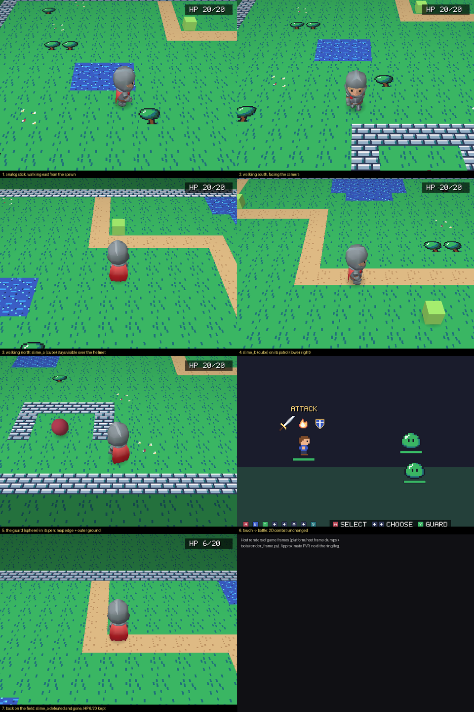

# 3D slice 1: the field in 3D with a KayKit hero

> **Superseded in part by VS2 (`SLICE_3D_2.md`):**
> * the field is now a 3D village;
> * the cube/sphere placeholders are now skeletons;
> * the hero uses native KayKit clips and runs at 2.81 tiles/s;
> * `.dmf` is v2.
>
> The pipeline, verification and hardware notes below still apply.

**Goal.** The overworld (field) becomes 3D:
* the tile backdrop is replaced by a 3D ground plane;
* the hero is a 3D KayKit model, packaged as `.dmf` and animated, and walks with the analog stick;
* the slime and the enemy are placeholders (cube, sphere).

**Combat is untouched:** it still uses the 2D sprites.



*Host renders of game frames. `slice3d_walk.gif` shows the motion; `slice3d_knight.png` shows the model.*

---

## 1. Result in one table

| Item | Result |
|---|---|
| Hero | **KayKit Knight** with the raised-visor part removed. Classic RPG hero, matches the sword/shield command ring, and has the lowest polycount of the six adventurers |
| `romdisk/models/knight.dmf` | **1490 triangles** (source 5800), 1611 vertices, 23 bones, 27 skin groups, 536 strips, 64×64 RGB565 texture (8 KiB VRAM), idle + walk clips. **80.9 KB** |
| Animation | Mixamo *Walking* retargeted onto KayKit `Rig_Medium` (in place, hip bob scaled to the short legs). Idle = mean pose of the walk + a breathing loop. Playback is **locked to distance walked**, so the feet don't slide |
| Placeholders | `cube.dmf` (12 tris) = **slime**, `sphere.dmf` (168 tris) = **enemy** (the guard). Vertex-coloured, squash/bob idles, blob shadows |
| Field | The tile map is laid out as a ground plane (1 tile = 1 unit) using the existing `tiles.png`, with a darker band of ground around the map. Walls and water still block, exactly as before. Follow camera. The HP HUD and fades are unchanged |
| Input | **Analog stick**: radial dead zone and linear ramp. The **d-pad** still works as a full-tilt stick. Same speed in every direction (14.0 ± 0.07 sub-px/tick across 24 directions) |
| Frame cost (field) | ~1600 triangles / ~2700 vertices submitted. **513k SH4 instructions** of game-side CPU per frame, measured on KOS code generation (see §5), ≈ **3–4.5 ms** of the 16.7 ms budget |
| Memory | VRAM +8 KiB. RAM (static): +192 KiB model arena (86 KB used), +160 KiB transform scratch, +256 KiB KOS vertex arena (peak use 3.8k of 8k vertices) |
| Combat | **Byte-identical** battle traces (every draw call and state line) vs the pre-3D build on 3 encounters × 40 fuzzed sessions |

## 2. What was built

| Area | Files | Notes |
|---|---|---|
| Format | `tools/dmf/dmf.py`, `docs/DMF.md` | spec + writer/reader/validator + reference skinning |
| Converter | `tools/dmf/kaykit_to_dmf.py`, `stripify.py`, `make_placeholders.py`, `build_models.sh` | Blender-python (`bpy==4.2.0` from PyPI). Reproducible byte for byte |
| Previews | `tools/dmf/preview_dmf.py`, `tools/dmf/raster.py`, `tools/render_frame.py` | PVR-like rasterizer: 1/w depth, GREATER test, modulate, the KOS culling convention, TR blending |
| Runtime | `src/dmf.*`, `src/math3d.h`, `src/render3d.*` | portable C++11; validation before trust; CPU transform + lighting; strips into the engine arena |
| Field view | `src/field3d.*` | camera, ground plane, hero/placeholder drawing. Cosmetic state only: camera smoothing, facing, animation clocks |
| Field logic | `src/field.*`, `src/input.*`, `src/game.cpp` | analog movement (integer, deterministic); the 2D tile/sprite drawing is removed; `field3d_tick/reset` wired in |
| Engine seam | `src/engine.h` | `Vert3` (== `pvr_vertex_t`), `vtx_begin/vtx_end`, `material_create`, `texture_create`, `input_axis`, `set_clear_color` |
| Dreamcast | `platform/kos/main.cpp`, `makefile` | materials = compiled PVR headers. Each 3D batch = **one header + one `pvr_prim()`** of the whole block. `make R3D_SAFE=1` falls back to one vertex per `pvr_prim` |
| Host | `platform/host/*`, `platform/bench/*` | stick columns in input scripts; `--dump` frame dumps; `--view`; `--tune name=value` |
| Tests | `tests/slice3d/` | `run.sh` runs the 12 checks listed in §6 |

## 3. Decisions you may want to revisit (each is one constant)

| Decision | Why | Where |
|---|---|---|
| **Hero speed 1.64 tiles/s** (was 3.75) | The walk clip covers 0.61 tiles per cycle at the Knight's scale. 3.75 tiles/s would need ~6× playback. On screen this is ~90 px/s (2D: 120 px/s) because the 3D camera shows fewer, larger tiles. A **run clip** is the way to go faster | `HERO_SPEED_Q8` (`field.h`) |
| Cadence cap 2.3× | Full speed wants 2.7×. Above the cap the feet slide a little rather than the legs blurring | `WALK_MAX_RATE` (`field3d.cpp`) |
| Hero scale 0.8 (≈1.9 tiles tall) | At 1.0 his big chibi head hid foes ~3 tiles ahead when walking north | `HERO_SCALE` |
| Camera 45° pitch, 10 units, 40° FOV, fixed yaw | The best compromise found between seeing the face and seeing what is ahead. Stick "up" is always map north | `CAM_*` |
| Ground = the tile map painted on the plane | Walls and water still block, so the collision stays readable. A plain plane would mean invisible walls | `draw_ground` (`field3d.cpp`) |
| Slime → cube, enemy → sphere | As briefed. The cube is light lime (#a7f070): the 2D slime green is the grass colour | `make_placeholders.py` |
| Back-face culling **off** | Every mesh is closed or double-sided, so the picture is identical. It removes the one PVR setting not yet seen on hardware. Turn on with `MAT_CULL` after a Flycast check (`render3d.h` explains the winding) | `field3d_init` |
| Ground filtering nearest, model bilinear | crisp pixel-art tiles; smooth gradients on the Knight | `material_create` flags |

All view constants can be changed on the host without rebuilding:

```sh
./build/battle_trace_f32 in.in t.trace --dump /tmp/f --dump-frames 120 --tune cam_pitch=38 --tune hero_scale=0.9
python3 tools/render_frame.py /tmp/f/frame_00120.txt romdisk out.png
```

## 4. The Knight, from FBX to `.dmf`

1. **Drop** `Knight_HelmetVisor` (428 tris).
2. **Delete hidden faces:** 279 head faces under the helmet. Without this, decimating the two shells independently made the hair poke through the helmet, and they were wasted budget.
3. **Decimate** to 1500 triangles with Blender's collapse decimator (symmetric in X), weighted per part:
   * head 1.5×, arms/legs 0.75×;
   * the cape is kept whole (silhouette).

   | Part | Source tris | Decimated tris |
   |---|---:|---:|
   | Head | 635 | 297 |
   | Body | 1288 | 401 |
   | Helmet | 418 | 128 |
   | Arms | 2 × 622 | 2 × 144 |
   | Legs | 2 × 628 | 2 × 146 |
   | Cape | 84 | 84 |

4. **Skinning:**
   * keep the 2 strongest bone weights per vertex;
   * sort the vertices into 27 skin groups;
   * build triangle strips (1.72 vertices per triangle).
5. **Texture:** 1024² atlas box-filtered to 64² RGB565. The atlas is 8 columns of gradient swatches, so every swatch stays 8 texels wide; 3 UVs sit near a swatch edge.
6. **Walk:**
   * retargeted through world-space rotation deltas (both rigs rest in a T-pose);
   * 1.56 m of forward root motion removed (in place);
   * hips scaled by 0.389 (leg-length ratio);
   * upper arms spread 20° to clear the wide chibi torso.
7. **Ground speed:** measured from the stance foot, 0.797 units/s at 1× (0.764 units per cycle).
8. **Idle:** the mean pose of the walk cycle (arms down, weight centred) plus a 2 s breathing loop.

## 5. Performance

Measured, not estimated:
* The game-side work of a field frame (logic tick + pose + skinning + lighting + ground + strip building) was compiled with **GCC 13.2 configured for `-m4-single-only`**, the same compiler version and code generation as the DreamSDK build.
* It was run on an emulated SH4 (qemu) with KOS's FPSCR (`0x00040000`, read from this build's `_start`).
* SH4 instructions were counted per frame (`tests/slice3d/bench3d.cpp`).

| | SH4 instructions / frame |
|---|---:|
| Knight: transform + light (1611 vertices, 27 groups) | ~263k |
| Knight: strip emission (2562 vertices) | ~54k |
| Models: per-bone matrices, lighting table, placeholders | ~48k |
| Ground plane (grid transform + ~200 quads) | ~103k |
| Pose sampling, blend, skin matrices | ~21k |
| Blob shadows (4) | ~11k |
| HUD, logic tick, misc | ~13k |
| **Total** | **~513k** |

Converting to time on the 200 MHz SH4:
* At 0.7–1.0 instructions per cycle, plus ~100k cycles of cache misses and store-queue traffic, that is **≈ 3–4.5 ms**.
* The TA gets ~2.7k vertices (~90 KB) per frame. The TA vertex buffer is 512 KiB.
* **Confirm on hardware:** `make DIAG=1` prints the worst CPU frame, the arena peak and the PVR frame rate every 300 frames.

Changes made because of the measurements:

| Change | Frame cost |
|---|---|
| Before | 1.09M instructions |
| `fminf`/`fmaxf` replaced by compares (on the SH4 they are NaN-aware library calls) | −460k |
| Ground grid points transformed once and shared by the four quads around them | −60k |
| One matrix per loop pass (no register spills); strip emission as word copies | −65k |
| Shadow discs transformed once (the clipper stays only as a fallback) | −30k |

**Next optimisation (not needed at this content size):** an SH4 `FTRV` path (matrix × vector in one instruction, one XMTRX load per skin group; the `.dmf` vertex order was designed for it). This is worth ~100k instructions per frame on the Knight and scales with every extra character. It needs inline asm, so it should be validated on hardware.

## 6. Verification done here (`tests/slice3d/run.sh`, 12/12 pass, ~4 min)

| # | Check | Result |
|---|---|---|
| 1 | models parse with the spec | ok |
| 2 | C++ runtime == Python reference: every emitted vertex (screen x/y, 1/w, UV, colour, strip ends), 10 poses incl. loop wrap | max error 1.2e-4 px |
| 3 | C++ and Python validators agree on 3000 mutated files (6000 across runs) | 0 disagreements |
| 4 | loader + renderer fuzz under ASan/UBSan (+float-cast-overflow), 9000 mutated files | clean |
| 5 | movement invariants on 42 sessions (40 × 6000 ticks of fuzzed stick/d-pad/battles):<br>M1 never inside walls; M2 never over speed; M3 no drift inside the dead zone; M4 frozen during fades; M5 full-speed motion in the stick direction | all hold |
| 6 | float == double logic traces (40 sessions) | identical |
| 7 | battle traces byte-identical to the pre-3D build (3 encounters × 10 sessions; 120 sessions during development) | identical |
| 8 | scripted: stick-walk into slime_a → battle → win → back on the field, foe gone, HP kept | ok |
| 9 | on **SH4** (GCC 13.2, qemu): runtime == reference; logic traces == x86; 3D frames == x86 within 0.001 px (47k vertices) | ok |

Also done:
* The checker found 12 of 13 injected movement bugs. The 13th is provably unobservable: two dead-zone checks back each other up.
* The KOS backend compiles warning-free in all 6 build variants, against a KOS API stub made from the DWARF of your `battle.elf` (KOS `9ba0350f`). Both the Ubuntu SH4 GCC and the `-m4-single-only` GCC were used.

Facts read from your binary rather than assumed:
* `pvr_poly_cxt_*` defaults: culling CCW, depth GREATER.
* The background plane depth: `zclip` = 0.0001, below every 3D z.
* `pvr_prim` copies `size/32` blocks through the store queues without a lock, so one call per batch works.
* `PVR_CMD_VERTEX`/`_EOL` values.
* `kos_img_t` format codes.
* `pvr_init_defaults` bin sizes and the 512 KiB vertex buffer.
* The FPSCR that KOS sets.

## 7. Needs Flycast / hardware (I could not run the PVR here)

1. `make clean && make`, then walk with the stick and the d-pad:
   * ground, Knight, cube and sphere render;
   * the Knight animates and faces the stick;
   * touching a foe gives the unchanged battle.
2. `make clean && make DIAG=1` and play for a couple of minutes. Read:
   * `dmf: ... ok` lines at boot;
   * `worst CPU frame`;
   * `3D: arena peak ... PVR ... fps` (expect 60.0).
3. If something is off:

   | Symptom | Check |
   |---|---|
   | Missing model | serial log: `MISSING: /rd/models/...` or `dmf: ... rejected` |
   | Garbled 3D | `make R3D_SAFE=1`: the per-vertex submission path |

   `TRIAGE.md` has the rest.
4. Optional: enable `MAT_CULL` in `field3d_init` and check the Knight isn't inside-out. That confirms the winding convention; then it can stay on.

## 8. Impact on the existing test suite (`tests/run_tests.sh`)

It wasn't in the upload, so it hasn't been run here. Expected:

* **Battle goldens and UI checks: unchanged.** Battle traces are byte-identical.
* **Field goldens will differ**, and some **field input scripts won't reach their targets any more**, because the hero now moves at 14 instead of 32 sub-px/tick. What to do:
  * re-record with `--update` after review;
  * regenerate the field routes (`harness/gen_inputs.py` timings) or scale their step counts by ~2.3;
  * `HERO_SPEED` / `HERO_SPEED_DIAG` are replaced by `HERO_SPEED_Q8` + `STICK_DEAD`/`STICK_FULL`, so scripts that read the old constants need updating.
* **Draw traces:**
  * the field no longer emits tile/character `S` lines;
  * 3D batches appear as `M <material> <vertices>` lines;
  * the memory texture appears as `L mem:64x64:fmt1 0`.

  `tools/render_trace.py` should skip `M` lines; `tools/render_frame.py` renders 3D frames from `--dump` output.
* **Input scripts** accept two optional stick columns (`<dt> <buttons> [<x> <y>]`). Old scripts still work.
* Invariant F4 (2D camera clamp) still holds: `cam_x`/`cam_y` are still computed for the traces.

## 9. Suggested next passes

1. **Style:** a KayKit environment (trees, walls, props) instead of the painted tiles. Fog (the PVR has table fog; `pvr_fog_*` is in your KOS build). A run clip and a higher top speed.
2. **Enemies:** a KayKit skeleton or slime `.dmf` to replace the placeholders. The converter already handles the Skeleton_* files (same rig).
3. **Performance:** the `FTRV` skinning path (§5), then back-face culling on.
4. **Battle in 3D** (the next big slice).
