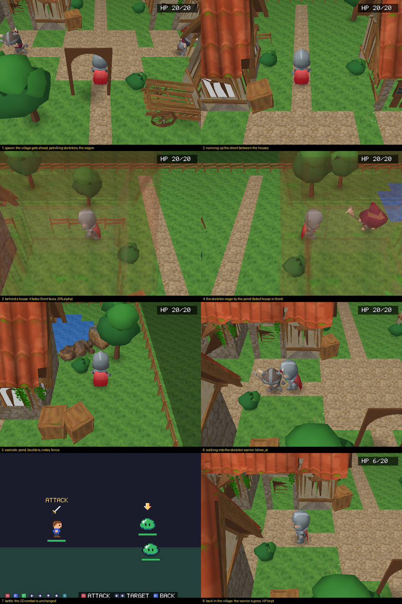
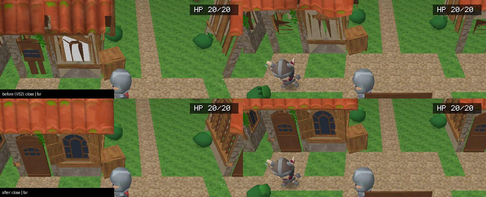

# 3D slice 2 (VS2): the overworld becomes a 3D village

**Goal.**
* The field becomes a 3D village: houses, props and decoration converted through the `.dmf` pipeline.
* Both enemies become animated 3D models: a KayKit skeleton warrior replaces the slime, a skeleton mage replaces the other enemy.
* The hero walks faster.
* Target 60 fps; the fallback target is 30 fps. The hand-written SH4 assembly library (SH4ZHAM) is the next slice.

**Combat is still the untouched 2D battle.**

*Host renders of game frames. Motion: `vs2_village_run.gif`. Assets: `vs2_assets.png`.*

---

## 1. Definition of done

| Item | Status |
|---|---|
| Overworld fully 3D | **Done.** The field draws no 2D art; only the HP box is 2D. It is made of: • a textured ground plane; • 180 placed 3D instances: 6 houses, wagon, 5 crates, 3 boulders, arch gate, 8 bushes, 23 trees, 133 fence segments; • 3D characters |
| Village assets + decorative details | **Done:** Quaternius Medieval Village kit (walls, doors, windows, shutters, roofs, chimneys, ivy, crate, wagon, fence, arch) and the two Poly Haven boulders, as 11 prefabs (§2; the houses as one view-culled model per yaw since the house fix-up, §9) |
| Enemies are animated 3D assets | **Done:** • `slime` enemies: **Skeleton_Warrior with Skeleton_Blade**, `Skeletons_Idle` / `Skeletons_Walking` (the patrolling one walks); • `guard`: **Skeleton_Mage with Skeleton_Staff**. Both have glowing eyes and face their direction of travel |
| Player walks faster | **Done:** top speed **2.81 tiles/s** (VS1: 1.64, +71%). It now uses KayKit's own **Running_A** clip, blended from Walking_A by stick tilt, so the feet don't slide |
| 60 fps | **Expected, not yet seen on hardware** (§4): • measured: 1.01M–1.50M SH4 instructions of game-side work per frame across a whole-village tour (median 1.23M); • estimated **~8–12 ms** typical and **~15 ms** worst of the 16.7 ms budget. If a view does run long, the fixed 60 Hz logic keeps game speed correct and the display drops to 30 fps. `make DIAG=1` reports the real numbers |

## 2. Asset choices

Everything is rebuilt by `tools/dmf/build_models.sh` and is **byte-for-byte reproducible** (27 files). Budgets are chosen for the SH4's CPU transform cost and the TA's vertex bandwidth.

### Characters

| Model | Triangles | Notes |
|---|---:|---|
| `knight.dmf` | 1490 | Native KayKit clips: `Idle_A`, `Walking_A`, `Running_A`. This replaces VS1's retargeted Mixamo walk: no retarget, real idle, real run |
| `skel_warrior.dmf` | 788 (from 5934 + blade 457) | Blade welded to `handslot.r`; **1 bone per vertex** (rigid bone segments, half the skinning cost, no visible difference) |
| `skel_mage.dmf` | 788 (from 4588 + staff 1519) | same treatment, with the staff |

### Village props

| Prefab | Triangles | From |
|---|---:|---|
| `house_stone` | 1146 (`_r0`), 686 (`_r180`), 1595 (any yaw) | uneven-brick door / window / straight walls, door, shuttered window, side windows, roof, chimney, ivy: 5072 source triangles |
| `house_plaster` | 1191 (`_r0`), 848 (`_r180`), 1869 (any yaw) | brick door wall, plaster window walls, timber-grid sides, roof, ivy: 4641 source |
| `wagon` | 300 | 1672 |
| `crate` | 110 | 230 |
| `fence` | 24 | 40, scaled to 1 tile |
| `arch` | 90 | `Wall_Arch`, used as the village gate |
| `boulder_a` | 319 | Poly Haven, 12245 |
| `boulder_b` | 180 | Poly Haven, 8102 |
| `tree` | 153 | **generated** (the packs have no trees): trunk + faceted canopy, vertex colours |
| `bush` | 82 | generated |

How the houses are built (`tools/dmf/build_village.py`; VS2 decimated them to 700 triangles + a 300-triangle LOD, which broke the doors and windows, see §9):
* **Assembled** from the 2 m modular kit. **Gable fills were generated**: the free kit has no gable walls, and the roof's ends were open.
* **View culling:** every face the game camera can never see is deleted, per yaw the map uses (`house_stone_r0.dmf`, `house_stone_r180.dmf`, ...), plus an any-yaw model. Checked by rendering (§9).
* **Shape-preserving simplification:** nearly coplanar faces merged; only the roof tiles (30%) and the chimney rocks (40%) are collapse-decimated. Doors, windows, shutters and frames are kept whole.
* On every prop: faces on the ground facing down are deleted.

**Textures:**
* 10 shared PNGs in `romdisk/tex/`: **272 KiB VRAM** in total, including a 256×256 ground atlas built from the kit's textures.
* Each is loaded once, whatever number of models use it.
* Only the base colours are kept; the PBR normal and roughness maps are dropped, because the PVR has no per-pixel lighting.

**Not used:**

| Asset | Why |
|---|---|
| `Prop_ExteriorBorder_Straight1` | too flat to read at this camera |
| `Prop_Vine9` | a 4 m horizontal vine, with no wall to hang it on |
| `T_RedBrick` | no model uses it |
| The KayKit sword/shield for the Knight | not requested; an easy next step (`--attach`) |
| The other skeletons/adventurers | not needed in this slice |

## 3. What was built

**Format (`.dmf` v2):**
* material table: up to 8 materials per model;
* shared textures referenced by romdisk path;
* alpha materials (ivy: 1-bit alpha in the TR list);
* v1 files still load.

Spec: `tools/dmf/dmf.py`; overview: `docs/DMF.md`.

**Converter (`kaykit_to_dmf.py`):**
* KayKit multi-take animation files (`FILE:ACTION:name`), with loop-frame detection;
* bone-parented parts (the warrior's helmet);
* weapons welded to a bone (`--attach`); the orientation was checked visually;
* untextured colour materials (`--material-color Glow=...`);
* `--max-influences 1`.

**Village builder:** `build_village.py`, plus the ground atlas.

**Map format:**
* `prop <model> <x> <y> <rot> [solid <w> <h>]`;
* footprints block like walls and are validated at load;
* the logic never reads model data;
* new map: `romdisk/maps/village.txt`, 36×28, the boot map.

**Renderer (`src/render3d.*`):**
* `draw_static`: static props with lighting baked once per instance;
* **box culling** per instance;
* **per-strip sphere culling**: strips of a half-visible house cost neither transforms nor TA bandwidth. Verified to change no pixel (§5);
* a near-plane **clipper** for props right under the camera;
* baked-lighting paths for skinned models (`prelit`).

**Field view (`src/field3d.*`):**
* model cache, per-yaw house variants (`<name>_r<yaw>.dmf`);
* automatic fences (`#`) and trees (`T`);
* **occluder fading:** a house or tree that covers the hero on screen fades to ~20% alpha, front faces only. It's an exact screen-space test, done each tick;
* walk/run locomotion blend;
* enemy animation;
* per-yaw baked lighting for the hero (32 buckets) and the enemies (16).

**Dreamcast backend:**
* `pvr_init` with the default parameters except a **1 MiB TA vertex buffer** (was 512 KiB), because the village submits up to ~14k vertices per frame;
* 16k-vertex arena;
* 128 materials;
* `eng::file_exists`.

**Engine:** `file_exists`.

**Logic:**
* `HERO_SPEED_Q8` = 24 (2.81 tiles/s);
* `NPC_STEP_TICKS` = 60 (the skeletons patrol at 1 tile/s; at the old 3.75 tiles/s their walk clip would have played 5× too fast);
* solid prop layer.

## 4. Performance

Method:
* **Instruction counts:** `tests/slice3d/bench3d.cpp` replays an input script on the SH4 code. It is compiled by a **GCC 13.2 configured for `-m4-single-only`** (KOS's code generation) and run under qemu with KOS's FPSCR. A frame-marker function splits qemu's instruction log per frame.
* **Route:** the whole-village tour (`tests/slice3d/tour.py`, 2335 ticks, every district).

| Tour frame | SH4 instructions (tick + draw) |
|---|---:|
| min (tick 700/1700) | 1.01 M |
| median (13 samples) | 1.23 M |
| max (tick 1177, south of the plaza: 6 houses, 3 skeletons, wagon, trees in view) | **1.50 M** |

Worst frame in detail:
* ~5.9k triangles;
* ~12k vertices submitted;
* vertex arena 13.9k / 16k at the tour's peak.

Cost split:
* `draw_model` (Knight + 3 skeletons): 40%;
* `draw_static` (props): 41%;
* ground: 8%;
* pose/skin: ~7%;
* shadows: 2%.

**Time estimate** (qemu counts instructions, not cycles):
* At 0.7–1.0 instructions per cycle on the 200 MHz SH4, plus ~1–2 ms of cache misses and ~1–2 ms of store-queue traffic to the TA:
  * median frame: **~8–12 ms**;
  * worst frame: **~11–15 ms**.
* The PVR renders the previous frame in parallel: ~6k triangles is far from its limits.
* So **60 fps is expected**, with a thin margin in the busiest view.
* If hardware shows more, the display falls back to 30 fps at unchanged game speed. The loop runs 2 fixed ticks per displayed frame, which is the slice's stated fallback.

How it got here (same view, same compiler):

| Step | Instructions / frame |
|---|---:|
| first village build | 2.09 M |
| instance box culling, characters before props (the arena was overflowing) | |
| static props transformed straight into the arena | 1.98 M |
| skeletons with 1 bone per vertex | |
| per-strip bounding-sphere culling (before transforming) | 1.60 M |
| enemy lighting baked per yaw | 1.36 M |
| hero lighting baked per yaw; skip the strip tests for props wholly on screen | worst view 1.50 M, median 1.23 M |

Where the rest goes (for SH4ZHAM), per-loop costs in the KOS build:

| Loop | SH4 instructions |
|---|---:|
| Prop vertex: transform + emit | ~70 / vertex |
| Skinned vertex (baked colours) | ~56 / vertex |
| Strip copy | ~21 / vertex |
| Per-strip overhead on props | ~35–45 / strip |

GCC spills matrix rows to the stack, and float stores lack displacement addressing. `FTRV` (one XMTRX load per skin group, as the `.dmf` vertex order intends), hand-scheduled stores and store-queue emission should roughly halve these loops. `tests/slice3d/sh4_cost.sh` re-measures after each change.

## 5. Verification (`tests/slice3d/run.sh`: 19/19 pass since §9)

| Check | Result |
|---|---|
| C++ runtime == Python reference, vertex by vertex: 18 cases. Covers skinned lit, skinned with baked colours (hero and enemies), static props wholly on screen, and static props **crossing the near plane** (the reference re-implements the clipper) | max 0.0036 px |
| Same on **SH4** (qemu) | 18/18 |
| C++ and Python validators agree on 3000 mutated files, including the v2 multi-material models | 0 disagreements |
| Loader/renderer fuzz under ASan + UBSan, 5 models × 3000 | clean |
| Movement invariants M1–M5 on 40 fuzz sessions + the d-pad/stick sweep | all hold |
| Solid prop footprints: an injected bug (props not blocking) is caught by M1 in every session | caught |
| float == double logic traces, 40 sessions | identical |
| **Battle traces byte-identical to the pre-3D build**, 3 encounters × 10 sessions | 30/30 |
| Scripted: walk into the skeleton warrior → battle → win → back in the village, foe gone, HP kept | ok |
| Village tour: invariants | ok |
| **Strip culling changes no pixel:** 4 tour frames with and without it. Frames where the unculled run overflows the arena are excluded: those drop props, which is the designed behaviour | identical |
| SH4 == x86 logic traces | identical |
| KOS backend + all `src/` with the `-m4-single-only` GCC, `-Wall -Wextra -Wshadow`, 6 build variants | 0 warnings |

## 6. Needs Flycast / hardware

1. `make clean && make`:
   * walk the village with the stick;
   * run with full tilt, walk with half tilt;
   * walk behind a house: it fades;
   * touch a skeleton: the 2D battle, then back.
2. `make clean && make DIAG=1`, play a few minutes, then read:
   * `worst CPU frame` (expect ~11–15 ms at the busiest);
   * `3D: arena peak`;
   * `PVR vtx buffer peak` (expect < 1 MiB);
   * the PVR frame rate.
3. If 60 fps doesn't hold in busy views: accept 30 fps there until SH4ZHAM (`FTRV` transforms), or lower the roof/chimney ratios in `build_village.py` (§9).
4. `TRIAGE.md` has a village section; it covers the `pvr_init` change and the faded-house culling.

## 7. Impact on the user's test suite

* **Field goldens will change.** The map, speed and patrol speed are all new. The field input scripts were written for `test_field`, which is still on the romdisk for `--map`.
* **Battle goldens: unchanged** (30/30 byte-identical here).
* Trace format:
  * 3D batches (`M` lines) appear in field draw traces;
  * `--view` `V` lines gained `statics`, `near` and `strips_culled`.

## 8. Fix-up after the first Flycast run (boot stopped after the `FOUND:` lines)

The report's log stopped after the last `FOUND:` line, with no `dmf:` line. The cause could
not be reproduced here: there is no KOS/Flycast in this environment, and the same code boots
under qemu-sh4. So this pass did three things: removed every construct that was new on that
boot path, fixed the build so stale objects cannot be linked, and made the next log name the
stage that stalls. Details and the expected log are in `TRIAGE.md` (last section). In short:

* makefile: header dependencies (`-MMD -MP`). Before, a plain `make` kept a `game.o` compiled
  against the VS1 `FieldState`. Stale `*.o`/`romdisk.*`/`battle.elf` were removed from the tree.
* `[boot]` breadcrumbs in every build, through the same path as the `FOUND:` lines.
* Map `prop` lines are parsed without `%f`. `field_load` has no guarded local static.
* Textures are RGBA PNGs, the format the 2D build already loaded.
* Bug fix: `house_plaster_lod` was loaded three times (name truncation in the model cache).
* Verified unchanged: logic traces byte-identical, 4 tour frames pixel-identical, 1.23 M SH4
  instructions per frame.
* Tests: `tests/slice3d/run.sh` 18/18 pass (with `BASELINE` and `SH4=1`). New: 8c, the map prop parser vs Python plus malformed lines, on x86 and SH4.

## 9. House fix-up: doors, windows and distance (VS2.2)

**What was wrong.** Four separate faults:

| Symptom | Cause |
|---|---|
| Door, door frame, window frame and shutters torn into spikes | the houses (4641 and 5072 source triangles) were collapse-decimated to a 700-triangle budget, mostly on thin wooden parts. Collapse decimation cannot keep a 4 cm frame bar at those ratios |
| White window panes (every window except the first one in the model) | Blender names the second import of a material `MI_WindowGlass.001`; the exporter only stripped that suffix for textured materials, so those panes lost their dark glass colour |
| A slot of background visible through the middle of the roof, holes at the eaves | the VS2 "enclosed face" test deleted roof faces: the overlapping tile rows block every ray of its hemisphere test, visible or not |
| The house changes when you walk away from it | not a culling problem: the distance **LOD** (`house_*_lod.dmf`, 300 triangles, swapped in beyond 14.5 m from the eye). It lost the door entirely. Confirmed with `--tune lod_dist=1000`, which made the far view match the near one |

**What the build does now** (`tools/dmf/build_village.py`, docstring has the details):
1. **View culling instead of decimation.** The game camera never yaws, and its pitch and distance are fixed. So for a house placed at a given yaw, every possible eye position is known: the hero anywhere around it. The builder samples those positions (1-tile grid, pitch 42–48°, FOV +10%) and ray-casts from points on every face to the eyes that have the point in frame. Every face that no ray reaches is deleted: wall interiors, the backs of things, faces under the eaves, the far side. One model is made per yaw the map uses (`house_stone_r0.dmf`, `house_stone_r180.dmf`, …). Plus `house_stone.dmf`, culled for every yaw (all view directions, tested exhaustively), which the field uses if a house is placed at a yaw without its own model.
2. **Shape-preserving simplification:** merge nearly coplanar faces (limited dissolve, 15°, never across material/UV borders). Only the roof tiles (to 30%) and the chimney rocks (40%) are collapse-decimated; they are organic and textured. Doors, windows, shutters and timber frames are never decimated.
3. Glass material names are normalised, and there are **no LODs**: every house looks the same at every distance.

**Verification:**
* `tests/slice3d/check_views.py` renders each culled model next to the unculled one from 40 random game cameras: 640×480, z-buffered, one ID per triangle.
  * Worst view: 8 differing pixels, all on 1-pixel slivers along edges.
  * Most views: 0.
  * `build_models.sh` runs it after every build.
* Host frames at the reported spots (image above) and along the tour show the same house near and far.
* `tests/slice3d/run.sh` 8d checks that every house loads its per-yaw model, with no LODs and no duplicate loads.
* The props that are not view-culled (crate, wagon, fence, arch, boulders), the characters and all textures are **byte-identical** to before.

| Model (drawn) | Triangles | Vertices emitted | VS2 (triangles / emitted) |
|---|---:|---:|---|
| `house_stone_r0` | 1146 | 2212 | 698 / 1472, LOD 360 |
| `house_stone_r180` | 686 | 1306 | same model |
| `house_plaster_r0` | 1191 | 2301 | 694 / 1568, LOD 395 |
| `house_plaster_r180` | 848 | 1674 | same model |

Model arena: 541 KiB. The arena is now 1 MiB, so the all-yaw fallbacks (91 + 113 KiB) also fit. Materials: 74 of 128, as before.

**Cost on the SH4** (same tour frames and method as §4):

The houses facing the camera now have more visible detail. Two renderer changes pay part of it back:
* **Viewport offset folded into the transform matrix**: 2 float registers and 2 multiply-adds less per vertex. The prop loop went from ~75 to 60 instructions per vertex.
* **Strip tests against only the screen edges the model's box crosses**, usually one of four. Strip culling decisions are unchanged (same counts, same pixels).

| Tour frame | VS2 | now |
|---|---:|---:|
| 100 | 1.31 M | 1.40 M (+6%) |
| 300 | 1.31 M | 1.30 M (-1%) |
| 500 | 1.10 M | 1.13 M (+2%) |
| 700 | 1.01 M | 1.01 M (-1%) |
| 900 | 1.23 M | 1.29 M (+5%) |
| 1177 | 1.50 M | 1.61 M (+7%) |
| 1300 | 1.40 M | 1.53 M (+9%) |
| 1500 | 1.07 M | 1.13 M (+6%) |
| 1700 | 1.01 M | 0.99 M (-3%) |
| 1900 | 1.12 M | 1.18 M (+6%) |
| 2100 | 1.40 M | 1.50 M (+8%) |
| **median** | 1.23 M | 1.29 M (+5%) |
| **worst** (1177, south of the plaza, 6 houses in view) | 1.50 M | 1.61 M (+7%) |

At §4's 0.7–1.0 instructions per cycle, the worst frame moves from ~11–15 ms to **~12–16 ms**. The village should still hold 60 fps, with a thinner margin in the busiest view. If hardware shows 30 fps there:
* the next step is SH4ZHAM's `FTRV` transform loop. qemu 8.2 does not execute `FTRV`/`FIPR`, so it has to be measured on hardware;
* or lower the roof ratio in `PREFABS`. 0.30 → 0.25 measured −73 emitted vertices per house; the tile rows get slightly flatter.
