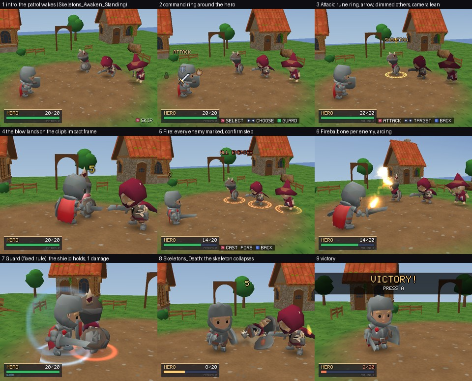
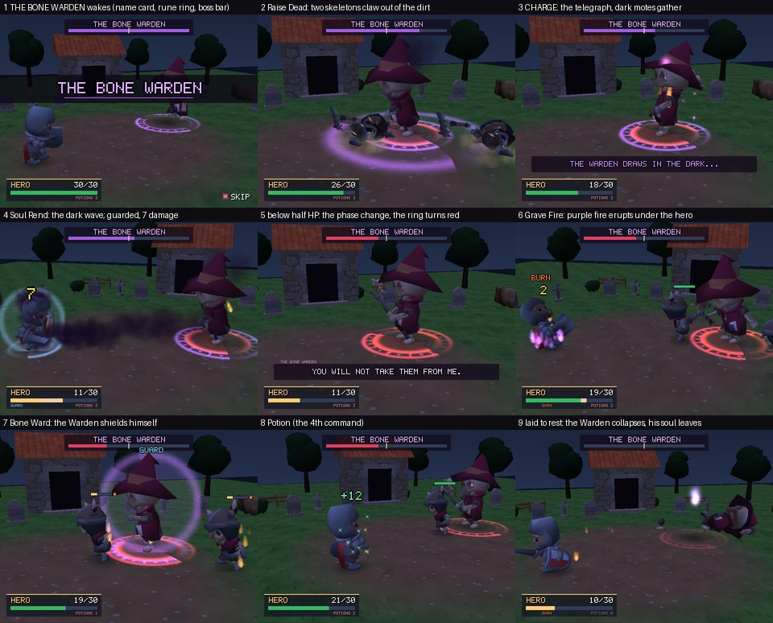
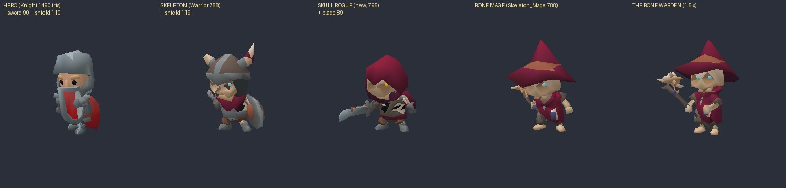

# Slice 3D-4: the 3D battle, and the Bone Warden

**Brief:** replace the 2D placeholder battle with a 3D sequence, using the supplied KayKit models
decimated for the Dreamcast (SH4, PowerVR2), with combat and enemies in the spirit of the GDD
(`docs/GDD_Horizontal_Slice.pdf`): a vertical slice through the horizontal slice's battles (GDD §11)
and its boss fight (GDD §12). The plan was `docs/NEXT_SLICE_3D_BATTLE.md`.

*The road patrol (`test_slimes`: a Skeleton Warrior, the new Skull Rogue and a Bone Mage) in the
village arena. Host frame dumps rendered with `tools/render_frame.py` (a PVR-like software
rasterizer), from one bot-played battle; the guard frame is from `slimes_2`.*

*The Bone Warden in the barrow arena at night: his intro, Raise Dead, the CHARGE telegraph, Soul
Rend against a guarding hero (7 instead of 14), the phase change at half HP, Grave Fire, Bone Ward,
a potion, and his end.*

## Summary

* **The battle is 3D.** Every encounter plays in an arena built from the village kit (the village
  arena; the barrow arena for the boss) with the field's own models: the Knight with a sword and a
  shield attached to his hand slots, skeletons with their weapons, the Bone Warden. Every action
  has a sequence - the attacker runs in, the blow lands on the clip's measured impact frame with
  sparks, a hit-stop, a white hit flash and a small shake; fireballs arc to each enemy and leave
  them burning; skeletons collapse into a pile of bones; a guard holds a shield bubble up through
  the enemies' turn. Cameras frame each action, numbers and HP bars follow the impact.
* **The rules are unchanged - proven.** 60 battles recorded from the untouched sprite build
  (3 encounters x 20 bot policies) replay turn for turn, byte for byte, on the 3D build, in float
  and double. The presentation only delays the state machine (three "wait while busy" gates).
* **The slice's rule additions (GDD §11.1)**, each behind a switch so the old rules stay provable:
  the **Guard fix** (it now lasts until the guarding actor's next turn starts - before, it expired
  before any enemy acted and never reduced damage), **potions** (the former "Items" placeholder
  becomes the ring's 4th command: heal 12), and **the Bone Warden** (§12): two-phase deterministic
  rotation, Raise Dead with two minion slots, the CHARGE telegraph and Soul Rend, Grave Fire, Bone
  Ward, the phase-change cutscene, his minions falling with him. An independent Python model of
  these rules checks 135 battle logs with 0 violations.
* **Balanced with bots, as the GDD asks (§12.6).** Two stats changed from the GDD's starting values
  (minion STR 4 -> 3, Soul Rend 12 -> 14): over 100 seeds, good play wins 95 % with 9 HP left in
  15 hero turns, naive play 48 %, no-guard play 78 % and mostly to Soul Rend - every target met.
* **Decimated for the Dreamcast and measured on SH4 code.** New content: the Skeleton Rogue (5,278
  -> 795 triangles), four weapons (80-200 triangles), 28 clips in a shared 252 KiB library, a
  procedural FX atlas, stand-in graveyard props; the arena's houses are cut to the triangles a battle
  camera can see. The battle's worst frame submits at most 13,939 vertices (the field's worst:
  13,957). Compiled with the DreamSDK flags and run under qemu with SH4ZAM's SH4 back-end, every
  battle's median frame is 0.76-0.98 M instructions and its worst 0.98-1.34 M - inside the field's
  envelope (median 0.95 M, worst 1.33 M); with the operand-cache model that is 4.3-6.0 ms median and
  at most 8.2 ms, about half of a 60 fps frame. **Since run on a physical Dreamcast and on Flycast: it works on both** (§8).
* **It plays end to end:** walk into the north-east patrol, then the road patrol; the Warden wakes
  at the east end of the road once both are down; beat him; back on the field. A test does exactly
  that with a field walker and the battle bot.

## 1. What was built

| Part | Files | What it does |
|---|---|---|
| Animation library | `src/anim.*`, `romdisk/anims/rig_medium.dma`, `docs/DMA.md` | 28 `Rig_Medium` clips stored once, shared by every character; per-clip translated bones (the skeletons' death throws a leg 2 units); impact / release / collapse events in ticks; an Animator with cross-fades, one-shots that hand back to the idle, hold-last-pose and hold-at (the CHARGE wind-up) |
| Arenas | `src/arena.*`, `romdisk/arenas/village.txt`, `barrow.txt` | data files like maps: props (prelit once, tinted by the arena light), formation slots, named camera shots, light and sky; the ground: grass in 3x3 cells and a dirt clearing (opaque core, translucent rim), every point transformed once per frame |
| Presentation | `src/battle3d.cpp` (tick side), `battle3d_draw.cpp`, `battle3d_internal.h` | actor views, the sequencer (cue lists built from clip events when a sequence starts), the camera rig, particles, projectiles, decals, HUD |
| Rules hooks | `src/battle.cpp`, `status.cpp` | presentation events (an action resolved, a burn ticked, minions collapsed) and the three gates (Command, Animate, the result banner wait while a sequence plays) |
| Rule additions | `src/skills.cpp`, `ai.*`, `encounters.cpp`, `ui.cpp`, `battle_state.h` | Guard fix, Potion, the Bone Warden's skills and AI, the 4-command ring; `Rules` switches (`--rules legacy` turns them off) |
| Field | `src/field.*`, `romdisk/maps/village.txt`, `src/game.cpp` | `entity ... after a b`: the Warden is dormant until both patrols are beaten; an encounter may set the hero up (the boss: max HP 30, full heal, 3 potions - stand-ins for Wren's blessing and the barrow waystone) |
| Engine | `src/engine.h`, `platform/kos/main.cpp`, `platform/host/host_engine.cpp` | `MAT_ADDITIVE` (TR list, src-alpha + one), 256 materials (124 in use), 512 batches |
| Renderer | `src/render3d.*`, `src/dmf.*`, `src/models.*` | an explicit culling sphere (clips move the body), bone world matrices (attachments), billboards, ground decals, projection, range prelighting; one model registry for field and battle; identical embedded textures uploaded once |
| Tools | `tools/battle3d/*`, `tools/render_frame.py` | see §6 |
| Tests | `tests/battle3d/*` | see §7 |

### 1.1 Sequences (60 ticks = 1 s; medians from bot-played battles; holding A plays them at 2x)

| Action | Sequence | Length |
|---|---|---:|
| Intro | the camera eases from an establishing shot; skeletons wake in turn (`Skeletons_Awaken_Standing`); the boss gets a name card. A skips | 1.2-2.2 s |
| Attack / enemy attack / Bone Slash | the pair framed from the south; run in; the swing (`chop`/`slice_d` hero, `slice_h`/`chop` skeletons, `stab` Rogue, `chop_2h` Warden); at the clip's impact frame: sparks, a 4-tick hit-stop, shake, the target's white flash, `hit_*` or its death, the number; run back | 2.4 s |
| ... against a guard | `block_hit`, a blue ring burst, a blue number and GUARD | |
| The Mage's attack | no approach: `throw`, violet motes gather, a bolt flies 24 ticks | 1.7 s |
| Fire | cast shot; fire gathers in the hand; one fireball per enemy, 5 ticks apart, arcing; impacts with embers and smoke, BURN, flames on every burning actor | 1.9 s |
| Guard / Bone Ward | `block` then `blocking` held while the rule keeps the guard; a bubble and a ring (purple for the Warden) | 0.6 s |
| Burn tick | a flame burst, `hit_a`, an orange number | 0.6 s |
| Potion | `use_item`, green sparkles, +12 | 1.0 s |
| CHARGE | the `throw` wind-up held; dark motes spiral into the staff; his eyes flare; "THE WARDEN DRAWS IN THE DARK..." | 1.4 s |
| Soul Rend | the staff slams; a dark wave rolls along the ground; an 8-tick hit-stop and a big shake | 2.1 s |
| Grave Fire | a cast; purple fire erupts under the hero; BURN | 1.8 s |
| Raise Dead | the staff strikes, the rune ring pulses, the minions claw out of the dirt (`Skeletons_Awaken_Floor`) | 3.3 s |
| Phase change | his line, the slam, the ring turns red, standing minions collapse, two rise | 4.5 s |
| Deaths | skeletons `Skeletons_Death` (they fall apart), dust and bone splinters, then sink and fade; the hero `Death_A` and holds; the Warden's soul rises as a purple wisp; his minions fall with him | |
| Victory / defeat | a slow orbit round the hero (`Jump_Full_Short`) / the camera pushes in while the skeletons taunt; the banner in the upper third, PRESS A after its hold | |

### 1.2 Selection and HUD

* **Command ring:** the commands (Attack, Fire, Guard, Potion) on a ring round the hero's chest;
  the ring turns to bring the selection to the front, enlarged and bobbing; its name above him; the
  Potion greyed at 0 with its count. Fire highlighted previews red rings under every enemy.
* **Attack:** a gold rune ring turning under the target, a bobbing arrow over it, its name, the other
  enemies dimmed, the camera leaning toward it. **◀▶ move in screen order** (the formation slots are
  left to right = actor order; a test checks the projected positions).
* **Fire:** red rune rings under every enemy, ALL ENEMIES, the camera easing toward the group.
* **During enemy turns:** a red ring under the acting enemy.
* HP bars over the enemies' heads (a light trail shows the damage as the bar drains), a hero panel
  (HP, GUARD / BURN, potions), numbers and labels rising from the heads, the unchanged prompt bar.
  The boss's bar is at the top with a pip at half (GDD §12.5).

## 2. Decisions (the plan's D1-D8, and the GDD)

| # | Decision | Choice | Why |
|---|---|---|---|
| D1 | Guard's legacy bug | **fixed** (GDD §11.1 requires it: Soul Rend teaches Guard), behind `rules().guard_fix` | a visible shield that does nothing would be wrong; the switch keeps the old rules provable |
| D2 | Squads | **mixed**: Warrior, Rogue, Mage skeletons in the road patrol; two Warriors in the north-east patrol | variety, and the Rogue and Mage are cheaper than the Warrior |
| D3 | Spellcast clip | **`Throw`** (no spellcasting clips were supplied) | it reads as a cast with the charge effects |
| D4 | Pacing | **hold A = 2x**, **A skips the intro** | battles are ~8x longer than the sprite battle's |
| D5 | Cameras | **eased shots**: overview, target lean, Fire ease, pair framing for every melee and bolt, cast, focus, intro, victory orbit, defeat push-in | the plan's "over the shoulder" hid the target behind the attacker; the pair framing keeps both |
| D6 | HUD | **bars over the heads + a hero panel**; the boss's bar at the top | as the plan and the GDD |
| D7 | Weapons on the field | **battle only** | the field's budget is unchanged |
| - | Models | the **field's own models** (Knight 1,490, Warrior 788, Mage 788 triangles, weapons merged where the field had them); only missing weapons are attached | the skeleton you touch is the skeleton you fight; no second copy in RAM |
| - | The GDD's stand-ins | the boss's max HP 30 / 3 potions come from his encounter (no quest yet); tombstones and the crypt are procedural props (asset A1 missing); Fire is always unlocked (no quest); `guard_duel` kept | the horizontal slice's quest and dialog are out of this slice |

## 3. Rules: unchanged, then extended

**Unchanged (legacy rules).** `platform/host/battle_bot.cpp` plays battles through the real UI
(closed loop: it presses a button, releases it and checks the UI state; a press the game ignored
while a sequence played is retried) and writes a turn log: every action, every HP and status,
the turn order, no ticks. The 60 baselines in `tests/battle3d/baseline/` were recorded from a
checkout of the tree before any change (`record_baseline.sh`). The 3D build reproduces every one,
float and double.

**Additions (game rules, the default).**

| Rule | Implementation | Checked by |
|---|---|---|
| Guard until the guarding actor's next turn starts | Guard gets 2 turns; a turn-start hook ends it | the Python model: halved hits while guarded, the guard present through the enemies' turns and gone at the next turn |
| Potion: self, heal 12, one potion, ends the turn | `SK_POTION` (was `SK_ITEMS`); the ring's 4th command, greyed at 0 | model + UI check |
| The Bone Warden (GDD §12.2-12.4, App. C) | `ai.cpp` rotation tables, `skills.cpp` skills, two pre-allocated minion slots (dormant at 0 HP) | model: every Warden action against an independent implementation of the rotation, damage of every hit, Grave Fire's single burn, minions raised at full HP, minions down with him |

*Interpretations:* the phase change takes the Warden's turn (his line, crumble, two rise), then
phase 2 starts at Grave Fire; a CHARGE interrupted by the phase change is lost; the AI always
targets the hero (the only party member).

**Balance (GDD §12.6).** `tools/battle3d/boss_tune.py` searched 144 stat combinations, then a
finer grid at 100 seeds, scoring the four targets and preferring the fewest changes; the bots add a
seeded 10 % chance of a random command per turn ("varied play"). Two changes met every target:

| Bot | Target | Result (100 seeds) |
|---|---|---|
| good: potion < 10 HP, Guard while he charges, Fire at two minions, else attack him | >= 95 %, 8-20 HP left | **95 %**, 9 HP, 15 hero turns |
| naive: potion < 10 HP, else attack him | 30-60 % | **48 %** |
| no guard: good without Guard | loses to the second Soul Rend more often than not | **78 %**; 16 of its 22 losses to Soul Rend |

(The GDD's targets pull against each other: no-guard play also fires at minions, so it cannot do
worse than naive play unless the longer fight brings it a second Soul Rend - which is what happens.)

## 4. Performance

Numbers from the host harness (every frame of bot-played battles) and from the SH4 build under qemu
(`tests/battle3d/sh4_budget.sh`: the same battles replayed tick for tick).

| | Submitted vertices, worst frame | SH4 instructions per frame, median / worst | Modelled CPU ms (20 / 40-cycle miss), median / worst |
|---|---:|---:|---:|
| field (reference, same build) | 13,957 | 0.95 M / 1.33 M | 5.1-6.2 / 7.0-8.4 |
| road patrol (3 skeletons) | 13,939 | 0.98 M / 1.34 M | 5.5-6.0 / 7.6-8.2 |
| north-east patrol (2) | 12,482 | 0.95 M / 1.22 M | 5.4-5.8 / 6.9-7.5 |
| guard duel | 10,201 | 0.76 M / 0.98 M | 4.3-4.7 / 5.5-6.0 |
| the Bone Warden (+2 minions) | 10,813 | 0.77 M / 1.06 M | 4.4-4.8 / 6.1-6.6 |

*Model, not measurement:* one cycle per instruction plus long FPU ops, plus a fixed cost per cache
miss; no dual issue. The KOS submission (`pvr_prim` copying the vertex arena to the TA) is not
included; it scales with submitted vertices, which stay within the field's.

**How the budget was met** (the first working build: median 1.41 M, worst 2.9 M instructions, a
full vertex arena and 142 dropped batches):

1. The arena ground transformed each grid point four times through `project()`: 330 k instructions
   for ~1,300 vertices. Now every point is transformed once per frame in one XMTRX batch.
2. Re-baking a character's lighting when it turns cost ~160 k instructions in one frame. Now the new
   yaw bucket is baked into a second buffer 512 vertices per frame while the old one is shown.
3. Props: the two houses are cut to the triangles any battle camera can see (`view_cull.py`, ~30 %
   of their strip vertices, verified pixel-identical on battles not used to build them); the wagon,
   the crates and a few trees went; the Fire-confirm shot no longer dollies out.
4. Characters are the biggest cost (7.2 k vertices for four) and stay as on the field.

**Memory:** model arena 756 of 1,024 KiB (field + battle); animation library 252 KiB (its own
384 KiB arena); 512 KiB of textures in VRAM in all, field included (the battle added the 32 KiB FX
atlas and the 32 KiB dirt; weapons use their holder's texture); 19 of 32 texture slots
(the three skeletons share one upload); 124 of 256 materials; romdisk 1.45 MB. No heap use: every
pool is fixed (192 particles, 8 projectiles, 24 floating texts, 12 queued sequences of 40 cues).

**Decimation** (QC renders against a full-resolution conversion of the same FBX, 12 views x 5 poses,
`tools/battle3d/qc_model.py`):

| Model | Source -> shipped triangles | Silhouette difference, mean / worst | Sheet |
|---|---:|---|---|
| Skeleton_Rogue | 5,278 -> 795 | 4.9 % / 7.5 % | [qc_rogue](battle3d/qc_rogue.jpg) |
| shield_badge_color | 262 -> 200 | 0.2 % / 0.6 % | [qc_weapons](battle3d/qc_weapons.jpg) |
| Skeleton_Shield_Large_A | 626 -> 119 | 6.6 % / 7.7 % | |
| Skeleton_Blade | 457 -> 89 | 12.4 % / 16.3 % (thin: a pixel of edge is 10 %) | |
| sword_1handed | 300 -> 80 | 17.0 % / 22.5 % (thin) | |

The shield's budget was raised from 110 to 200 triangles because 110 lost its quartered badge.
Decimating the houses was tried and rejected: Blender's edge collapse does not protect UV seams
and smeared the stone and lost the window glass; view culling changes no pixel instead.

*The battle cast as shipped (offline preview; the Warden's purple eyes are applied at runtime).*

## 5. Verification

`tests/battle3d/run.sh` (19 checks, ~8 minutes; `QUICK=1` ~3 minutes; all pass):

| Check | Result |
|---|---|
| 0 warnings (`-Wall -Wextra -Wshadow`) | pass |
| Animation library: C++ == Python, every clip at 6 times on 4 models | worst 5.4e-6 |
| Rules unchanged: 60 baselines, float and double | 60 / 60 identical |
| Rule additions: independent Python model over 135 logs | 0 violations; every boss skill exercised |
| The boss fight on the 3D build == on the sprite build | identical (3 seeds) |
| Boss balance (GDD §12.6) | every target |
| 3D UI: B back one step, entry lock, Fire confirm, cursor in screen order, ring wrap, Potion greyed, A skips the intro | 20 checks |
| Holding A plays sequences at 2x: the same battle, turn for turn | 1,229 ticks instead of 2,067 |
| Game flow: field -> both patrols -> the Warden wakes -> the boss -> field; a lost battle -> game over | pass |
| Frame budget (<= 14,000 vertices), no dropped batches, float == double tick for tick, in 6 battles | pass |
| View-culled houses: frames of 3 unseen battles identical within 2 colour levels | 186 frames |
| ASan + UBSan over village and boss battles and the field flow | clean |
| Procedural assets reproduce byte for byte; with `BPY=`, the Blender-built ones too | pass |
| `SH4=1`: SH4 instruction budget (qemu) | pass |

**The older suite** (`tests/run_tests.sh`) gives 33 pass / 21 fail, against 32 / 22 on the untouched
tree: its battle goldens now run on the sprite view with the legacy rules (still tick-exact), and the
asset check P2 passes again (the generator lacked the B and Y pad icons that the committed atlas
has). Its 21 failures all predate this slice: field goldens recorded on `test_field` before the
village existed, and field scripts that no longer reach a battle.

## 6. Pipeline and assets

All assets rebuild with `BPY=<Blender's Python> tools/battle3d/build_assets.sh` (20 s; byte-identical;
`VIEW_CULL=1` also redoes the culled houses, ~10 minutes). Blender as a Python module:
`uv venv -p 3.11 .venv && uv pip install --python .venv/bin/python bpy==4.2.0 numpy pillow`.

| Tool | Does |
|---|---|
| `tools/battle3d/dmfio.py` | reads/writes `.dmf` (byte-identical round trip of all 19 shipped models) and `.dma`; the reference pose math |
| `build_anims.py` (bpy) | the clip library; `--check` re-samples the clips the field models were built from: equal within half an int16 step |
| `convert_model.py` (bpy) | character or weapon FBX -> `.dmf`: model space, planar dissolve, edge collapse to a budget, 2 bone weights, rigid parts to a bone, the `Glow` eyes, skin groups, strips, the atlas at 64x64 |
| `strips.py` | stripifier (winding-exact; 1.70 vertices per triangle on the Knight, the original tool's 1.72) |
| `make_fx.py`, `make_props.py` | the FX atlas and the dirt; the barrow's stand-in tombstones and crypt |
| `view_cull.py`, `tests/battle3d/cameras.sh` | triangles visible from any battle camera (ID buffer from every sampled camera, jittered, at 2x resolution; translucent triangles never occlude) |
| `raster.c/.py`, `preview.py`, `clip_sheet.py`, `qc_model.py`, `frames_sheet.py`, `review.py`, `tools/render_frame.py` | a PVR-like rasterizer and the sheets built on it |
| `boss_tune.py` | the balance search |

**Licences:** KayKit (characters, animations, weapons) and Quaternius (Medieval Village MegaKit) are
CC0 (`KayKit/License_*.txt`, `Village/License_Quaternius.txt`); the dirt texture is derived from the
kit's CC0 terrain noise; everything else here is generated.

## 7. Host harness additions

`build/battle_trace_*`: `--bot POLICY`, `--bot-wait N`, `--bot-linger N`, `--turn-log FILE`,
`--rules game|legacy`, `--view2d` (the sprite battle), `--set id.stat=v` (balance), `--tune3d n=v`,
`--bot-battles POLICY` + `--walk-to x,y;...` (a field walker that plays every battle with the bot),
`--record-inputs FILE` (replayable inputs of a bot run), `--max-ticks N`. With `--view` each battle tick
adds a `B` line (sequence, camera, vertices per part, arena, dropped batches) and a `U` line (UI state,
the enemies' screen positions).

## 8. Not done / to check on hardware

* **Hardware (update):** built with DreamSDK and run on a physical Dreamcast and on Flycast; it works
  on both and looks better on hardware than on Flycast. Still open: `DIAG` frame-time logs to replace the
  qemu model numbers. The original note follows.
* *(original)* **No Dreamcast run, no DreamSDK build.** The game code compiles for SH4 with the DreamSDK flags
  (GCC 13.2 `sh-elf`, SH4ZAM's SH4 back-end) and runs under qemu; `platform/kos/main.cpp` could not be
  compiled without KOS headers. Its changes are small: `MAT_ADDITIVE` sets `cxt.blend.src =
  PVR_BLEND_SRCALPHA; cxt.blend.dst = PVR_BLEND_ONE` on a TR material, 256 materials, 512 batches, and
  boot checks for the new files. **First step: `make clean && make` under DreamSDK, then Flycast.**
* Hardware look to confirm: additive glows (fire, sparks, rings), the translucent dirt rim, the
  hit flash (an untextured white copy of the model, 2 frames), the night lighting's readability.
* Not in this slice (GDD): the quest (Wren's blessing, Brom's potions, the learned Fire), dialog,
  portraits, the barrow as a field map (the boss stands at the village's east road), the death
  screen (a lost battle still shows GAME OVER), the ending, audio, PVR fog, the T5 iris.
* Warden staging simplifications: his staff is part of the Skeleton_Mage model, so it cannot fall
  when he dies; "eyes flare" is an additive glow at the head.
