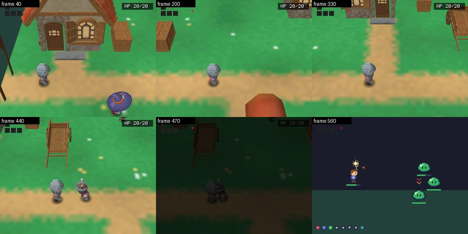
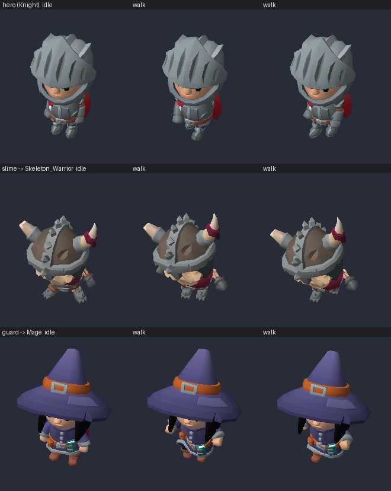
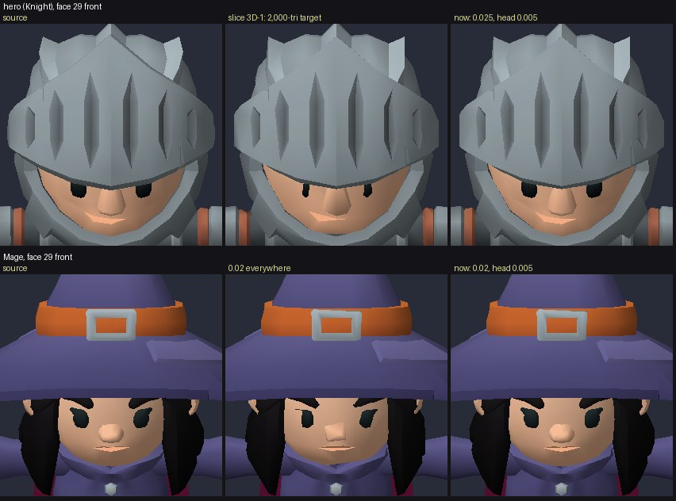
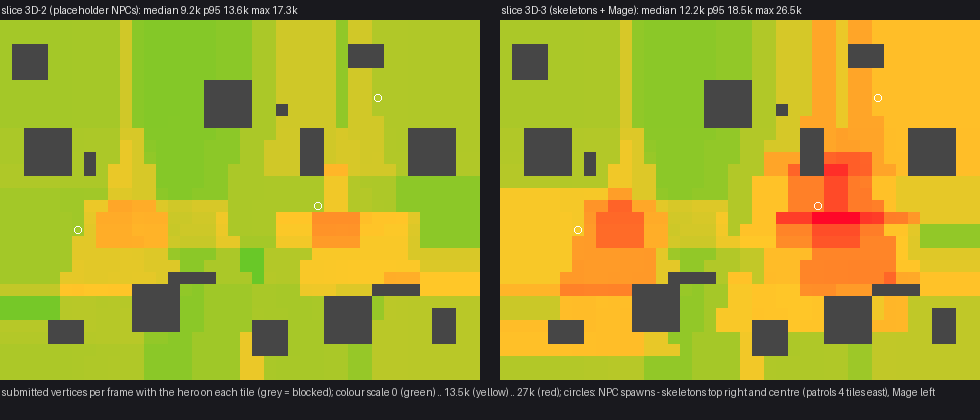

# Slice 3D-3: 3D NPCs in the overworld

**Brief:** replace the placeholder NPCs with real characters: skeletons for the slimes, the Mage for
the guard. Combat stays untouched (2D sprites).


*Real Dreamcast backend (`platform/kos/main.cpp` in kossim), `npc_tour` input: past the Mage by the
gate (frame 40), east along the road (200, 330), up to the patrolling skeleton (440), contact and the
battle transition (470), the unchanged 2D battle (560). The skeleton at the top right of frame 440
is the second one, at its spawn.*


*The three field characters as converted (`romdisk/models/*.dmf`), idle and two walk frames, seen
from 40° above like the overworld camera.*

## Summary

* **Slimes → `Skeleton_Warrior`**, **guard → `Mage`** (KayKit Adventurers/Skeletons, same
  `Rig_Medium` skeleton as the hero). Mapping is by sprite sheet, so every slime in every map
  becomes a skeleton and every guard a Mage. Touching one starts the same encounter as before;
  the battle still shows the 2D slimes.
* **Animations are the packs' own clips**, not retargets: `Skeletons_Idle` / `Skeletons_Walking`
  (`Rig_Medium_Special.fbx`) and `Idle_A` / `Walking_A` (`Rig_Medium_General.fbx`,
  `Rig_Medium_MovementBasic.fbx`), resampled to 15 fps. The runtime interpolates every frame.
  NPCs crossfade idle ↔ walk when they patrol and turn to face where they walk. Idle phases are
  staggered so two skeletons never breathe in sync.
* **The skeleton's eyes glow**: the `Glow` material is drawn flat and unlit (cyan `78FFE6`, a new
  DMF submesh flag). His helmet is a separate, unskinned mesh in the FBX; the converter now
  attaches such parts to their parent bone (`head`), so it follows the head.
* **Quality control for characters** (`tools/dmf/qc_chars.py`): source FBX vs DMF, posed with the
  DMF's own keys, 52 views per character + 8 face close-ups. All three pass, and every face was
  reviewed by eye (§3).
* **The hero changed too.** The face review showed that slice 3D-1's 2,000-triangle hero had his
  eyes turned into slits and his nose shrunk. All characters are now built with an error bound,
  plus a tighter one for the head (`--part-error`), by one script: `tools/dmf/build_characters.sh`.
* **Budget:** hero 2,272, skeleton 2,499, Mage 2,998 triangles. Frame cost over every walkable tile:
  **median 12.2k, p95 18.5k, max 26.5k submitted vertices** (village with placeholders: 9.2k /
  13.6k / 17.3k). The worst tiles are around the patrolling skeleton by the wagon (§5). Not yet
  measured on hardware.
* **Off-screen characters are skipped before posing**: a per-model animation box computed at load
  time (every pose of every clip) is tested against the frustum.

## 1. Choices

**Which skeleton.** The pack has three; all were converted and QC'd (the two alternatives with the
`--view-pitch` experiment, so their counts are ~5 % optimistic):

| Variant | Triangles at its passing bound | Seen from the overworld camera |
|---|---:|---|
| **Skeleton_Warrior** (chosen) | 2,499 (0.025) | horned, spiked helmet over a skull with glowing eyes, bones and a red cloak: reads as an enemy |
| Skeleton_Rogue | 2,055 (0.025) | a red hood covers almost everything: a red blob from 45° |
| Skeleton_Mage | 1,740 (0.025) | a big red witch hat, which is the guard's silhouette in another colour |

The Warrior costs ~450–750 triangles more per skeleton. If the frame budget needs it back, swapping
is one line in `build_characters.sh` (§5).

**Guard → Mage.** As briefed. The tall hat dominates from above; the face shows under the brim
when he faces the camera.

**Scale.** Every character is scaled to `HERO_HEIGHT` (1.55 tiles) by its bind-pose height, hat and
helmet included, like the 2D sprites which all filled one tile.

**Walk speed.** Entities move at the hero's full speed (one tile per 16 ticks, 3.75 tiles/s). A
stride-true walk would play the clips 9–11× faster, a blur. The clips play at the hero's cadence
instead (`SKELETON_WALK_RATE` 3.0: the 1.6 s shamble loops every 0.53 s; `MAGE_WALK_RATE` 2.1: 0.51
s). Feet slide a little; tune in `src/field3d.cpp` if patrols get slower.

## 2. Pipeline additions (`tools/dmf/fbx2dmf.py`)

```sh
tools/dmf/build_characters.sh .. ../.. .venv/bin/python     # hero, skeleton, mage (~6 min)
```

| Option / step | What | Why |
|---|---|---|
| `--native-anim FILE:STACK:name[:fps]` | evaluates a clip authored for the rig with ufbx and samples its local transforms; KayKit clips are in place and loop (checked: last key = first) | the packs' own idle/walk instead of retargeted Mixamo motion |
| `--max-error E` | error-bounded simplification: every material simplified to an absolute error E (model units; characters are ~2.6 units tall) | the bound is what QC decides; a triangle target means different quality per model |
| `--part-error PART=E` | a mesh part (e.g. `Mage_Head`) gets its own bound | faces: see §3 |
| `--unlit MAT=RRGGBB` | that material becomes an untextured, unlit submesh | the skeleton's glowing eyes |
| unskinned parts | attached rigidly to the nearest bone ancestor | the skeleton's helmet under `head` |
| multi-material | per-material strips and submeshes, written as DMF v2 with the texture embedded | skeleton (body + eyes) |
| `--view-pitch LO:HI` | hidden-surface pass restricted to the overworld camera's pitch band | **tried, not used:** ~5 % fewer triangles and a worse Mage face at the same bound |

| Character | Source tris | Never visible | Final tris | Vertices | Strip indices | File | Clips |
|---|---:|---:|---:|---:|---:|---:|---|
| hero (Knight) | 5,800 | 1,015 | 2,272 (body 0.025, head 0.005) | 2,735 | 3,751 | 141 KB | walk (Mixamo, 23 @ 24 fps), idle (derived) |
| skeleton (Skeleton_Warrior) | 5,934 | 885 | 2,499 (0.025) | 3,476 | 4,423 | 189 KB | idle 64 @ 15 fps (4.3 s), walk 24 @ 15 fps (1.6 s) |
| Mage | 6,668 | 1,200 | 2,998 (body 0.02, head 0.005) | 3,013 | 4,530 | 139 KB | idle 16 @ 15 fps, walk 16 @ 15 fps (1.07 s) |

Each has a 128² RGB565 texture (32 KiB of VRAM). The converter is deterministic: the test runner
rebuilds all three byte-identically.

## 3. Quality control

`tools/dmf/qc_chars.py` → [`character_qc/`](character_qc/report.md) (one sheet per character:
source | DMF | difference | DMF with the Dreamcast texture).

* **Source:** the FBX after the converter's weight step (2 influences), before hidden-surface
  removal and simplification. Both sides are posed with the DMF's own keys: bind pose and 3 frames
  of each clip.
* **Views:** the overworld camera's 45° pitch from 6 directions (characters turn), and the camera
  band's edges (29°, 61°). Orthographic, about 2× the on-screen size at the closest camera.
* **Gate** (as the village QC): silhouette ≤ 0.5 % and colour ≤ 1 % per view, with two
  differences:
  * colour compares **unlit** renders (texture integrity: eyes, trims, emblems). Gouraud shading
    over a simplified curved surface shifts along creases without deforming anything;
  * a colour may move by **one QC pixel** (half a game pixel). The strict number (no shift, the
    village's metric) is printed as well. It fails even the slice-1 hero (2.2 %) on 1-pixel eye
    and trim shifts, so it is reported, not gated.
* **Face close-ups** (review rows, not gated): the head part at ~2.4× the body views' scale, from
  the front (29°, 45°) and 40° to each side, bind pose and one idle frame.

**Results:**

| Character | Views | Worst silhouette | Worst colour | Strict colour (info) |
|---|---:|---:|---:|---:|
| hero | 52 + 8 | 0.34 % | 0.23 % | 1.64 % |
| skeleton | 52 + 8 | 0.30 % | 0.40 % | 2.28 % |
| Mage | 52 + 8 | 0.06 % | 0.44 % | 1.73 % |

**Error-bound sweeps** (triangles, worst silhouette / colour over the 52 gated views; the chosen
bound is the largest with margin):

| Bound | Skeleton_Warrior | Mage (one bound for everything) |
|---:|---|---|
| 0.015 | 3,203 tris, 0.02 % / 0.05 % | 2,805, 0.07 % / 0.34 % |
| 0.02 | 2,746, 0.18 % / 0.25 % | 2,404, 0.11 % / 0.58 % |
| 0.025 | **2,499, 0.30 % / 0.40 %** | 2,116, 0.24 % / 0.79 % |
| 0.03 | 2,346, **fail** (0.53 % silhouette: rib and finger spikes) | 1,926, 0.33 % / 0.91 % (too close) |
| 0.04 | 2,139, **fail** (1.08 % / 1.19 %) | 1,721, **fail** (0.78 % / 1.49 %) |

**What the metrics miss: faces.** The numbers above passed a Mage whose nose had gone flat and a
hero whose eyes had become slits. A nose is ~1 % of a head's pixels and changes by a small shading
step: on the lit close-ups, the flattened nose scored 1.04 % against 0.73 % for an intact face
(delta > 0.05), inside the noise of hair and helmet edges. No threshold separated them. So faces
were judged by eye on the close-up rows, and each head got its own bound:



| | Body bound | Head at the body bound | Head bound | Cost |
|---|---:|---|---:|---:|
| hero | 0.025 | eyes become slits, smaller nose (also true of the slice-1 hero) | 0.005 | +272 tris vs slice 1 |
| Mage | 0.02 | nose flattened to a square, thinner lips | 0.005 (0.01 still thins the lips) | +594 |
| skeleton | 0.025 | skull, teeth and eye glow intact | (none) | – |

## 4. Runtime changes

| File | Change |
|---|---|
| `src/field3d.*` | `CharModel` per sprite sheet (hero.dmf; mage.dmf for guards; skeleton.dmf for slimes), scaled to `HERO_HEIGHT`; per-entity idle/walk state with crossfade and staggered idle phase; `draw_character()` shared by hero and NPCs; cube/sphere code and models removed |
| `src/dmf.*` | `DMF_SUB_UNLIT`; **animation culling box** `Model::anim_lo/hi`, computed at load (every key of every clip, each bone group's box through its bones, +5 % of height); arena 1.5 MiB (929 KiB used) |
| `src/render3d.*` | unlit submeshes in the skinned and the static path; `r3d_model_visible()` (sphere + animation box) so off-screen characters are not posed or skinned |
| `platform/kos/main.cpp` | boot check for `skeleton.dmf` / `mage.dmf` instead of the placeholders |
| `platform/host/dmf_dump.cpp` | `--anim-box` prints the runtime's culling box |

## 5. Budget


*Submitted vertices per frame with the hero on each walkable tile, slice 3D-2 (placeholder NPCs)
vs now. NPCs stand at their spawns.*

| | Slice 3D-2 | Slice 3D-3 |
|---|---:|---|
| Submitted vertices: median / p95 / max | 9.2k / 13.6k / 17.3k | **12.2k / 18.5k / 26.5k** |
| Transformed vertices: median / p95 / max | 6.8k / 10.8k / 13.7k | 9.4k / 14.6k / 20.8k |
| Tiles above 20k submitted | 0 | 35 of 1,065 (around the patrol by the wagon) |
| VRAM textures | 500 KiB | 564 KiB |
| Model arena | 610 KiB | 929 KiB of 1.5 MiB |
| KOS vertex arena peak (NPC tour) | – | 22,001 of 32,768 (the worst tile needs 26.5k) |

* **Per character on screen:** hero 2,735 skinned vertices / 3,751 submitted, skeleton 3,476 /
  4,423, Mage 3,013 / 4,530.
* **The worst tile** (26,16) puts the hero against the patrolling skeleton's spawn, with the
  wagon and a house corner in view: 26.5k submitted. The second skeleton counts too: its culling
  box (with its 5 % pad) just reaches the top edge of the screen, although none of its pixels do.
* **SH4 estimate** with the slice-1 cost model (~80 cycles per skinned, lit vertex; ~30 per
  submitted vertex; the static direct path ~35 per index): about 8 ms of the 16.7 ms frame on the
  worst tile and ~4 ms at the median. Not measured. `make DIAG=1` on hardware decides.
* **If the worst views drop frames,** the levers are, in order:
  1. the map: move `slime_b`'s patrol a few tiles away from the wagon and house (the worst cluster
     is where NPCs and props overlap);
  2. swap the skeleton for `Skeleton_Rogue` (−444 triangles, about −800 submitted vertices per
     skeleton; measured with the `--view-pitch` build, so slightly optimistic);
  3. `ftrv` for the skinned transform (not yet written);
  4. per-character bounds (QC decides; the body bounds are already at the edge for the skeleton).
     The Mage's head bound is a quality choice: from the overworld camera his face is mostly under
     the hat brim, so `Mage_Head=0.01` (−282 triangles) or dropping `--part-error` (−594) costs
     little on screen. It would matter in a closer camera or a 3D battle.

## 6. Verification

| Check | Result | Where |
|---|---|---|
| Character render QC | 3/3 pass; faces reviewed | `qc_chars.py`, `docs/character_qc/` |
| Reproducible characters | hero, skeleton and Mage rebuilt byte-identical | runner with `DMF_PY` |
| C++ runtime == Python reference | ≤ 1.0e-06 on every model, NPCs included | `crosscheck.py` |
| Culling box contains every pose | 400 random poses per character (clips at random times, idle/walk blends): ≥ 4.6 % of height to spare; without the 5 % pad the hero and skeleton poke out (the check catches it) | `tests/slice3d/check_anim_box.py` |
| NPC contact → same battle | walking into the patrolling skeleton starts its encounter (`test_slimes`) at tick 451; the field simulation itself is unchanged (pre-3D d-pad goldens) | runner (`npc_tour`) |
| Real KOS backend in kossim | NPC tour: 600 frames, 0 TA stream errors, every model loads; DIAG: 564 KiB VRAM, 929 KiB arena, no dropped batches | `make kossim` |
| Memory safety | ASan + UBSan preview build over the NPC tour and the full tile sweep: clean | host |
| Village QC unchanged | 34/34 with the village metric (the character-only colour tolerance is not applied to props) | `qc.py` |
| Existing checks | d-pad goldens, stick invariants S1–S6 on three maps, float == double, prop loader, 14/14 mutations | `tests/slice3d/run.sh`, `mutate.sh` |

`tests/slice3d/run.sh`: all checks in ~2 min. `DMF_PY=.venv/bin/python` adds the byte-identical
rebuild of every model; `QC=1` adds the village and character render QC (~20 min).

**Not proven here:** SH4 frame times with three characters on screen; how the glowing eyes and the
walk cadence feel in motion.

## 7. Flycast / hardware checks

1. `make clean && make`. Boot log: `FOUND:` for `/rd/models/skeleton.dmf` and `/rd/models/mage.dmf`,
   no `dmf_load` lines.
2. The Mage stands south of the road by the gate, idling. The skeletons: one north-east, one on the
   road east of the wagon, walking a 4-tile patrol.
   * Skeleton eyes glow cyan (flat colour, not textured, not black).
   * The helmet stays on the skull while he walks.
   * Idle ↔ walk transitions are smooth, and the two skeletons are not in sync.
3. Walk into the patrolling skeleton: the same slime battle as before (2D sprites). Win, return:
   it is gone from the field. Touch the Mage: the guard duel.
4. `make clean && make DIAG=1`. Stand next to the patrolling skeleton (east road, by the wagon) and
   walk around there. Send the `worst CPU frame` and `3D last frame` lines. Levers in §5.

## 8. Tuning knobs

| Where | Knob | Now |
|---|---|---|
| `tools/dmf/build_characters.sh` | `--max-error`, `--part-error` per character | hero 0.025 / head 0.005, skeleton 0.025, Mage 0.02 / head 0.005 |
| | skeleton variant | `Skeleton_Warrior` |
| `src/field3d.cpp` | `SKELETON_WALK_RATE`, `MAGE_WALK_RATE` | 3.0, 2.1 |
| | `HERO_HEIGHT` (every character's height) | 1.55 tiles |
| | idle phase stagger | 0.61 s × entity index |
| `src/dmf.cpp` | culling box pad | 5 % of height |
| `tools/dmf/qc_chars.py` | `COLOUR_SHIFT`, `FACE_R`, views | 1 QC px, 0.6, see file |
