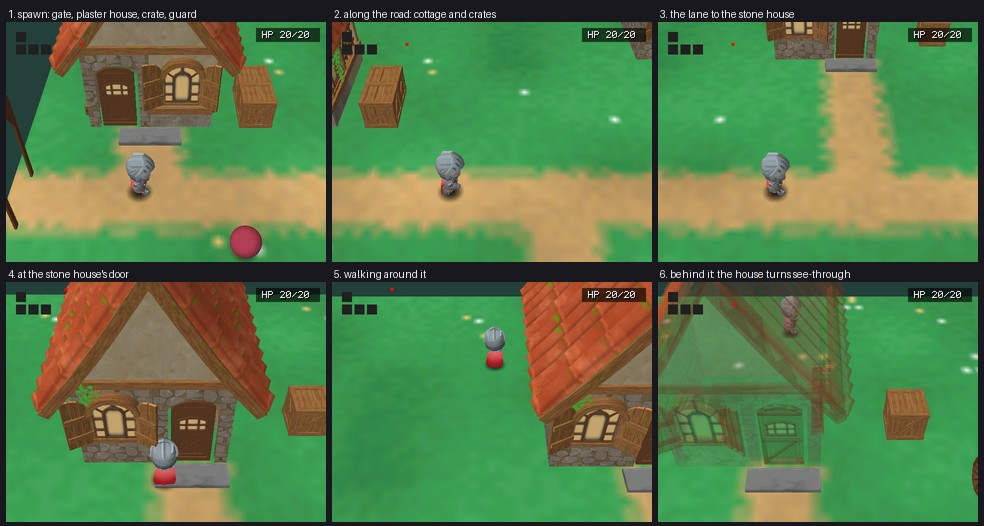
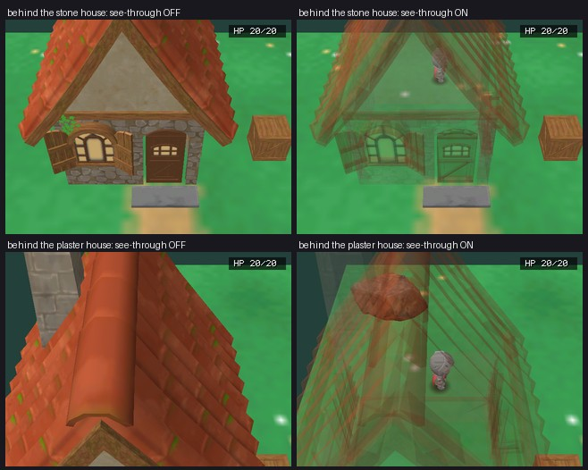
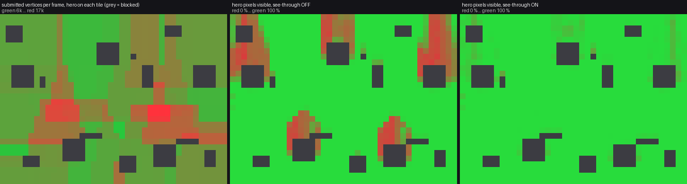

# Slice 3D-2: the village overworld

**Brief:** populate the overworld with the Medieval Village MegaKit and the boulders.
* Test-render every decimated asset: a house must look like a house, with no deformities in the
  windows, door or panels.
* Make village art see-through when the hero walks behind it, so he is nearly always visible.
* Combat stays untouched.

> **Slice 3D-3** ([SLICE_3D_NPCS.md](SLICE_3D_NPCS.md)) replaced the placeholder NPCs with skinned
> characters. The frame-cost numbers below are for this slice's placeholders; with the NPCs the
> sweep is median 11.8k / p95 18.1k / max 26.2k submitted vertices (see that document, §5).

*Real Dreamcast backend (`platform/kos/main.cpp` in kossim): the boot map `village.txt`. In
frame 6 the stone house turns see-through because the hero is behind it.*

## Summary

* **World:** a 40×30 village map.
  * Five houses (two variants, assembled from 9–10 kit pieces each, plus generated gable walls).
  * An arch gateway, a wagon, crates, fences, door-step slabs and five boulders.
  * Dirt roads on natural grass.
  * The same three encounters.
  * Props block movement through their footprints; the field simulation is unchanged otherwise.
* **Quality control:** 21 kit pieces and 13 prefab orientations are render-tested against their
  sources. **All 34 pass** (silhouette ≤ 0.5 %, colour ≤ 1 % in every view, sub-pixel-tolerant).
  * Each piece was decimated to the largest error bound that still passes. For example, the
    window's arch starts faceting at 3 cm, so it stays at 2 cm.
  * Sheets for every piece and prefab are in [`village_qc/`](village_qc/report.md).
* **See-through:** a prop that hides the hero from the camera fades to 25 % (less when very close
  to the camera).
  * Measured with the hero on each of the 1,065 walkable tiles: he is **never less than 67 %
    visible** (median 100 %).
  * Without the fade, 168 tiles hid him by more than half (worst: 7 % visible).
* **Budget:** visible triangles per prop:

  | Prop | Source | Visible in game |
  |---|---:|---:|
  | Houses | 4,609–5,678 | 1,890–2,276 |
  | Boulders | 12,245 / 8,102 | ~1,190 / ~660 |

  * Frame cost over all tiles: **median 9.2k submitted vertices, p95 13.5k, max 17.3k.**
  * VRAM textures: 500 KiB in total. Model RAM: 610 KiB.
  * Estimated SH4 cost at the median is comfortable; the worst ~1 % of tiles is at the edge of
    what the C path can push. `make DIAG=1` measures it (§6).
* **Camera:** the slice-1 camera (4.5 m high) was sized for a lone character and ended up inside
  the 6.8 m roofs.
  * It is now 9 m up and 9 m back (pitch 45°) with a 32° FOV: a diorama look with the hero about
    the same size on screen.
  * It aims 1.5 m ahead of the hero and is clamped to the map.

## 1. Assets: from the kit to the Dreamcast

`tools/dmf/village_kit.py` (kit, recipes) → `tools/dmf/props.py` (pipeline) → `tools/dmf/qc.py` (render QC).

| Step | What | Why |
|---|---|---|
| load | assimp, centimetres → metres, all materials kept (submeshes) | the kit's pieces mix 2–3 materials each |
| decimate | per piece and **per material** (material seams stay exact), **borders locked** (modular joints stay exact), normals + UVs as attributes, an **absolute** error bound per piece (`DECIMATE`) | at the game camera 1 px ≈ 1.2–2.6 cm; bounds are 2 cm for windows, door and walls, 4.5 cm for roof and chimney, 3 cm for the wagon |
| boulders | triangle targets (Boulder02 1,600 with free borders and weak attributes; Boulder03 900) | photo scans with fragmented UV islands; settings chosen by QC |
| assemble houses | 8 wall modules, door, windows, shutters, roof, chimney, vine, plus **generated plaster gable triangles** | the free kit's 4×4 roof is an open A-frame with no gable wall |
| detail where the camera looks | the wall facing the camera (per orientation) gets windows with shutters; one side wall a plain window; the back wall stays plain | the fixed camera sees the side walls edge-on: 1,640 window vertices per house bought almost nothing |
| camera-cone culling | drop triangles that no direction of the overworld camera can see (pitch 20–68°, yaw ±30°; the camera never rotates): roof undersides, interior faces, floors, outward faces of walls turned away | about 40 % fewer triangles with zero visible change (checked by prefab QC) |
| prelight | bake `0.50 + 0.62·max(N·L, 0)` into vertex colour, same light as the runtime (checked) | static props skip lighting at runtime |
| pack | per-texture submeshes (WoodTrim + WoodTrim_Wear merge), strips, 26-direction k-DOP occluder, DMF v2 | fewer PVR headers; the k-DOP drives the see-through test |
| textures | 10 shared DTX files (`romdisk/textures/`): wood, stone, rock trim and roof tiles at 128², plaster and vine at 64² (vine ARGB4444), a baked warm lit-window glass at 32² | one VRAM copy for every house; 242 KiB |

**Result per prop** (triangles):

| Prop | Source | Decimated | Camera-visible | Vertices | File |
|---|---:|---:|---:|---:|---:|
| house_plaster r0 / r180 | 5,150 / 5,678 | 3,692 / 4,138 | 2,077 / 2,276 | 3,113 / 3,447 | 84 / 93 KB |
| house_stone r0 / r180 | 4,609 / 5,159 | 3,239 / 3,707 | 1,890 / 1,990 | 2,707 / 2,876 | 74 / 78 KB |
| boulder02 r0 / r90 | 12,245 | 1,599 | 1,210 / 1,163 | 1,130 / 1,148 | 32 KB |
| boulder03 r0 / r90 | 8,102 | 899 | 653 / 669 | 468 / 462 | 14 KB |
| wagon | 1,672 | 1,018 | 946 | 1,544 | 42 KB |
| crate, fence, border, arch | 230, 40, 16, 196 | 230, 40, 16, 118 | 157, 38, 16, 116 | – | 1–9 KB |

## 2. Render QC (the "does it still look like a house" check)

`tools/dmf/qc.py` writes [`docs/village_qc/report.md`](village_qc/report.md) and one sheet per
piece and prefab (columns: source | decimated | difference heat map).

* **Pieces:** source vs decimated, identical textures and lighting, 8 orthographic views (around,
  high three-quarters, the game camera). QC pixels are 2–4× finer than the game's at the closest
  camera distance.
* **Prefabs:** the raw source assembly vs the final model (decimated and camera-culled), through
  the real game camera from 6 hero positions around each prefab. A third column shows the
  Dreamcast textures.
* **Metrics:**
  * *silhouette*: pixels covered by only one render and more than 1 px away from the other's
    coverage;
  * *bad pixels*: interior pixels whose colour, after a 1-px blur, moved by more than 0.15.

  Both are floored at 1 % of the frame so an edge sliver cannot dominate. The thresholds are
  0.5 % and 1 % per view.
* **The metric finds real defects.** The error-bound sweep and the (rejected) LOD experiment below
  were both decided by it. For the window, 3 cm gives an arch that facets and a bent centre
  mullion, and 4.5 cm makes the arch octagonal. That was confirmed by eye before trusting the
  numbers.

**Results:** 21/21 pieces and 13/13 prefabs pass. The worst house view changes 0.08 % of the
silhouette and 0.45 % of the colours.

**Tried and rejected: distance LOD.**
* A conservative LOD1 (2× bounds, same recipe) saved only ~7 %.
* An aggressive one (free borders, weak attributes, no shutters or vines beyond 16 m) failed QC
  with 3.6–8.6 % changed pixels at 2× the game's density at the switch distance. That means
  visible pops: shutters vanishing, the roof's tile shading sliding.
* Not shipped. The runtime has no LOD code.

## 3. See-through village art

* **Test (per tick, `field3d.cpp update_fades`):** five segments from the camera eye to the hero
  (feet, waist centre, waist left and right, head) are clipped against each fading prop's k-DOP
  (Cyrus–Beck). The segments stop short of the hero, to allow corner slack.
* **Fade:**
  * A hit eases the prop's alpha to 0.25 (0.18 per tick).
  * When a hiding prop is within 5 m of the camera, it goes further, down to 0.12 at 2 m.
  * A prop the camera is inside is not drawn. Otherwise no prop vanishes: it stays a visible
    ghost.
* **Drawing:** faded props go to the TR list with vertex alpha. The PVR sorts translucency per
  pixel, so the ghost blends correctly over the hero.
* **Which props fade:** the catalog says so (houses, boulders, wagon, arch). Crates, fences and
  slabs are too low to hide him.
* **Measured** (`build/preview … --visibility`: three renders per tile give the hero's exact
  pixels, and a pixel counts as visible if the full frame differs from the prop-less frame by at
  most a translucent tint):

| Fade | Tiles | Min visible | p5 | Median | Tiles with hero < 50 % visible |
|---|---:|---:|---:|---:|---:|
| off | 1,065 | 7 % | 18 % | 100 % | **168** |
| **on** | 1,065 | **67 %** | **93 %** | 100 % | **0** |

*Left: frame cost per hero tile. Middle and right: hero visibility without and with the fade.
Grey = blocked by a prop.*

## 4. Runtime changes

| File | Change |
|---|---|
| `src/dmf.*` | **DMF v2** (see [DMF.md](DMF.md)): submeshes, shared `.dtx` textures cached by name, k-DOP, prelit; v1 still loads. Limits: 8,192 vertices per model, 1 MiB arena |
| `src/render3d.*` | **submesh loop**; **alpha → TR list**; **near-plane clipping** (Sutherland–Hodgman in clip space) instead of dropping strips; an AABB-vs-frustum test for static props; a **direct path for prelit static models** that transforms each strip index straight into the PVR arena (pixel-identical to the general path, checked on 4 frames; `-DR3D_NO_DIRECT` for A/B) |
| `src/field.*` | `prop` map lines, prop catalog (`/rd/models/props.txt`), rotated footprints, a blocked-cell bitmap used by collision, patrols and spawn/entity validation. `FieldState` is reset in place (it grew to ~14 KiB) |
| `src/field3d.*` | prop models and instances; see-through fades; new camera (9/9/32°, 1.5 m ahead, clamped to the map); natural ground (value-noise grass, dirt roads with soft edges, bilinear) |
| `platform/kos/main.cpp` | boot map `village.txt`; vertex arena 32,768 (1 MiB); 160 batches; the boot log checks the catalog, a texture and a house |
| `platform/host/preview_main.cpp` | `--place X Y out.png`, `--sweep` (frame cost on every tile), `--visibility` (+ `--no-fade`) |

## 5. Verification

| Check | Result | Where |
|---|---|---|
| Render QC, all pieces and prefabs | 34/34 within thresholds | `tools/dmf/qc.py`, `docs/village_qc/` |
| Hero visibility, every walkable tile | min 67 %, 0 tiles below 50 % (168 without the fade) | `build/preview --visibility` |
| Frame cost, every walkable tile | median 9.2k, p95 13.5k, max 17.3k submitted vertices | `build/preview --sweep` |
| Real KOS backend in kossim | village tour into the see-through house: 736 frames, 0 TA stream errors, every model and texture loads, DIAG reports 500 KiB VRAM, 610 KiB arena, no dropped batches | `make kossim` |
| Static direct path == general path | pixel-identical, including a clipped frame | `-DR3D_NO_DIRECT` build |
| C++ runtime == Python reference | 9.3e-07 on every model, village included | `crosscheck.py` |
| Baked light == runtime light | same direction, ambient, diffuse | runner |
| Map loader | 10 cases: unknown model, bad yaw, footprint off the map (plain and rotated), rotated fit, spawn/entity under a prop, non-blocking prop, the shipped village | `tests/slice3d/check_props.sh` |
| Movement with props | invariants S1–S6 on the village (props block, exact reference model), plane and test maps; float == double | `check_stick.py` |
| Tests catch bugs | **14/14** mutations caught, incl. "props do not block" and "footprint not rotated" | `tests/slice3d/mutate.sh` |
| D-pad gameplay and battles unchanged | pre-3D goldens identical (f32 and f64) | runner |
| Reproducible pipeline | `props.py` rebuilds models, textures and catalog byte-identically | runner with `DMF_PY` |

`tests/slice3d/run.sh`: 46 checks in ~2 min. `DMF_PY=.venv/bin/python` adds the rebuild and
`QC=1` adds the render QC (~10 min).

**Not proven here:**
* real PVR behaviour for TR alpha with RGB565 textures (expected: vertex alpha);
* real SH4 timing of the worst views;
* how the fade feels in motion.

## 6. Flycast / hardware checks for this slice

1. `make clean && make`. The romdisk grows by ~800 KB (`models/village`, `textures`). Boot: the
   serial log must show `FOUND:` for `/rd/models/props.txt`, `/rd/textures/wood.dtx` and
   `/rd/models/village/house_plaster_r0.dmf`, and no `dmf_load` errors.
2. Walk the road, then go behind a house (north of it).
   * The house must turn into a translucent ghost with the hero visible through it, and come back
     when he leaves.
   * A house that is fully opaque or black while "faded" means the TR path is wrong (blend
     state).
3. Look at windows (warm glow), doors, shutters, roof tiles and vines (the leaves need alpha, not
   black squares).
4. `make clean && make DIAG=1`. Walk around for a few minutes, especially the south-east corner
   near the southern plaster house, the costliest spot. Send the log: `worst CPU frame` and
   `3D last frame: … submitted` tell whether the worst views hold 60 fps.
5. If they don't, the levers in order are:
   1. map density (houses ≥ 14 tiles apart already keep ≤ 3 on screen);
   2. `CAM_UP`/`CAM_BACK` (a slightly closer camera frames less);
   3. `ftrv`-based transforms in `draw_static_direct`;
   4. per-piece bounds (QC decides).

## 7. Tuning knobs

| Where | Knob | Now |
|---|---|---|
| `src/field3d.cpp` | `CAM_UP`, `CAM_BACK`, `CAM_FOV_Y`, `CAM_AHEAD` | 9, 9, 32°, 1.5 m (change with `CAMERA_CONE` in `props.py`) |
| | `CAM_CLAMP_TOP/BOTTOM/SIDE` | 7, 3, 4.5 m |
| | `FADE_ALPHA`, `FADE_RATE`, `FADE_SEG_END` | 0.25, 0.18/tick, 0.92 |
| | `NEAR_FADE_DIST`, `NEAR_FADE_MIN`, `NEAR_FADE_CLOSE`, `ALPHA_SKIP` | 5 m, 0.12, 2 m, 0.08 |
| `tools/dmf/props.py` | `DECIMATE`, `BOULDER_TARGET`, `CAMERA_CONE`, `CATALOG` | see file; QC must pass |
| `tools/dmf/village_kit.py` | house recipes, `CAMERA_SIDE`, gable, roof/door/window placement | |
| `romdisk/maps/village.txt` | layout (regenerate or edit by hand; props need a rebuild only for new (model, yaw) pairs) | |

## 8. Open items and next passes

* **Cost:** the worst ~1 % of hero positions submit 16–17k vertices. Measure on hardware first.
* **The ghost look:** a faded house shows its rafters and frames as overlapping layers. A
  dithered or depth-only "cutaway" could be cleaner; it is a stylistic choice to test in motion.
* **Boundaries:** the map edge is still a plain boundary; the camera clamp hides most of it.
  Boulders and fences could frame it.
* **Kit coverage:** the free kit has no gable walls (generated), no corner posts and no trees.
  The PRO kit or other packs would fill these.
* **KayKit update:** the new pack includes the hero's native animation set (Idle, Walking_A/B,
  Running_A, combat, hit and death for Rig_Medium) and weapons (sword_1handed,
  shield_badge_color). `Running_A` would fix the foot slide noted in slice 3D-1, and the combat
  clips are what the 3D battle needs. These are natural next-slice items. `fbx2dmf.py` needs a
  small extension: an identity bone map instead of the Mixamo one, and picking an animation stack
  by name, since these files hold many clips.
