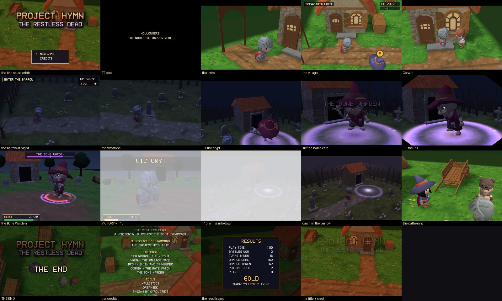
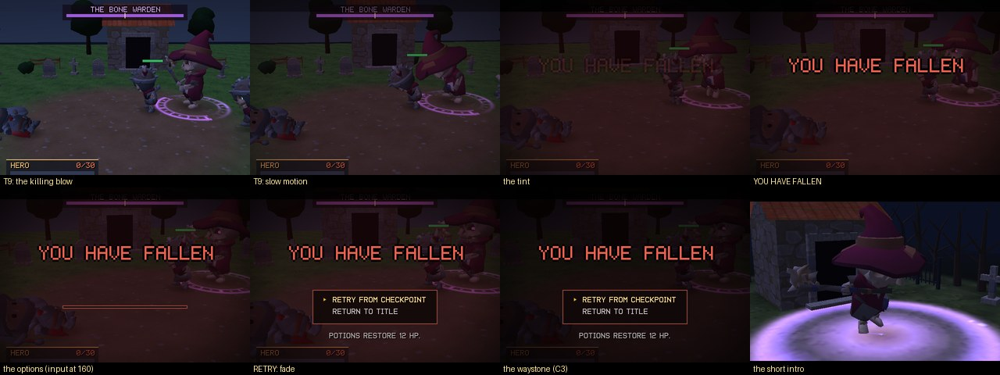
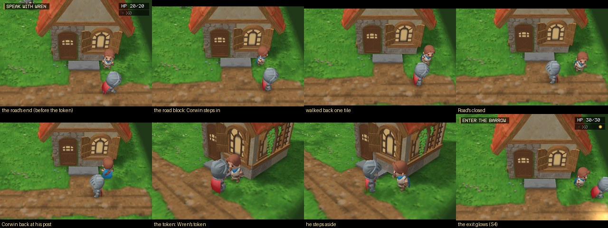

# Slice 3D-6: "Into the Barrow" - the night half, the ending, and the frame around the game

**Brief:** finish the GDD's horizontal slice (`docs/GDD_Horizontal_Slice.pdf`) on the plan
[NEXT_SLICE_BARROW.md](NEXT_SLICE_BARROW.md): a title screen, a new game with its text card and intro, the village half
of slice 3D-5, **Corwin** guarding the east road, the **east exit** to **the Barrow** at night (fog, withered trees,
tombstones, an iron fence, the crypt), the waystone checkpoint, the **Bone Warden's** staging and battle, a **death
screen** with retry from the checkpoint, and the **ending**: dawn, the village's gathering, THE END, the credits, the
results card and back to the title - every mode change a catalogued transition. GDD numbers ("GDD 6") are the GDD's
sections, "plan 5.2" the plan's.

*The full playthrough as the host harness plays it (`tests/barrow/routes/full.route`, rendered from frame dumps with
`tools/render_frame.py`, the PVR-like rasteriser; fog emulated): the title at dusk, T2's text card, the intro, the
village, the barrow at night, the waystone, the Warden's crane with his name card, T5's iris, VICTORY under T10's white,
the barrow at dawn, the gathering by the wagon, THE END, the credits, the results card and the title's crest.*

## Summary

* **The whole horizontal slice plays, title to title.** Boot -> **T1** -> the title (the village at dusk on a slow
  orbit, the logo, PRESS START, NEW GAME / CREDITS; after 40 s idle the **attract demo**) -> **T2** (black, the card
  "Hollowmere. The night the barrow woke.") -> the **intro** cutscene (Rowan walks in through the gate, Wren's `!`)
  -> the village quest of slice 3D-5 with the GDD's lines and stages restored -> **Corwin** blocks the east road
  (he steps in, Rowan is walked back a tile) until he sees Wren's token and steps aside (S4; the exit glows) -> **T7**
  into **the Barrow** (night preset, PVR table fog, the painted barrow ground, withered trees, iron fences, tombs, the
  crypt, a rune ring) -> the **waystone** (heal, checkpoint C3, S5) -> the ring: **T8** (crane from the crypt to the
  Warden rising, THE BONE WARDEN, three lines) -> **T5** (two white flashes, a diamond iris) -> the battle of slice
  3D-4 -> **VICTORY without A** -> **T10** (white) -> dawn in the barrow (a light lerp, the fog lifts), the wisp's line
  -> the village in morning light, Wren, Brom and Corwin by the wagon, the cheer -> the crane up, **THE END** ->
  **credits** (Start skips) -> **results** (time, battles, turns, damage, potions, retries, rank) -> **T11** -> the title
  with its **cleared crest**. Any lost battle -> **T9** -> **YOU HAVE FALLEN**: RETRY FROM CHECKPOINT (the boss: straight
  to his short intro) or RETURN TO TITLE.
* **Everything the GDD calls data is data**: maps (`trigger`, `exit`, `shot`, `glow`, `light`, `trees`, `fences`,
  `asleep`), a map table (`maps.txt`), light presets (`lights.txt`), scripts across maps (`@map`, actor slots bound per
  map), cutscene commands (`move`, `place`, `cam`, `a | b`, `battle`, `map`, `light [lerp]`, `namecard`, `card`,
  `transition`, `credits`, `results`, `title`), the credits roll (`credits.txt`), the demo (`demo/attract.in`). The
  Python twin of the compiler produces a byte-identical dump of all three script files.
* **Within the budgets on every new camera** (host measurement, estimated for the SH4): the barrow's worst tile 10.6k
  written vertices (0.94 M instructions), the title orbit 9.8k (0.99 M), the credits flyover 9.1k, the gathering and
  the crane 16.6k (1.49 M), the field 16.1k (1.43 M), no drops anywhere in the playthrough; 28/32 texture slots,
  980 KiB VRAM, 152 materials, a 1,592 KiB model arena, a 2.88 MB romdisk, no heap allocation after the boot.
* **Tests:** a new suite, `tests/barrow/run.sh` (T1-T14 of the plan); the four older suites updated and green
  (section 7).

## 1. What was built

| Part | Files | What it does |
|---|---|---|
| Game flow | `src/game.*` | one state machine for every mode (title, card, field, dialog/cutscene, to_battle, battle, to_field, map_change, death, credits, results, the attract demo); `trans_start()` = the one entry for the new transitions; input locked while one runs, a fresh press needed after it; the session's stats; the script host (moves, cameras, battles, map changes, cards, screens) |
| Transitions | `src/transitions.*` | the catalogue T1-T11 (GDD 6) and its visuals: fades, white flashes, the 32-segment diamond iris (opaque), a multiplicative tint (`MAT_MULTIPLY`) + overlay + vignette for T9, title cards |
| Screens | `src/screens.*`, `tools/make_logo.py`, `romdisk/tex/logo.tex`, `romdisk/scripts/credits.txt` | the title (logo 256x64 ARGB4444 at 2x, PRESS START, the menu, the crest, the orbit), T2's card, the name card, THE END card, the death screen (tint, YOU HAVE FALLEN, options at 100, input at 160, tips), the credits roll and flyover, the results card and its rank |
| Light presets | `src/lights.*`, `romdisk/maps/lights.txt`, `src/field3d.cpp` | `day` (built in: the look of every earlier slice, bit for bit), `dusk`, `night`, `dawn`, `morning`; a preset relights the props (runtime-lit ones by the light and its colour, PRELIT ones by the tint), re-bakes the characters, tints the ground and sets the fog; a lerp blends in 8-tick steps and lights the characters per frame meanwhile, then re-bakes them two yaw buckets per tick |
| Fog | `eng::set_fog`, `platform/kos/main.cpp` | PVR table fog: `pvr_fog_table_color` + `pvr_fog_table_linear`, and a fogged header compiled for every material; `make NO_FOG=1` never turns it on |
| Maps | `src/field.*`, `romdisk/maps/*.txt`, `romdisk/maps/maps.txt` | triggers (edge-detected, `once` bits in Progress, `if`), exits (closed = blocking tiles), shots, glows, the light, the tree and fence models per map, `asleep` enemies, the looks `watch` (Corwin), `warden` (1.5x), `stone` (the waystone, static); cutscene movement (the hero in sub-pixels, entities tile by tile) and `place` |
| Quest state | `src/progress.*` | Progress gains the map, per-map defeated and trigger bits (32 bytes; a checkpoint carries its map) |
| Scripts | `src/script.*`, `tools/dialog/lint.py`, `romdisk/scripts/{village,barrow,ending}.txt` | every file compiled at boot into one pool; per-map links and actor binding; the cutscene commands and parallel lines; `@script <name> skip`; Start fast-forwards a skippable cutscene (D7) |
| The barrow | `romdisk/maps/barrow.txt` + `barrow.gnd`, `tools/ground/paint_ground.py` (barrow palette), `tools/battle3d/make_props.py` (waystone, dead_tree, iron_fence) | 24x16 at night; the painted ground reuses the village's VQ texture slot (`eng::texture_update_vq`, D5) |
| Corwin | `romdisk/models/corwin.dmf`, `assets/vs1_art/{bodies/corwin,models/ranger}.dmf`, `romdisk/portraits/corwin_*.dtx` | the KayKit Ranger: our body (Blender, 1,000 triangles) + VS1's head (1,929 vertices, as Wren and Brom); 3 portraits; the Warden's 3 portraits |
| Battle | `src/battle*.cpp` | the lost battle ends by itself (the death screen shows it), the boss's win ends by itself 150 ticks after VICTORY (no A), the battle intro's short form (no second name card, BA4), the results card's tallies |
| Attract | `tools/make_attract.sh`, `romdisk/demo/attract.in`, `src/input.*` | the first minute of a new game recorded by the host harness (run-length, 3.8 KB), fed through the input layer; any button returns |
| Harness | `platform/host/*` | `--boot` (the Dreamcast's start), `--path title|credits`, `--probe-view`, story steps `newgame`, `skip`, `death`, `until`, `exit`, expectations `map`, `cleared`, `walkable`, `transition`; T (transition) / R (results) / A (audio) trace lines |

### 1.1 The flow and its transitions (GDD 3, 6)

| Id | Where | Ticks (checked by `tests/barrow/check_flow.py`) | Visual |
|---|---|---|---|
| T1 | boot / T11 -> title | 45 in | fade from black; the logo fades in over the same 45 |
| T2 | title -> intro | 30 out, card mode 15 + 90 (A skips the 90), 30 in | fade to black, the text card, the intro fades in |
| T3 / T4 | field <-> dialog | slice 3D-5 | letterbox, two-shot |
| T5 | field / cutscene -> battle | 8 + 24, then the battle's 12-tick fade in | two white flashes, the diamond iris closing |
| T6 | battle -> field | 24 + 12 (the retry: 30 + 20) | fade through black |
| T7 | map -> map | 20 + 20, + a 30-tick walk-in through an exit | fade through black; the map, its scene, its light, its ground swap at black |
| T8 | the boss ring | a script (`warden_intro`), about 280 ticks watched; the retry's `warden_retry` 60 | letterbox, cut to the crypt, crane to the Warden rising, THE BONE WARDEN, three lines |
| T9 | battle lost -> death | 0.5x for 30, tint 40, title 30; options at 100, input at 160 | grey-red multiply tint, overlay, vignette, YOU HAVE FALLEN |
| T10 | the boss won -> the ending | 48 + 40 | a white flash (8), white (40), from white into the dawn |
| T11 | results / death / credits -> title | 60 (30 from the title's credits), then T1 | fade to black |

Input is locked while a transition runs and a fresh press is needed afterwards (`input_reset`), so a held button never
carries over (GDD 4). The last two ticks before a swap draw nothing but the fade's colour: the swap may rewrite the
ground's texture slot, which the PVR must not have been given in the last 2 frames (`eng::texture_update_vq`).

*T9 and the death screen after a loss to the Warden (`tests/barrow/routes/cp_c3.route`): the killing blow, the slow
motion, the grey-red multiply tint with the vignette, YOU HAVE FALLEN, the options (input from tick 160) with the
context tip, RETRY, and the short boss intro (`warden_retry`) straight from the waystone.*

*The road block and the gate (`tests/barrow/routes/road_block.route`): before the token Corwin steps into the road and
Rowan is walked back a tile; with the token he steps aside and the road's end glows (S4).*

## 2. The content

Scripts: GDD Appendix A verbatim where the systems now exist (`intro`, `corwin_block`, `corwin_main`,
`barrow_stone`, `warden_intro`, `ending`; `wren_main`'s S3-S5 line "Corwin is waiting at the east road."; the
objectives of App. B). Slice 3D-5's AD3 (the Warden on the east road), AD4 (Corwin's lines rewritten), AD6 (stage 6 =
the end) and AD7 (GAME OVER) are undone. Every deviation is marked `# slice 3D-6` in the scripts (22 marks):

| # | Deviation | Why |
|---|---|---|
| BD1 | `intro`: `place rowan 0 15 right` before `move rowan 3 15` | the spawn (C0) is inside the VS1 gate; he has to start outside it to walk in |
| BD2 | `corwin_block`: `move corwin 38 14 \| face rowan corwin` first and `move corwin 37 13` last | GDD 9.3 "Corwin steps in"; the GDD script only faces |
| BD3 | `corwin_main`: `@if stage == 3 && has_token && !gate_open`; `move corwin 38 13` | `stage == 3` is the same state and lets the lint prove the stage only moves forward; (37,12) is inside the VS1 house |
| BD4 | `barrow_stone`: `set stage 5` before `checkpoint c3`; a second touch heals and saves again | the GDD order would save C3 at stage 4, so a retry would need the stone again |
| BD5 | `ring_nudge` (a trigger on the ring at stage 4) | before the waystone the ring would do nothing: GDD pillar 3, no dead end |
| BD6 | `warden(worried)` for the GDD's `warden(angry)` | the portraits have three variants (neutral, happy, worried) |
| BD7 | `warden_retry`: the retry's short form is its own script; the game runs it after a loss to the boss | the checkpoint (C3) is taken before the intro, so a flag set by the intro would not survive the retry |
| BD8 | T10 is the boss battle's hand-over, not `ending`'s first line; `warden_intro` says `call ending` after `battle warden boss` | the white flash must cover the battle, which the script cannot draw over; `goto` cannot cross scripts |
| BD9 | `ending`: the gathering by the wagon, `place wren/brom/corwin` under the fade, Rowan walks 4 tiles | BA2 (the road centre costs ~19-20k vertices with four characters); the GDD's walks are 25 tiles long |
| BD10 | `ending`: `anim brom jump_short \| anim wren ... \| anim corwin ... \| anim rowan ...` for `anim all cheer` | A5's stand-in clip; the parallel line names them |
| BD11 | `ending`: `set stage 6` under `@if stage <= 5`, `set stage 7` before THE END | App. B's S6 / S7; the lint's forward-only check |

Objective by stage (App. B): S0 "Speak with Wren" (Wren `!`, C0), S1 "Defeat the skeleton patrols (n/2)" (C1), S2
"Report to Wren" (Wren `!`), S3 "Show the token to Corwin" (Corwin `!`, C2), S4 "Enter the Barrow" (the exit glows;
the waystone `!`), S5 "Lay the Warden to rest" (the ring glows, C3), S6 none (the ending), S7 the title's crest.

## 3. The barrow (`romdisk/maps/barrow.txt`)

24x16: withered trees round the edge (`trees dead_tree`: a bare trunk and five branches, 62 triangles, procedural),
iron fence runs on the east side (`fences iron_fence`), the old path from the west exit to the rune ring, twelve
tombstones, the crypt north of the ring, the waystone by the path, the Warden asleep in the ring (`asleep`: no contact,
drawn in the first frame of `skel_awaken` - lying - until the intro raises him). Glows: the rune ring (always, dim
purple), the ring at S5 (bright), the waystone at S4, a soft white glow where the Warden fell (the wisp's stand-in, A6).
The ground is painted by `paint_ground.py` with the barrow palette (dead olive grass, grey-brown earth, a pale stone
path, the props' shadows) and night-tinted at runtime. The exit back to the village is closed once the Warden is down
(BA3).

**Night** (`lights.txt`): light from the upper left behind, ambient 0.35, diffuse 0.55, colour 8C99F2 (the arena's), a
blue tint on the ground and the baked props, clear colour 0B1022 and fog of the same colour from 9 to 26 units. The
night reads without the fog (`NO_FOG=1`: the tint and the clear colour carry it). **Dawn**: warm, from the east, a
lighter mauve fog from 18 to 44; the ending lerps night -> dawn over 240 ticks.

## 4. Decisions taken on the way

| # | Decision | Why |
|---|---|---|
| D2 (plan) | all scripts compiled at boot into one pool; `@map` per file; actor slots bound per map | as recommended |
| D5 | the barrow's ground reuses the village's VQ slot | as recommended; 0 extra VRAM |
| D6 | fog on; `NO_FOG=1` kill switch | as recommended |
| D7 | skip = the same ticks run with A pressed every other tick and nothing drawn, within one frame | deterministic (watched == skipped is a test) |
| D8 | Gold < 20 min and 0 retries, Silver < 30 min and <= 2, Bronze otherwise | as recommended |
| D9 | the logo typeset from the dialog font's TTF (`make_logo.py`) | as recommended |
| D10 | the attract demo: a recorded run, fed through the input layer | done (a should) |
| N1 | T5 = 32 ticks (the GDD's 8 + 24) | the GDD; the legacy field goldens were re-recorded (section 7) |
| N2 | transitions other than T3-T6 run on one machine with a swap callback; T5/T6 keep their counters | the existing battle hand-over and its traces stay as they were |
| N3 | characters lit per frame during a light lerp, re-baked after it (2 buckets per tick) | a full re-bake costs ~70 ms: fine under a fade, a hitch in the open |
| N4 | the near-plane prop path reserves at most the arena's room | its bound (5 vertices a triangle) refused whole house batches once Corwin's 2k vertices were in view (5 sweep tiles dropped a batch) |
| N5 | host file I/O at a map change is outside the allocation counter | the C library (like KOS's `fs_open`) allocates a file handle and frees it at close; the game's code allocates nothing |

## 5. Budgets (measured on the host; the SH4 figures are the calibrated estimate of `tests/dialog/sh4_model.py`)

| Scene | Worst written vertices | Drops | SH4 estimate |
|---|---:|---:|---:|
| The village, hero on every tile (`--sweep`) | 15,797 | 0 | 1.56 M |
| The barrow, hero on every tile | 10,592 | 0 | 0.94 M |
| The title's orbit, a whole loop (`--path title`) | 9,833 | 0 | 0.99 M |
| The credits' flyover, both ways (`--path credits`) | 9,093 | 0 | 1.01 M |
| The playthrough by mode: field / dialog (cutscenes, the gathering, the crane) / map change / results | 16,131 / 16,633 / 10,256 / 6,102 | 0 | 1.43 / 1.49 / 0.95 / 0.81 M |
| Battles (slice 3D-4's, unchanged) | 17,434 | 0 | - |

Limits: 18,000 written vertices and 1.60 M instructions per frame (plan D13, until the hardware numbers restate
them in milliseconds). Resources after the boot: 28/32 texture slots (+ the logo and Corwin), 980 KiB VRAM, 152/256
materials, 1,592/1,792 KiB model arena (the barrow's props add 12 KiB at its first visit), 25.2 KiB script pools,
15 portraits cached (480 KiB), a 2.88 MB romdisk; no heap allocation in any tick or draw after the boot over the
playthrough, the boss retry and the demo. Load hitches happen only under black: a map change (the map, its scene,
the characters' re-bake, the ground upload) and the title.

## 6. Hardware: what is not verified here

There is no SH4 toolchain or DreamSDK in this environment: **nothing of this slice has run on a Dreamcast or in
Flycast.** The KOS backend is checked against stub KOS headers in six build flavours; everything else runs on the
host harness (the same game code). Before trusting the slice, run `docs/barrow/HARDWARE_CHECKLIST.md`. The new risks,
each with a switch:

* **Fog** (`pvr_fog_table_linear` maps W through the PVR's fog density register; the host emulation is linear in W):
  if the barrow is fogged wrongly (all grey, or none), `make clean && make NO_FOG=1`.
* **The VQ slot reuse** (`texture_update_vq`): if the barrow's ground is garbled, `GROUND_NO_VQ=1` uploads plain RGB565.
* **`MAT_MULTIPLY`** (the death screen's tint: `PVR_BLEND_DESTCOLOR`/`ZERO`): if the death screen goes black instead of
  grey-red, the overlay and the vignette still carry it - remove the multiply in `trans_draw_tint`.
* **Frame time**: the estimate puts every scene under 1.60 M instructions (~8 ms); the title orbit, the gathering and
  the dawn lerp (characters lit per frame) are the spots to time with `DIAG=1`.
* **The night's brightness** is data: the `night` line of `romdisk/maps/lights.txt` (after the first hardware run it
  was raised: `tint` 6C7CB8 -> 94A2D8, `ambient/diffuse` 0.35/0.55 -> 0.48/0.62, `colour` 8C99F2 -> A8B4FF, fog and
  clear 0B1022 -> 1E2640, fog 9..26 -> 11..30; before / after in `docs/barrow/night_brightness.jpg`). After an edit,
  `make rm-elf && make` (KOS's romdisk image is not rebuilt when only a file inside `romdisk/maps/` changes).
* **Audio** is hooks only: `eng::audio_event(name)` is called at every cue (menus, dialog, battles, stingers,
  transitions) and traced on the host, but the KOS backend's body is empty - there is no sound in this slice.

## 7. Tests

| Suite | Result | Changes |
|---|---|---|
| `tests/barrow/run.sh` (new) | 37/37 | T1 the playthrough from the title (float == double, every transition's ticks, the results card against the run, the audio hooks: `eng::audio_event` fires for menus, dialog, battles, stingers and the transitions, traced as A lines), the rest at the waystone after C3, T2 out of the barrow and back, T4 the boss's loss and retry (C3 byte for byte, the short intro) and RETURN TO TITLE, T5 the road block and the exits, T6 watched == skipped (the intro; the boss intro, the ending and the credits), T8 fog in the dumps, T11 the demo replays its recording tick for tick, T3 budgets (the barrow sweep, the title and credits paths, the playthrough), T12 resources and the heap, T14 the assets rebuild byte for byte, ASan/UBSan |
| `tests/dialog/run.sh` | 34/34 (32/32 with `QUICK=1`) | routes updated for the GDD's stages (Corwin instead of the village Warden; r4 talks to Corwin before and after the token; cp_s3 takes Brom's rest at S1); lint fixtures updated (`cam` is in scope: `unknown_shot`; parallel lines: `only move, anim...`) and five added (an actor of another map, a battle with an NPC, an unknown map, light and transition); budgets restated (30 slots, 200 materials, 1,700 KiB, 32 KiB pools, 3.0 MB romdisk); a dialog's cameras may now see more than the field's (<= 18,000) |
| `tests/vs1art/run.sh` | 13/13 | Corwin in the cast (VS1's ranger head on our body), the barrow's painted ground reproducible, the layout check pins Corwin, the road block and the east exit to GDD 15.2 |
| `tests/battle3d/run.sh` | 19/19 | the game-flow check walks the gate and the barrow to the ending; a loss shows the death screen |
| `tests/run_tests.sh` | 54/54 | the field goldens re-recorded: four differ only in the boot's model lines (Corwin, the waystone load at boot), five by T5's 8 extra ticks and the death screen; the three route-recorded inputs (`field_win`, `field_lose`, `field_full`) re-recorded from their routes; `check_invariants.py` counts the death screen's retry |

## 8. Pointers

* **Next slice (plan):** [NEXT_SLICE_SOUND_SAVE.md](NEXT_SLICE_SOUND_SAVE.md) - audio, VMU save, pause, sign-off.

* HOWTO: §14 (a map's triggers, exits, shots, glows and light; a cutscene; a light preset; a second painted map;
  the title, the credits and the demo). TRIAGE: "Slice 3D-6". The hardware checklist: `docs/barrow/HARDWARE_CHECKLIST.md`.
* Assets and licences: the KayKit Ranger (Corwin) and Skeleton Mage (the Warden's portraits) are KayKit Adventurers /
  Skeletons (Kay Lousberg, CC0, `../KayKit/License_*.txt`); the logo is typeset from "Home Video" (GGBotNet, CC0); the
  graveyard set is procedural (GDD A1's stand-in).
