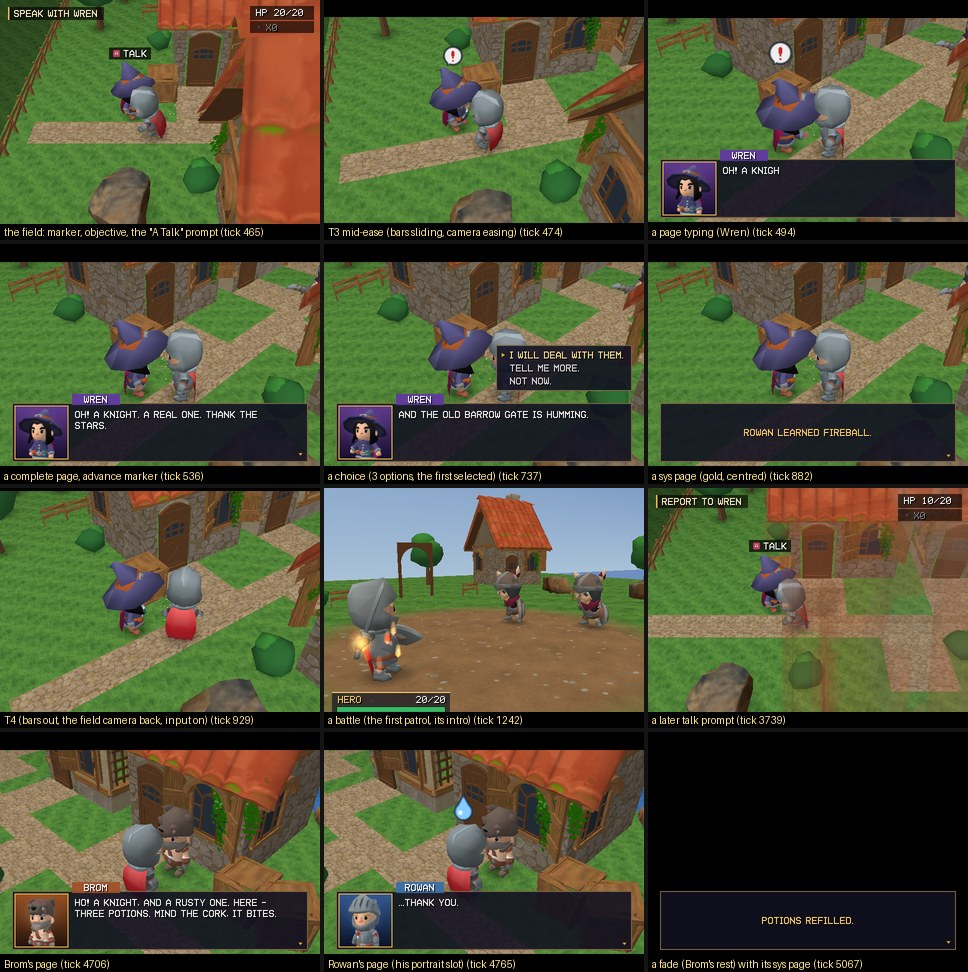
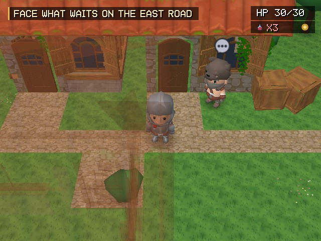
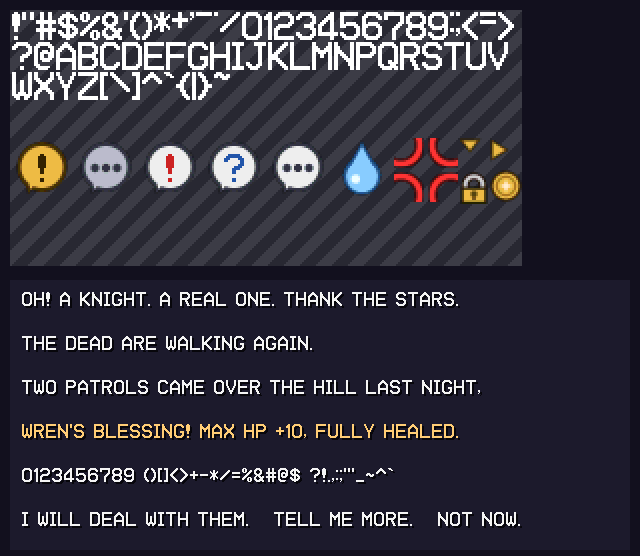
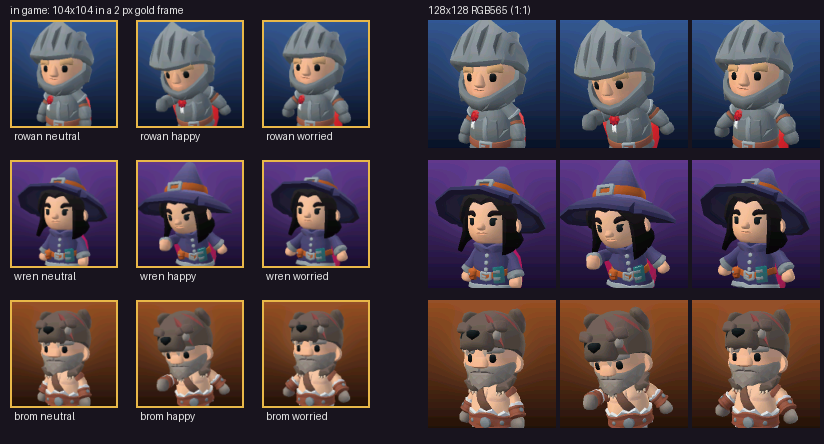
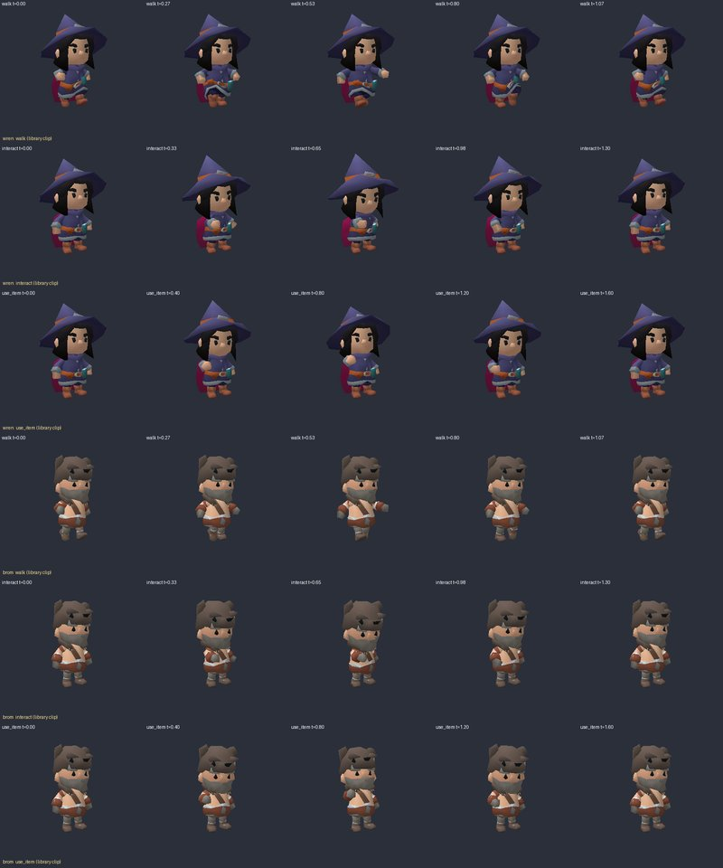

# Slice 3D-5: "Talk to Wren" - dialog, portraits and the village quest

> **Follow-up: the VS1 art** ([SLICE_VS1_ART.md](SLICE_VS1_ART.md)). The village, its props, ground and camera, and
> the characters' heads and textures now come from the uploaded sibling implementation ("VS1"). Superseded here:
> the village map and the NPC places (AD1: Wren and Brom now stand at the GDD's (6,17) and (21,10) - VS1's map is
> the GDD's), the village pictures, the two-shot's pitch/distance (§6), the model sizes (§5) and the budgets (§8).
> The dialog system, scripts, quest, portraits and tests described below are unchanged and pass on the new art.

**Brief:** build, end to end and at production quality, the village half of the GDD
(`docs/GDD_Horizontal_Slice.pdf`): dialog, quest sequencing, talking portraits, the item inventory (potions) and
a playable flow from arriving in the village through every combat encounter, within the Dreamcast budgets. The
plan was `docs/NEXT_SLICE_DIALOG.md` (decisions D1-D11); this document says what was built, what was measured and
what was decided on the way. GDD section numbers ("GDD 7.1") refer to the GDD; "plan 5.2" to the plan.

*Route 1 played by the story driver, rendered from host frame dumps (`tools/dialog/qc_frames.py`; PVR-like
software rasteriser): the talk prompt over Wren, T3 with her `!` emote, a page typing, a complete page with the
advance marker, the choice, the gold `sys:` page, T4, the first patrol battle, a later prompt (objective "Report to
Wren"), Brom's page, Rowan's page in his own portrait slot (with a sweat-drop emote), and Brom's rest: the screen
faded to black with "Potions refilled." in the box.*

## Summary

* **The village half of the GDD plays end to end.** Rowan walks up to **Wren** (the human Mage, new model); a gold
  `!` hangs over her and an **A Talk** prompt appears. Letterbox bars slide in, the camera eases to a two-shot,
  her **portrait** slides in and the **typewriter** tells him the dead are walking. He **chooses** "I will deal with
  them", learns **Fireball** (greyed with a lock in the battle ring until then) and the **objective HUD** reads
  *Defeat the skeleton patrols (0/2)*, counting live. **Brom** (the Barbarian, new model) gives three **potions**
  and later a **rest** (fade to black, full heal, checkpoint) and, from stage 3, one refill. With both patrols beaten
  Wren gives her **token and blessing** (max HP 30, full heal, checkpoint), the **Bone Warden** appears on the east
  road, and beating him ends the village half (stage 6; Wren's closing line). Losing any battle returns, after
  GAME OVER, to the **last checkpoint**, byte for byte. The **inventory** (GDD 1.2: potions, and the quest's token)
  shows under the HP panel on the field and in the battle HUD.
* **Everything is data.** Scripts are plain text (`romdisk/scripts/village.txt`, `speakers.txt`) compiled at load
  into fixed pools (22.7 KiB static; no heap, no parsing per frame) and run by a small VM; the map says who talks
  (`talk`), what a win sets (`win`) and who appears when (`if`); markers are `@marker` rules. A Python twin of the
  compiler (`tools/dialog/lint.py`) produces a **byte-identical compiled dump** and runs every GDD 7.4 check.
* **Every order works** (GDD 17): six story routes (canonical; patrols before Wren; skipping Brom; everyone twice at
  every stage; the "Not now" / "Tell me more" loops; a lost battle and retry) plus two checkpoint routes are played
  by a closed-loop story driver with the battle bot; 174 expectations, float == double tick for tick.
* **Measured against the budgets** (T1/T2): 24/32 texture slots, 656 KiB VRAM, 127 materials, 856 KiB model arena,
  a 1.93 MB romdisk, **no heap allocation** in any tick or draw after the boot, the field's worst frame submitting
  fewer vertices than slice 3D-4's. On the SH4 this is an **estimate** (no SH4 toolchain in this environment): a
  model calibrated on slice 3D-4's qemu measurement puts the field's worst frame at 1.30 M instructions (limit
  1.40 M) and the dialog's at 1.22 M (<= the field's worst). `SH4=1 tests/dialog/run.sh` measures it for real.
* **Tests:** a new suite, `tests/dialog/run.sh`, **34/34** (35/35 with `BPY=`); slice 3D-4's `tests/battle3d/run.sh` **19/19** (its
  game-flow check now walks the quest); the old `tests/run_tests.sh`, red since before 3D-4, triaged to **54/54**.

## 1. What was built

| Part | Files | What it does |
|---|---|---|
| Dialog font | `tools/dialog/make_font.py`, `romdisk/fonts/dialog.tex` + `.fnt`, `src/text.*` | the supplied CC0 font (D1) filled on its exact pixel grid at 2x into a 256x128 ARGB4444 atlas, per-glyph widths; measure, wrap (C++ == Python), draw with colour codes; icons in the atlas's free half (markers, emotes, advance marker, cursor, lock, the token) |
| Scripts | `src/script.*`, `romdisk/scripts/*.txt`, `tools/dialog/lint.py` | compiler (load time, fixed pools, line-numbered errors), VM (blocking pages / choices / waits / fades, 4-deep calls, a 512-op loop guard), the lint (§7) |
| Quest state | `src/progress.*` | the 16-byte `Progress` (GDD 10.1), flags from `@flags`, condition byte code, objective text with `{patrols}`, RAM checkpoints |
| Dialog UI | `src/dialog_ui.*` | T3/T4, letterbox, box, plate, portraits, typewriter, advance marker, choices, `sys:` pages, in-dialog fades |
| Portraits | `tools/dialog/make_portraits.py`, `romdisk/portraits/*.dtx`, `src/portrait.*`, `eng::texture_update` | 9 portraits rendered from the models; two VRAM slots; a RAM cache twiddled at load; the hardware-safe upload rule |
| Field logic | `src/field.*`, `romdisk/maps/village.txt` | `talk` / `if` / `win`, the looks `mage` and `smith`; NPCs block instead of fighting; the facing vector; the talk target (plan 5.1); NPCs stop and face the hero within 3 tiles |
| Field view | `src/field3d.*` | Wren and Brom on the shared animation library (idle / walk, gestures), the two-shot camera with a prop-box search, turn-to, markers / emotes (3D billboards), the prompt, the objective HUD and the inventory, the speaker in the see-through test |
| Game flow | `src/game.*` | the Dialog mode, `after_battle`, checkpoint retry, Progress <-> party, the battle-test "boss-ready" party |
| Battle | `src/ui.cpp`, `src/battle3d_draw.cpp`, `src/battle*` | Fire greyed with a lock until learned (both rings), `Rules.learned_skills` (off under `--rules legacy`) |
| Characters | `romdisk/models/wren.dmf`, `brom.dmf`, `romdisk/anims/rig_medium.dma` (+`walk`) | converted with the 3D-4 pipeline; the library gains the forward `walk` |
| Engine | `src/engine.h`, `platform/kos/main.cpp`, `platform/host/host_engine.cpp` | `texture_update` (KOS: a 32 KiB store-queue copy of pre-twiddled texels), a 20,480-vertex arena, sprite queues reserved up front, boot checks for the 17 new files, the debug pad overlay in DIAG builds only |
| Harness | `platform/host/story.cpp`, `trace_main.cpp`, `battle_bot.cpp` | the story driver (routes), `Q`/`G`/`N`/`I`/`E` trace lines, `--dump-scripts`, `--probe-talk`, `--probe-cam`, `--text-widths`, `--resources`, `--skills`; the bot's greyed-command fallback and the `smart` policy |
| Tests | `tests/dialog/*` | §7 |

### 1.1 Timings (ticks at 60 Hz; all checked tick by tick by `tests/dialog/check_dialog.py`)

| What | Rule |
|---|---|
| T3 (talk) | tick 0 = the A press: the NPC turns to the hero and plays `interact`, the hero turns to the NPC; bars 36 px over ticks 0-11 (ease-out); the camera eases over 20 ticks (smoothstep); the box and the first page at tick 12 |
| Typewriter | a page's first glyph on its first visible tick, then 1 glyph a tick (spaces too), 4 with B held; 6 idle ticks after `.` `!` `?`, 3 after `,` (2 / 1 with B); a run (`...`, `!!`) pauses once, after its last character; no pause at the end |
| A | on a typing page: the whole page at once; on a complete page: the next command. The press is consumed (`input_consume`) |
| Choices | open as soon as the page before them is complete (no advance marker then); first option selected; d-pad edges and the stick crossing +-64 move it, no wrap; A picks; a fresh B picks the `cancel` option if there is one, else nothing; nothing is taken on the tick a choice appears |
| Portraits | the speaker in slot 0 (Rowan in slot 1); a new speaker slides in over 8 ticks; a variant change on a portrait on screen hides it for 2 frames, then uploads (§4) |
| `fade out/in n` | blocks n ticks, the box hidden, the level moving linearly; the fade sits under the box (z 2.9), so a `sys:` page reads in the dark |
| T4 | on the closing tick the mode is the field (the hero moves at once); bars out over 12, camera back over 20; the field HUD returns when the bars are gone |

Measured on the route traces: Wren's stage-0 talk up to the accepted request takes 411 ticks (6.9 s) when every page
types out and stays up half a second; clicked through as fast as the rules allow (A every other tick), 27 ticks.

*The field at stage 3: the objective, HP 30/30 after Wren's blessing, the inventory (three potions, her token),
Brom's `...` marker (his refill is still to come).*

## 2. The content (`romdisk/scripts/village.txt`)

The GDD Appendix A lines are verbatim, except the lines marked `# slice 3D-5` with a reason (the file's header
lists them). The plan's adaptations AD1-AD8 are in the data as planned; this slice added:

| # | Change | Why |
|---|---|---|
| AD9 | One GDD page ("Long ago a guardian was bound under the barrow.\|The Bone Warden. He keeps the dead asleep.") is two pages | the supplied font is wider than the plan's stand-in; the lint's page-fit check flagged it (D1: "the lint decides whether any line needs rewording"). The words are unchanged |
| AD10 | Brom's "Later." branch says "The fire's lit whenever you need it." | GDD 7.3: "the 'no' branch always ends with a line telling the player how to come back"; the lint now enforces it for every `cancel` option |
| AD11 | `@script new_game` sets the first objective ("Speak with Wren") | stands in for the intro cutscene's last command (out of scope) |
| AD12 | `checkpoint c1 / c2 / rest` | names the checkpoint in the traces (`cp_id`); behaviour as in the GDD |
| AD13 | `emote` / `anim` commands (Wren's `!` on meeting, her `use_item` when giving, Brom's, Rowan's sweat drop at "Mind the cork, it bites") | S16: emotes are in scope; the GDD scripts had none in the village half |

Objective by stage (GDD Appendix B, adapted): S0 "Speak with Wren" (Wren `!`, Brom `...`, C0); S1 "Defeat the
skeleton patrols (n/2)" (C1); S2 "Report to Wren" (Wren `!`); S3 "Face what waits on the east road" (Brom `...`
until refilled, C2; the Warden appears); S6 no objective.

## 3. The font (decision D1)

"Home Video" (GGBotNet, CC0, `assets/fonts/`) turned out to be a **pixel font, monospaced, capitals only** (its
lower-case code points carry the capital shapes). D1's rule for a pixel font applied: `make_font.py` fills the
outlines itself on the font's exact grid (every point lies on a 50-unit grid; at 20 px per em one design pixel is
2 screen pixels), no anti-aliasing, nearest filtering - bit-exact and independent of any FreeType version.

| | |
|---|---|
| Size | 2x the design grid: capitals 10x14 px, line pitch 22 (the GDD layout's), a 2 px shadow |
| Widths | per glyph (GDD 7.5): the ink plus one design pixel (`--spacing mono` gives the font's own cells); space 8 px. ~38 characters per 420 px line (the plan's proportional stand-in: ~49; the GDD estimated ~42) |
| Atlas | 66 unique glyph shapes in 45 of the top 64 rows; the icons in the bottom half; 64 KiB VRAM, one texture slot |
| Fit | every shipped page fits 3 x 420 px except the one split above; the widest choice, "I will deal with them.", is 228 px, so the choice box widens from the layout's 236 to 272 px (options may be up to 300 px: the lint checks) |

**Not the GDD's ask:** GDD 7.5 wants "upper and lower case" to be less "shouty" than the 5x7 HUD font. This font
has capitals only, and it was the supplied decision (D1). The scripts keep mixed case, so a mixed-case CC0 TTF drops
in with `make_font.py --ttf` and no code change; the lint then re-checks every page's fit.

## 4. Portraits (GDD 8)

`make_portraits.py` renders high-detail conversions of the same FBX (D10: `convert_model.py --tris 9000
--tex-size 512`, build products only) posed with library clips (neutral `idle_a`, happy `interact`, worried
`hit_a`), head and shoulders, 3/4 view at 25 degrees, a soft three-point light computed per vertex (warm key, cool
fill, rim), 2x supersampled, on a per-character gradient with a glow behind the head, rounded to RGB565. 9 files of
32,800 bytes. The variants are pose-only (KayKit faces are painted on the texture); GDD R3 (alternate face
textures) is the real upgrade.

**In the game:** two VRAM slots (the speaker, Rowan). Two findings shaped the runtime:
* **Upload hazard on hardware.** The KOS loop renders frame N-1 while tick N runs, so rewriting a texture the
  previous frame used can show half of each for a frame. A slot is only rewritten after 2 frames off screen; a
  variant change on a portrait that is showing hides it for 2 frames first (a short blink), which the UI check
  verifies on every upload.
* **Cost and allocation.** KOS twiddles textures in software on upload (~16k texels per portrait, a few hundred
  thousand SH4 instructions), and opening a file allocates a handle. So the speakers' portraits are read once,
  after the scripts load, into a 288 KiB RAM cache, **twiddled there** (the same bit order as KOS's `TWIDOUT`), and
  an upload in play is a 32 KiB store-queue copy (`pvr_txr_load`). The host de-twiddles on upload, and the test
  checks the round trip is exact. If portraits ever show scrambled on hardware, `make PORTRAIT_KOS_TWIDDLE=1` uses
  KOS's own twiddling (the path every other texture takes).

## 5. Wren and Brom

| | Wren (`Mage.fbx`) | Brom (`Barbarian.fbx`) |
|---|---|---|
| Model | 1,094 triangles, 1,068 vertices, 64x64, 49.5 KB | 949 triangles, 1,079 vertices, 64x64, 49.4 KB |
| Silhouette / colour error vs a full conversion ([QC](dialog/characters/qc_wren.jpg), [QC](dialog/characters/qc_brom.jpg)) | 6.95 % / 8.88 % mean | 4.42 % / 7.36 % mean |
| Place (AD1, D2) | (4,13), `patrol 1 0 2` - **now the GDD's (6,17), `patrol 0 -1 3`** (VS1 map) | (28,12) - **now the GDD's (21,10)** |
| Clips (shared library, D9) | `idle_a`, `walk` (new), `interact` (greeting), `use_item` | the same |
| Plate colour | `6038A0` | `A0502A` |

The plan allowed 1,200 triangles each. Measured QC picked the budgets: Wren's wide, thin hat needs ~1,100 (950
gave 8.2 % / 10.5 %), and Brom holds up at 950. The savings went to the vertex budget (§8).

NPCs use the Knight's walk stride for their cadence (same rig). They are lit per yaw bucket like the skeletons,
face the hero (exactly, not in 4 directions) within 3 tiles, and stop their patrol meanwhile. Every look is bound to
the library, so `anim <actor> <clip>` plays on anyone, Rowan included.

## 6. The dialog camera (T3, plan 5.3)

The plan's fixed 25-degree swing put the hero in front of Wren whenever he stood diagonally next to her. The shot
now faces the pair side by side: the camera sits on the south side of the line perpendicular to them, at most
45 degrees off the field camera's heading. That matches the plan's rule (swing away from the hero's side) when the
hero stands south-east or south-west of the NPC. Level with the NPC, the camera needs no swing at all. North-east or
north-west of the NPC, it swings toward his side, which is what keeps the two side by side (the rule's purpose). A
pair on a north-south line gets the full 45 degrees, away from the hero's side. **T-CAM:** the eye is tested against every prop's world box (+0.3 units). The
search tries less turn, then the mirrored turn, then closer, before falling back to the field camera.
`--probe-cam` over every walkable tile within 2 tiles of each NPC spot: **100 of 105 positions get a two-shot**; the
5 fallbacks are east of Wren's patrol end, at the edge of talk range, where the south house's box is in the way.

Pitch 38 degrees and distance 8 are the plan's values. A 32-degree shot was tried: it showed more of the village
but cost about 12 % more SH4 work per dialog frame (the house facades come into view) and showed faces no better
(Wren is in profile under her hat in any two-shot). The speaker is included in the see-through test, so a house
between the camera and either character fades.

## 7. Verification

`tests/dialog/run.sh` (34 checks, ~9 minutes; `QUICK=1` ~3 minutes; `BPY=` adds the Blender rebuild, `SH4=1` the
qemu measurement):

| Check | Result |
|---|---|
| 0 warnings: `src/` and the host harness at `-fsyntax-only` and `-O2` (`-Wall -Wextra -Wshadow`) | pass |
| The KOS backend against stub KOS headers (`tests/dialog/kos_stub`; syntax and types only), 4 build flavours | 0 warnings |
| Lint on the shipped scripts | clean: 4 scripts, 91 ops, 26 pages, 2 choices |
| 23 negative fixtures (missing label, unset flag, unreachable page, page overflow, unknown speaker / variant, 4 options, out-of-scope command, backwards stage, loop with no exit, a loop that never blocks, cancel branch without a page, run off the end, parallel commands, bad condition, unknown actor / clip / script, double space, cancel not last, op and string pool overflow, a file over 16 KiB) | all refused by the lint with the expected message; the 17 the compiler checks also make the game show SCRIPT ERROR with the same message (no crash) |
| Parity: `--dump-scripts` == `lint.py --dump`; text widths and glyph counts C++ == Python | identical (91 ops); 135 strings |
| Talk prompt vs an independent model (1.3 tiles, 60 degrees, nearest, ties) | 34,848 positions x facings on the village, and 34,848 on a test map with Wren and Brom 2 tiles apart (8 exact ties, the lower index wins) |
| Dialog UI rules on a scripted-input fixture (every rule of §1.1; the fixture also runs every VM command the shipped scripts do not use: `face`, `call`, `letterbox`, `take`, `unflag`, `set max_hp`) | 2,362 typewriter ticks, 218 choice ticks, 50 fade ticks ... 0 violations |
| Layout (F4) on frame dumps: bars, box (alpha 0xE0 = 0.88), portrait frame and sprite, plate, text lines and shadows, advance marker, choice box, a centred gold `sys:` page, the HUD (HP, inventory, objective) hidden, every depth layer; the uploaded portrait textures equal the shipped `.dtx` files (the twiddle round trip) | 39 checks on 3 frames, all within 1 px |
| Story routes 1-6 and two checkpoint routes: expectations, dialog UI rules, float == double | 174 expectations, 0 failures; 53 dialogs; tick-exact |
| Routes 1, 2 and 4 end in the same quest state | stage 6, max HP 30, all seven flags |
| Checkpoints: a retry restores Progress byte for byte, the hero's tile, full HP, entities per `defeated` (losses at S0, S1, S3; **S2 has no battle** to lose: both patrols are down and the Warden has not appeared) | 4 retries |
| Fire lock: A on a locked Fire does nothing (twice), Y still selects Guard, Attack works; learned, A confirms all enemies; the bot falls back to Attack | pass |
| Field battles use the quest's max HP (20 at the patrols, 30 at the Warden) | pass |
| 60 legacy turn-level baselines of slice 3D-4 (`--rules legacy`: every skill unlocked) | 60 / 60 |
| Budgets: resources, romdisk, vertices and the arena, heap, SH4 estimate | §8 |
| ASan + UBSan: routes 1-6, the UI route, every lint fixture's load | clean |
| Assets: the font (atlas, metrics, report) byte for byte; with `BPY=`, the library (with `walk`), Wren, Brom and the 9 portraits | byte-identical (3 + 12 files) |

The story driver (`platform/host/story.cpp`) plans 4-connected paths around patrols (with a one-tile margin, so
no battle starts by accident), walks with the stick, faces an NPC until the prompt points at it, presses A,
reads pages (A every other tick, or "paced" for QC), answers choices from a queue (`cancel` presses B, testing the
cancel rule), chases patrols (re-planned as they move), lets the battle bot play, and presses A on GAME OVER.

**The other suites.** `tests/battle3d/run.sh`: 19 / 19. Its game-flow check walked both patrols and expected the
Warden to wake; he now appears with Wren's token, so it walks the quest route (`tests/battle3d/flow.route`).
`tests/run_tests.sh` (the oldest suite) was 33 pass / 21 fail before this slice; task 0.2 triaged it to **54 / 54**:

| Failure | Cause | Fix |
|---|---|---|
| `check_invariants.py` checked nothing | its regex predated the analog hero (it matched no line: 0 field ticks, vacuously "OK") | rewritten for the current trace; F3 is now "the feet box never overlaps a body box" (the tile rule is wrong for box collision: the feet can share a tile without touching). It now also fails if no tick matched |
| 9 field goldens | recorded before the village map and the analog movement | run on `test_field` (the map they were written for) with the sprite battle and the original rules, re-recorded |
| `field_win` / `field_lose` / `field_full` expectations | the key scripts were written for the old tile-stepping hero and no longer reach an enemy | regenerated with the story driver (`tests/inputs/routes/*.route`) and recorded as plain inputs: 1 win / 1 restart / both again |
| 8 battle goldens | recorded before the Fire confirm step (`TargetAll`, an earlier slice, "rules unchanged") | re-recorded; the rules themselves are proven by the 60 turn-level baselines |
| `check_ui_buttons.py` | "A enters targeting" predated the UI keeping the chosen command's icon above the hero | condition updated to the current UI |

(The 3D-4 report said the 21 failures were all field goldens; 8 were battle goldens and 1 the UI check.)

## 8. Budgets (plan 9, T1/T2)

| Resource | 3D-4 | Now | Limit |
|---|---:|---:|---:|
| Texture slots | 19 | **24** (font 1, portraits 2, Wren and Brom 2) | <= 24 / 32 |
| VRAM (textures) | 512 KiB | **656 KiB** (+64 font, +64 portraits, +16 NPCs) | <= 660 KiB |
| Materials | 124 | **127** | <= 140 |
| Model arena | 756 KiB | **856 KiB** | <= 900 KiB |
| Animation library | 252 KiB (28 clips) | **259 KiB** (29: `walk`) | <= 384 KiB |
| Script pools (static) | - | **22.7 KiB** (+26.5 KiB compiler scratch, load time only) | <= 24 KiB |
| Portrait cache (RAM) | - | 288 KiB | - |
| Vertex arena | 16,384 (512 KiB) | **20,480** (640 KiB) | - |
| Romdisk | 1.45 MB | **1.93 MB** (1,926,603 bytes) | <= 2.0 MB |
| Heap allocations per tick / draw | 0 | **0** (counted: routes 1, 4 and a checkpoint route) | 0 |
| Main RAM added (all static) | - | ~0.7 MiB of 16 MiB: portrait cache 288 KiB, arena +128 KiB, font texels + file buffer 128 KiB, NPC lighting +64 KiB, script pools + compiler scratch 50 KiB, portrait file buffers 64 KiB | - |

**Vertices.** Slice 3D-4's field peaked at 13,957 submitted vertices, but its **arena** (everything written: models,
props, ground, shadows) already peaked at **15,844 of 16,384**, which the 3D-4 report did not list. A full arena
silently drops the last batches (props). With Wren and Brom at the plan's 1,200 triangles the peak reached 16,363. The arena is now
20,480 (the TA vertex buffer is 1 MiB) and the NPC meshes were trimmed (§5). On slice 3D-4's own field scripts
(`field_walk`, `field_fuzz2`) the worst frame now submits **13,383** vertices (3D-4: 13,957) and peaks the arena at
16,039. Over the story route: field 13,614 / 16,039, dialog 12,397 / 15,152. No frame drops a batch.

**SH4 instructions - an estimate, not a measurement.** This environment has no `sh-elf` toolchain or qemu (only
PyPI/npm were reachable) and no hardware counters, so slice 3D-4's qemu run could not be repeated. Instead,
`tests/dialog/sh4_model.py` models game-code instructions per frame as s x (40 per transformed vertex + 24 per
written vertex) + K, using the per-vertex costs measured on the SH4 build (`docs/SLICE_SH4ZAM.md` 4.2). s and K are
calibrated so that the 3D-4 build's counters on the same two field scripts reproduce its measured median (0.95 M)
and worst (1.33 M). Dialog frames add ~60 instructions per 2D sprite of game code; the KOS sprite submission
(~200 per sprite, at most ~32 k per frame) is listed separately.

| Frames (this build) | Median | Worst | Limit |
|---|---:|---:|---:|
| Field, `field_walk` + `field_fuzz2` | 0.93-1.02 M | 1.30 M | <= 1.40 M |
| Field, story route 1 | 1.03 M | 1.30 M | <= 1.40 M |
| Dialog, story route 1 | 1.08 M | 1.22 M | <= the field's worst |

The real measurement is one command with the toolchain of `tests/sh4zam/README.md`: `SH4=1 tests/dialog/run.sh`
(`tests/dialog/sh4_budget.sh`). It replays the recorded story route and the UI route on the SH4 build under qemu,
and classifies field, dialog and portrait-swap frames from the host trace of the same run.

## 9. Decisions taken during the slice

| # | Question | Decision |
|---|---|---|
| S-1 | The supplied font is caps-only and monospaced | Used as D1 says for pixel fonts (2x, no AA), with per-glyph widths; flagged as not meeting GDD 7.5's "upper and lower case". A mixed-case TTF is one flag away |
| S-2 | NPC budgets | Wren 1,100, Brom 950 (QC-chosen), below the plan's 1,200, for the vertex budget |
| S-3 | Vertex arena | 16,384 -> 20,480: the 3D-4 build was already at 97 % |
| S-4 | Two-shot | perpendicular to the pair, clamped to +-45 degrees, with a prop-box search; pitch 38 / distance 8 (the plan's) after measuring 32 degrees |
| S-5 | Portrait uploads | RAM cache twiddled at load + the 2-frame rule; `PORTRAIT_KOS_TWIDDLE=1` fallback |
| S-6 | `sys:` pages inside a fade | the in-dialog fade sits under the box (z 2.9) so Brom's "Potions refilled." reads in the dark |
| S-7 | Brom's "Later." | a line added (GDD 7.3); the lint enforces the rule for every cancel option |
| S-8 | Debug pad overlay (KOS) | only in `DIAG=1` / `INPUT_OVERLAY=1` builds: it sat on the objective HUD |
| S-9 | Retry when the hero's checkpoint tile is taken by a walking NPC | the hero may always step out of an NPC he overlaps (NPCs block only moves that start a new overlap) |
| S-10 | A script with no page or choice (e.g. `after_battle` when nothing applies) | runs within the tick, no Dialog mode (plan 5.3) |
| S-11 | Where the inventory shows outside battle (the brief asks for the item inventory; the plan had none on the field) | a panel under the HP panel: the potion icon and count (greyed at 0), Wren's token (a new atlas icon) once given; hidden with the rest of the field HUD |

## 10. Not done / to check on hardware

* **No DreamSDK build, no Dreamcast run, no qemu measurement in this environment.** The KOS backend changes are
  small (`texture_update` with `pvr_txr_load` / `pvr_txr_load_kimg`, `reserve_queues`, the arena size, boot checks,
  the overlay switch). They were checked against stub KOS headers, but only for syntax and types. **First step:
  `make clean && make` under DreamSDK, then run `docs/dialog/HARDWARE_CHECKLIST.md`.**
* The twiddle order of the portrait cache follows KOS's `TWIDOUT` macro and round-trips exactly on the host; only
  hardware shows that the PVR agrees (scrambled portraits -> `make PORTRAIT_KOS_TWIDDLE=1`, TRIAGE).
* SH4 frame costs are estimates (§8) until `SH4=1` or a `DIAG=1` run on hardware.
* Not in this slice (plan 1.3): the title, intro and ending; transitions T1, T2, T5-T11; Corwin, triggers, exits and
  the barrow map; stages S4, S5, S7; the death-screen presentation (a loss still shows GAME OVER, now retrying from
  the checkpoint); VMU saves; audio; the pause menu; portraits of Corwin, the Warden and the skeletons.

**Licences.** Font: "Home Video" by GGBotNet, CC0 1.0 (`assets/fonts/README.md`, the licence in the font's name
table). Wren, Brom and the `walk` clip: KayKit Adventurers / Animations by Kay Lousberg, CC0
(`KayKit/License_*.txt`). The portraits are rendered from those models; the icons are drawn procedurally by
`make_font.py`.
