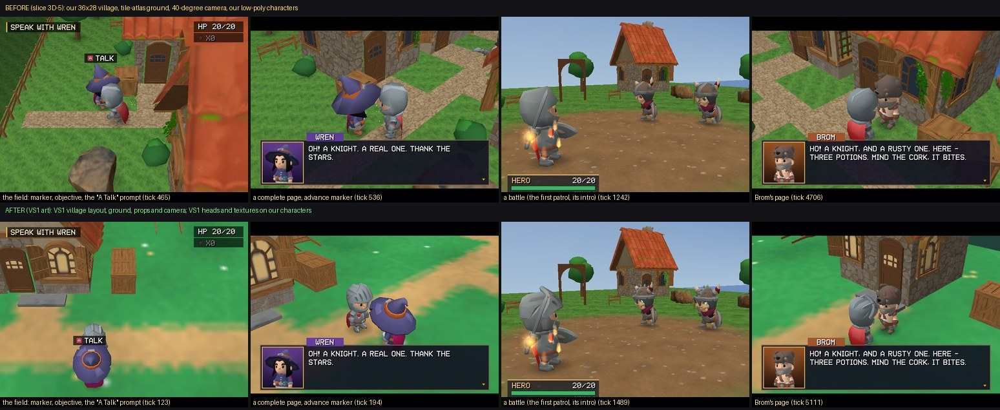
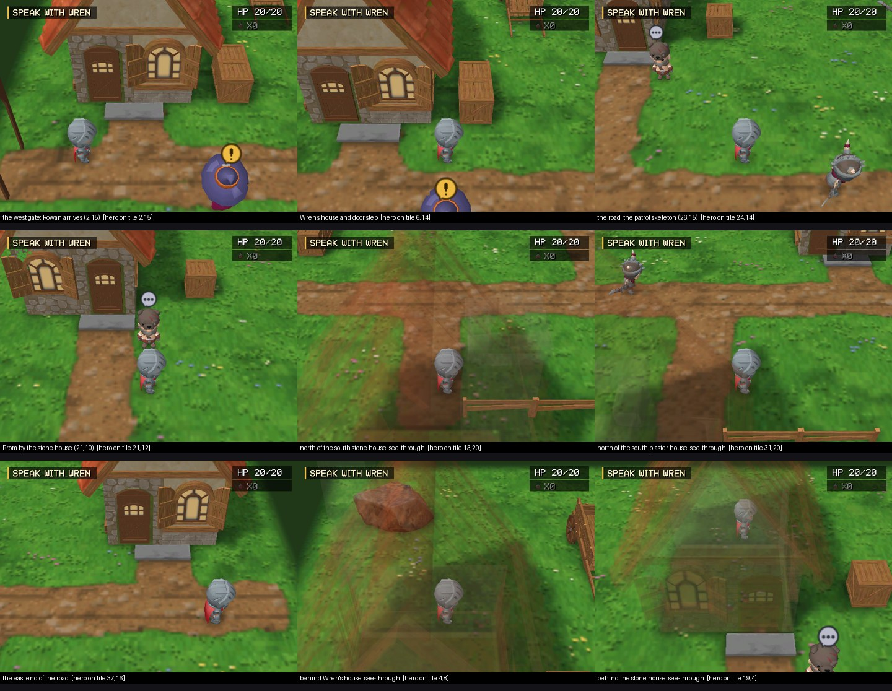
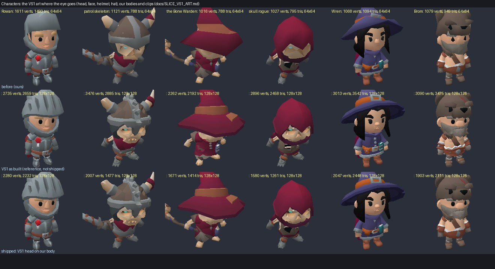
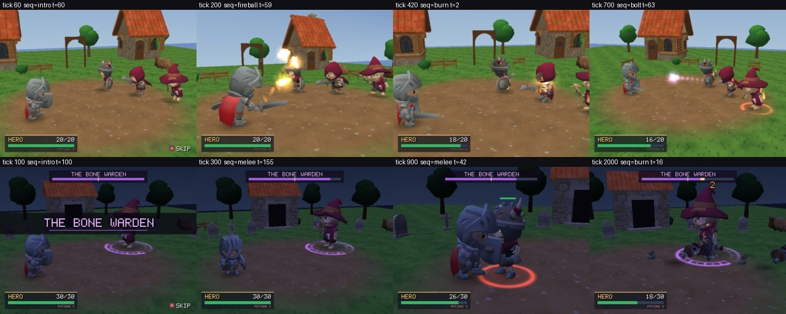
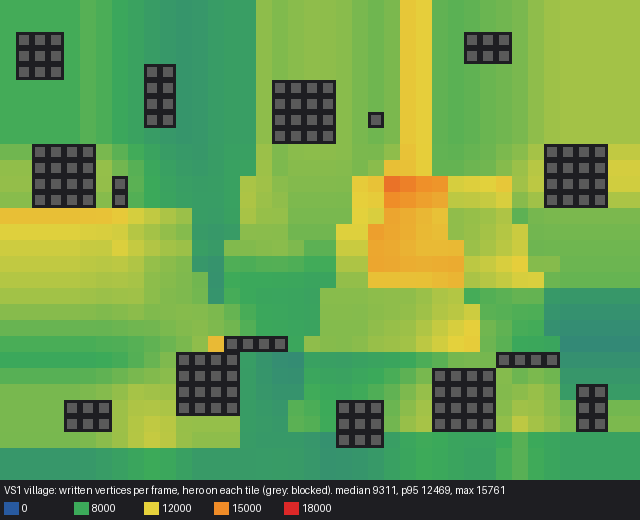

# The VS1 art in the 3D-5 game: village, characters and enemies

> **Follow-up: the ground art pass** ([GROUND_ART.md](GROUND_ART.md)). VS1's generated ground (V5, §3 "Ground")
> read as washed out; the village now has a painted ground (12 texels per tile, the kit's palette, prop shadows,
> VQ-compressed, 66 KiB). VS1's generator still serves maps without a painted ground. Frame costs are unchanged;
> VRAM 916 KiB, romdisk 2.45 MB.
>
> **Next slice:** [NEXT_SLICE_BARROW.md](NEXT_SLICE_BARROW.md) (Corwin, the Barrow, the death screen, the ending, the title).

**Brief:** a different implementation of the village was uploaded (`larp2_3d_vs1.zip`, called **VS1** here). Reconcile
what we have - the slice 3D-5 game: dialog, portraits, quest, inventory, the 3D battle - but with VS1's art for the
**village**, the **character model** and the **enemies**, where that is not too expensive. VS1 looks better,
particularly the village.

*The same four moments of the story route, played by the story driver and rendered from host frame dumps
(`tools/dialog/qc_frames.py`): the talk prompt, Wren's first page, the first patrol's battle, Brom's page. Top: slice
3D-5 as delivered. Bottom: with the VS1 art.*

## Summary

* **The village is VS1's.** Its 40x30 map - which is also the map the GDD describes - with VS1's five houses, gate
  arch, door steps, wagon, crates, fences and boulders, converted **losslessly** from VS1's files: every triangle
  lands where VS1 put it, with VS1's UVs, baked lighting and 128x128 textures (checked with VS1's own reader). VS1's
  **ground** (a generated texture over the whole map: noisy grass, soft-edged dirt roads, flower specks) is ported
  bit for bit, and its **camera** (9 up, 9 back, 32-degree lens, clamped to the map) and character scale are adopted.
  Props that hide the hero turn see-through by VS1's rules.
* **The story moved onto it without changes to the scripts or the quest.** Rowan arrives at the west gate (2,15),
  Wren stands at (6,17) and Brom at (21,10) - the **GDD's positions**, which our old map could not host (slice 3D-5
  adaptation AD1 is undone) - and the patrols at the GDD's (31,6) and (26,15). All six story routes, the checkpoint
  routes, the talk-prompt and dialog-camera probes pass unchanged.
* **Characters and enemies: VS1's art where the eye goes.** VS1's characters are the same KayKit models built
  finer (2,300-3,500 vertices each, 128x128 textures); ours had lost skulls, eyes and helmet crests at 800-1,500
  triangles. Used whole, they are too expensive: with VS1's hero and skeletons the field's worst frame reaches
  **20,136 vertices and drops batches**. What ships instead is **VS1's head parts** (helmet, face, skull, jaw,
  glowing eyes, hat, hood - exactly VS1's triangles and texture) **on our bodies** (our skeleton, clips and body
  triangles): Rowan, the skeleton warrior, the Bone Warden, the skull rogue, Wren and Brom. Next to VS1's whole
  models they are hard to tell apart ([cast](vs1art/cast.jpg)); they cost +550 to +980 vertices each. VS1 never
  built Brom, the Warden or the rogue: their heads come from VS1's own converter (vendored) with VS1's recipe.
* **Cost.** The field is **cheaper** than before in the typical and the worst frame: with the hero on each of the
  1,065 walkable tiles, median 9,311 written vertices (was 10,935), p95 12,469 (14,144), worst 15,761 (16,481); the
  SH4 estimate's worst is 1.42 M instructions (1.39 M). The **battle** pays for the heads: its worst frame (the road
  squad's overview: four VS1-headed characters) is **17,434 vertices, 1.57 M** (was 13,939, 1.27 M). Both are inside
  the budget set for this change (18,000 vertices, 1.60 M, no dropped batch; §6). Getting there took three changes:
  moving VS1's wagon out of the road patrol's path (-1.8k in the worst view), drawing the ground as row strips
  (2 vertices per tile instead of 4), and fixing the near-plane path of props under the camera, which the frame-cost
  sweep exposed (a VS1 house under the camera was sent as 6,900 one-triangle strips: -3.3k, pixel-identical).
* **Tests:** a new suite, `tests/vs1art/run.sh` **12/12**; `tests/dialog/run.sh` **35/35** (with `BPY=`),
  `tests/battle3d/run.sh` **21/21** (with `BPY=`), `tests/run_tests.sh` **54/54**.

## 1. VS1, and what "its art" is

VS1 (`larp3-2/`) is a sibling of this project: the same GDD and the same asset kits, a different path from slice
3D-1 on. Its field has no battle in 3D, no dialog and no quest; its art pipeline went further than ours.

| | Ours (slice 3D-5) | VS1 |
|---|---|---|
| Village map | 36x28, our own layout (6 houses, 23 trees, 133 fence segments, a cobbled plaza) | 40x30, the GDD's map: 5 houses at least 14 tiles apart, a road across, door paths |
| Houses | Quaternius kit, view-culled per yaw, 686-1,191 triangles, lit at runtime, 64-128 px textures | the same kit with VS1's recipe: windows with shutters on camera-facing walls, generated gable walls, **warm lit-window glass**, vines, 1,890-2,276 visible triangles, **lighting baked into the vertices**, 128 px textures |
| Ground | a tile atlas: one 64x64 cell per tile, hard tile edges | **one generated texture** over the map, 4 texels per tile, bilinear: soft grass noise, dirt roads with frayed edges, flower specks |
| Camera | FOV 40, pitch 45, 10.5 units, follows the hero | FOV 32, 9 up / 9 back, aimed 1.5 tiles ahead, leads the motion, **clamped to the map** |
| Characters | KayKit, Blender edge collapse to 790-1,490 triangles, 64x64 | KayKit, meshoptimizer per part with an error bound (faces at 5 mm), hidden-surface pass, 2,270-3,000 triangles, 128x128; skeleton eyes drawn unlit cyan |
| Files | our DMF (32-byte vertices, linear textures, shared PNGs) | its own DMF variant (24-byte vertices, pre-twiddled `.dtx`, pre-rotated per-yaw variants, bake in the normal bytes, k-DOP occluders) |

Adopting "its art" therefore means its **files** (props, textures, character heads), its **layout** and its
**generated ground**, and the **view** it was composed for (camera, character scale, see-through rules) - on our
runtime, with our game on top.

## 2. Decisions

| # | Decision | Why |
|---|---|---|
| V1 | **Convert VS1's files, do not rebuild the art.** `tools/vs1art/import_props.py` turns the 13 prop variants and 10 textures into our formats; every triangle, UV and baked colour is kept (`check_props.py`) | VS1's props were QC'd against the kit by VS1 (34 render checks); rebuilding them would need its whole pipeline and re-verification. A converter is small and provable |
| V2 | **Keep VS1's baked lighting**: a `PRELIT` header flag (docs/DMF.md); `r3d::prelight()` copies the vertex colours | VS1's files no longer have normals (the bake replaced them); its light is within a few degrees of ours (0.50 + 0.62 N.L vs 0.55 + 0.50) |
| V3 | **VS1's map, which is the GDD's.** Tiles and props as VS1 placed them; the entities at the GDD's coordinates: Rowan (2,15) at the west gate, Wren (6,17) walking between the road and her door (`patrol 0 -1 3`, GDD 9.1), Brom (21,10) beside the stone house's door path, the patrols (31,6) and (26,15). The Warden keeps slice 3D-5's AD3 role at the road's east end (38,15) | the GDD was written against this map: AD1 (Wren and Brom moved) is undone. No script, quest or encounter changed |
| V4 | **Move one VS1 prop: the wagon**, from beside the road patrol (25,9) to the open north-west (10,6) | it stood where both patrols, Brom and the stone house share a view: moving it lowers the worst field frame from 17,577 to 15,761 vertices (§6). Nothing else was moved |
| V5 | **Port VS1's ground generator bit for bit** (`build_ground_texture`, field3d.cpp), one 256x128 RGB565 texture for any map (4-8 texels per tile), the padding holding VS1's outer colour for the border tiles | the ground is most of what makes VS1's village look soft. `check_ground.py` compares it with an independent transcription of VS1's code |
| V6 | **VS1's camera and character scale** (0.66, VS1's 1.55-unit characters), the clamp included; the dialog two-shot re-tuned for the smaller characters (pitch 32, distance 7.5, look-at 0.85; a pair on a near north-south line tries the mirrored full turn before a half turn) | the village was composed for that lens: at most three houses in view, doors and windows in proportion. `check_camera.py` checks every field frame of route 1 |
| V7 | **Characters: VS1's head parts on our bodies** (`import_chars.py --body`): the head is every triangle rigid on the `head` bone - KayKit heads, hats and helmets are separate meshes, so no triangle mixes the two sources. Skeleton, rest pose and clips stay ours (battle, library and field animation unchanged); the texture is VS1's 128x128 | VS1's whole models are 2.3-3.5k vertices (3x ours): with them the worst field frame is 20,136 vertices with dropped batches, the worst battle 19,775. The heads carry nearly all the visible difference (skulls and teeth, eyes, the helmet crest, the hat's shape) for +550 to +980 vertices |
| V8 | **VS1's converter for the heads VS1 did not build** (Brom's Barbarian, the Warden's Skeleton_Mage, the rogue's Skeleton_Rogue): `tools/vs1art/vs1_fbx2dmf.py`, vendored unchanged, run with VS1's recipe | the same look for the whole cast. The vendored converter reproduces VS1's uploaded skeleton and Mage byte for byte, so the three new builds are what VS1 would have made |
| V9 | **The skeletons' eyes glow unlit** (VS1's cyan `78FFE6`), in the field and the battle; the Warden's stay purple in his battle | VS1 draws its `Glow` material unlit; lit, the eyes were dark on the shadow side |
| V10 | **See-through as VS1**: houses, boulders, the wagon and the gate arch fade when they cover the hero (VS1's catalog); a hiding prop closer than 5 units to the eye fades further (to 0.12 at 2 units); the eye inside a prop's box: not drawn. Blob shadows only under runtime-lit props | VS1's camera is 9 units up: a house south of the hero fills the lower screen |
| V11 | **The battle arena keeps its own (view-culled) houses and grass**, but its houses take VS1's textures automatically (same kit UVs, same `/rd/tex/` names) | VS1 has no battle; the arena's houses are cut to the battle cameras (1,460-1,564 vertices vs VS1's 2,700-3,400). Their source models moved to `assets/arena_src/` |
| V12 | **Budgets for this change** (§6): <= 18,000 written vertices per frame anywhere, no dropped batch, <= 1.60 M estimated SH4 instructions; 28 texture slots, 1 MiB of textures, 160 materials, 1,600 KiB of model arena, 2.5 MB romdisk | the previous limits (14k-15k vertices, 1.40 M) were set as "no worse than slice 3D-4's measured worst". The field stays there; the battle's road squad exceeds them by ~25 % for the four VS1 heads, with a per-model switch back (the bodies are kept) if hardware disagrees |

## 3. The village

*Host renders, hero on nine tiles (`battle_trace --sweep --dump`): the west gate, Wren's house, the road patrol,
Brom at the stone house, the east end, and four see-through views (the south houses fade when the hero walks north
of them; behind a house it becomes a ghost, as in VS1).*

**Props** (`romdisk/models/<name>_r<yaw>.dmf`; VS1 built one variant per yaw the map uses, with the faces its camera
cannot see removed):

| Model | Triangles / written vertices (ours before) | VS1 |
|---|---:|---:|
| `house_plaster_r0` / `_r180` | 1,191 / 2,301 ; 848 / 1,674 | 2,288 / 3,680 ; 2,506 / 4,038 |
| `house_stone_r0` / `_r180` | 1,146 / 2,212 ; 686 / 1,306 | 2,100 / 3,270 ; 2,210 / 3,456 |
| `wagon_r0` | 300 / 750 | 1,024 / 1,672 |
| `boulder02_r0` / `_r90`, `boulder03_r0` / `_r90` | 319 / 631, 180 / 294 (two models) | 1,502 / 1,942, 1,445 / 1,903, 835 / 1,021, 833 / 1,009 |
| `crate_r0`, `fence_r0`, `arch_r90`, `border_r0` (door step) | 110, 24, 90, - | 158, 38, 128, 20 |

A VS1 prop costs 1.5-5x ours (the boulders most); but the village has only **22** of them (ours had 180
instances: 133 fence segments, 23 trees, 8 bushes, 6 houses...) and VS1's narrower lens frames less of it.

**Conversion details** (`import_props.py`): VS1 stored each variant pre-rotated into world orientation; ours are
stored un-rotated by `mat_trs_y(-yaw)`, so `prop house_stone 13.0 24.0 180` draws every vertex back where VS1 had it
(`check_props.py`: positions within 1e-5). Submeshes become batches with one material each, double-sided as VS1 drew
them (VS1 runs with PVR culling off). VS1's k-DOP occluders are dropped: our see-through test is screen-space.

**Textures** (`romdisk/tex/`): VS1's 128x128 `brick`, `rocktrim`, `boulder02`, `boulder03`, its `roof`
(`rooftiles`), `ubrick` (`stonewall`), `wood`, 64x64 `plaster` and `vine`, and the new 32x32 lit-window `glass`.
They replace ours under our names: same kit, same UVs, so the battle arena's houses are sharper too. The RGB565
ones survive the PNG round trip bit for bit (the loader truncates, the unpacking rounds); VS1's ARGB4444 vine
becomes ARGB1555 (its leaf edges cut at 50 % alpha: 468 of 4,096 texels were partly transparent).

**Ground:** one 256x128 RGB565 texture (64 KiB), VS1's algorithm: grass `3E9E55` at 86-108 % brightness from
value noise on a 3-tile lattice plus per-texel jitter, paths `C9A46A`, flower tiles with 1-in-11 white or yellow
specks, path edges mixed half-and-half with the grass beside them on two texels in three. Texels per tile: the
largest of 8/4/2/1 that fits (the village: 4). It is regenerated only when another map loads (`texture_update`,
same size). Drawing: rows of the grid go out as strips; quads beyond a screen edge end a strip; quads across the
near plane go through the clipper; border tiles sample the padding (VS1's outer ground `24403A`, also the clear
colour now).

**Camera:** `field3d.cpp` tunes `cam_fov` 32, `cam_pitch` 45, `cam_dist` 12.73, `cam_look_h` 0.55, `cam_ahead` 1.5,
`cam_follow` 0.14, `cam_lead` 1.6 at `cam_lead_rate` 0.035 (the lead follows the hero's actual motion: none while
blocked), clamp 4.5 / 7 / 3 tiles (sides / north / south). At the west gate and the east end a sliver of the outer
ground shows at the side, as in VS1.

## 4. Characters and enemies

*Top: ours as shipped in slice 3D-5. Middle: VS1's whole models (reference, not shipped). Bottom: shipped - VS1's
head parts and texture on our body. Rendered with `tools/battle3d/preview.py` in a library idle.*

| Character (model) | Ours before: verts / tris / texture | VS1 whole | Shipped | + vertices |
|---|---|---|---|---:|
| Rowan (`knight`) | 1,611 / 1,490 / 64x64 | 2,735 / 2,659 | 2,280 / 2,232 / 128x128 | +669 |
| skeleton warrior (`skel_warrior`: the patrols, the battle) | 1,121 / 788 | 3,476 / 2,885 | 2,007 / 1,477 | +886 |
| the Bone Warden (`skel_mage`) | 1,016 / 788 | 2,262 / 2,192 * | 1,671 / 1,414 | +655 |
| skull rogue (`skel_rogue`, battle) | 1,027 / 795 | 2,896 / 2,458 * | 1,580 / 1,261 | +553 |
| Wren (`wren`, the Mage) | 1,068 / 1,094 | 3,013 / 3,542 | 2,047 / 2,448 | +979 |
| Brom (`brom`, the Barbarian) | 1,079 / 949 | 3,090 / 3,475 * | 1,903 / 2,111 | +824 |

\* built here with VS1's converter and recipe (V8).

**What was tried first** (field worst frame with the hero on every tile; the battle's worst of six bot battles):

| Characters | Field worst | Battle worst |
|---|---:|---:|
| ours (slice 3D-5), VS1 village | 13,201 | 13,939 |
| VS1 whole hero + VS1 whole skeletons | **20,136, 20 dropped batches** | 19,775 |
| VS1's converter with coarser bounds for the skeleton (0.05-0.2 units, faces kept) | ~17.5k: the model does not go below ~2,850 vertices (UV seams and part borders) | - |
| VS1 heads on our bodies (shipped), wagon where VS1 put it | 17,577 | 17,434 |
| the same, wagon moved (V4) | **15,761** | **17,434** |

Our own Blender converter at 1,100-1,500 triangles with 128x128 textures was also tried for the skeleton: the
helmet's spikes come back, the skull's teeth and eye sockets do not (VS1 simplifies per part with the face's own
error bound; edge collapse does not).

**How the merge works** (`import_chars.py`): VS1's model is converted (its armature root `Rig_Medium`, identity and
unweighted, dropped; its bone-1 weight becomes our bone-0 weight), its head triangles are taken with their strips,
our body's other triangles with theirs, the vertices re-sorted into skin groups (the untextured eye vertices last
and contiguous, as the battle's eye recolouring expects), and the file gets our body's bone table, rest pose and
embedded clips and VS1's texture. The two skeletons agree to 1.1e-5 units (FBX loader noise); `check_chars.py`
poses both and compares the heads.

The **portraits** are unchanged: they are rendered from full-resolution conversions of the same FBX files, which
have the details the old low-poly heads had lost.

*The road squad's battle (top: intro, Fireball, burn, a bolt) and the Bone Warden's (bottom): Rowan's crested helm,
the skulls with cyan eyes (the Warden's purple), on the unchanged arena (now with VS1's sharper kit textures).
The whole story route on the new art: [dialog_qc.jpg](vs1art/dialog_qc.jpg).*

## 5. Runtime changes

| File | Change |
|---|---|
| `src/dmf.h/.cpp` | `DMF_PRELIT` flag (rejected on skinned models); model arena 1,024 -> 1,792 KiB |
| `src/render3d.cpp/.h` | `prelight()` copies baked colours for PRELIT models; **near-plane path**: the in-front triangles of a prop crossing the near plane go out as runs of its own strips (a run starting on an odd triangle repeats a vertex to keep the winding), those wholly off screen are dropped, only the crossing ones are clipped (was: every triangle a 3-vertex strip, and not counted in the stats). `set_near_strips(false)` keeps the former path for the A/B test |
| `src/field3d.cpp` | VS1 ground (generator, 256x128 texture, row strips, border in the padding); VS1 camera (lead, ahead, clamp; tunes); character scale 0.66; two-shot tuning and the north-south candidate order; see-through set and near fade, `ALPHA_SKIP`; no blob shadows under PRELIT props; PRELIT colour sets shared across yaws; unlit eyes in the baked NPC/enemy lighting; lighting buffers sized for the new characters (2,304 vertices, a 7,680-vertex pool); clear colour = outer ground |
| `src/models.h/.cpp` | `models_glow_range()` (the eyes' vertex range; battle and field) |
| `src/battle3d_draw.cpp` | baked-light buffers 2,304 vertices; every skeleton's eyes unlit (the Warden's purple) |
| `platform/host/trace_main.cpp` | `--sweep` (frame cost with the hero on every walkable tile: `S` lines); the `V` line gains `eye=` |
| `platform/kos/main.cpp` | boot checks for `house_stone_r0.dmf`, `wagon_r0.dmf`, `glass.png` (the retired `house_stone.dmf` dropped) |
| `romdisk/` | the VS1 props and textures, the six characters, the map; retired: `house_plaster.dmf`, `house_stone.dmf` (all-yaw houses), `wagon.dmf`, `crate.dmf`, `boulder_a.dmf` |
| `tools/vs1art/` | `import_props.py`, `import_chars.py`, `build_chars.sh`, `sweep_map.py`; vendored from VS1: `vs1_fbx2dmf.py`, `dmf_format.py`, `pvrtex.py`, `raster.py` |
| `assets/vs1_art/`, `assets/arena_src/` | VS1's files as uploaded, the three VS1-recipe heads, our pre-VS1 bodies; the arena houses' source models ([README](../assets/vs1_art/README.md)) |
| `tools/battle3d/build_assets.sh`, `tools/dialog/build_assets.sh`, `view_cull.py` | the Rogue's, Wren's and Brom's Blender builds now write the **bodies** (`assets/vs1_art/bodies/`); the arena houses are view-culled from `assets/arena_src/` |

## 6. Budgets

| Resource | Slice 3D-5 | Now | Limit |
|---|---:|---:|---:|
| Field: written vertices per frame, hero on every walkable tile (median / p95 / worst) | 10,935 / 14,144 / 16,481 (715 tiles) | **9,311 / 12,469 / 15,761** (1,065 tiles) | <= 18,000 |
| Field: SH4 estimate, worst tile | 1.39 M | **1.42 M** | <= 1.60 M |
| Story route 1 + the field scripts: field / dialog worst, submitted (written) | 13,614 (16,039) / 12,397 (15,152) | **14,597 (14,949) / 14,030 (14,676)**; SH4 estimate 1.42 M / 1.27 M | dialog <= field |
| Battle: worst frame of six bot battles (road squad overview) | 13,939 (1.27 M) | **17,434 (1.57 M)** | <= 18,000 |
| Dropped batches | 0 | **0** | 0 |
| Texture slots | 24 | **26** (+ glass, + the generated ground) | <= 28 of 32 |
| Texture VRAM | 656 KiB | **914 KiB** (+96 VS1's 128x128 kit textures, +64 ground, +96 characters at 128x128, +2 glass) | <= 1 MiB (of ~4.4 MiB free) |
| PVR materials | 127 | **145** (faded copies of boulders, wagon, arch) | <= 160 |
| Model arena | 856 KiB | **1,487 KiB** of 1,792 | <= 1,600 KiB |
| Romdisk | 1.93 MB | **2.38 MB** (2,379,658 bytes) | <= 2.5 MB |
| Static RAM added | - | ~1.5 MiB: model arena +768 KiB, romdisk +0.45 MB, NPC/enemy lighting +160 KiB, hero lighting +32 KiB, battle lighting +16 KiB, ground texels 64 KiB | - |

*Written vertices* count everything the frame puts in the vertex arena (ground, shadows and billboards included);
the SH4 figure is `tests/dialog/sh4_model.py`'s calibrated estimate, not a measurement (this environment has no
SH4 toolchain; `SH4=1` runs the qemu measurement where it has). Where the cost sits, per tile:

*Before* ([sweep_map_before.png](vs1art/sweep_map_before.png)) the worst views were the cobbled plaza's, with
six houses and 133 fence segments in reach. Now they are north-west of the road patrol, where both patrols, Brom
and the stone house share the view (tile (24,11)).

**Why the new limits.** The old ones (15,000 submitted vertices, 1.40 M; the battle 14,000) meant "no worse than
slice 3D-4's measured worst" (1.33 M instructions; 7.0-8.4 ms modelled CPU). The field now stays within ~2 % of
that. The battle's road squad is the one view where VS1's heads cost more than the old envelope (+25 %: 1.57 M,
~8.3-9.9 ms modelled, plus the TA submission of 17.4k vertices, which scales with the count). 18,000 vertices is
88 % of the 20,480-vertex arena and 56 % of the 1 MiB TA vertex buffer. If the DIAG build's `worst CPU frame`
disagrees on hardware, each character can be put back to its pre-VS1 model by copying its body
(`assets/vs1_art/bodies/`) - exactly slice 3D-5's file - one at a time.

## 7. Verification

| Check | Result | Where |
|---|---|---|
| Props and textures are VS1's (VS1's own reader: every triangle's world position, UVs, baked colour, texture, winding; RGB565 bit for bit) | 13 props, 10 textures | `tests/vs1art/check_props.py` |
| The character converter keeps every VS1 triangle (positions, UVs, normals, bones, weights) | 6 models, 14,656 triangles | `check_chars.py` |
| Each shipped character = VS1 head + our body, our skeleton and clips, VS1's texture, contiguous cyan eyes, heads posed identically | 6 characters | `check_chars.py` |
| Conversions reproducible | props, textures, characters byte for byte; with `VS1PY=`: the vendored VS1 converter reproduces VS1's skeleton and Mage byte for byte, and the three VS1-recipe heads | `tests/vs1art/run.sh` |
| Layout: VS1's tiles and props (footprints converted), the wagon's documented move, the GDD's positions | 22 props | `check_layout.py` |
| Ground == VS1's generator | 19,200 map texels bit for bit; 13,568 padding texels = outer ground | `check_ground.py` |
| Camera == VS1's | 3,305 of 3,389 field frames of route 1; the other 84 are T4 eases back from a two-shot | `check_camera.py` |
| Frame cost on every walkable tile | worst 15,761, no drop, 1.42 M | `--sweep` |
| Near-plane strip runs == the former per-triangle path | 8 frames pixel-identical (48 tiles use the path; their worst 19,075 -> 15,761) | `--tune near_strips=0`, `compare_dumps.py` |
| The game on the new art: dialog UI, talk prompt (60 degrees, 1.3 tiles, ties), two-shot validity (119 of 119 talk positions get a two-shot; slice 3D-5: 100 of 105), 6 story routes + 2 checkpoint routes (float == double), Fire lock, budgets, heap, sanitizers, lint and compiler parity, the KOS backend against stub headers | 35/35 | `tests/dialog/run.sh` (`BPY=`: the Blender-built bodies, library and portraits rebuild byte for byte) |
| Battles: animation C++ == Python on the new characters, 60 legacy rule baselines, budget, view-culled arena houses (against their `assets/arena_src/` sources), game flow, game over, sanitizers | 21/21 | `tests/battle3d/run.sh` |
| Legacy goldens | 54/54: the 9 field goldens re-recorded after checking that only the boot's model-size lines differed (the game state is identical tick for tick) | `tests/run_tests.sh` |

## 8. On hardware

`docs/dialog/HARDWARE_CHECKLIST.md` has the additions: boot files (1.1b), textures (1.3), the heaviest field view
(3.1) and the road squad's battle (3.6), and a section on the village's look (5: ground, lit windows, vines,
see-through, the map edges, the heads). `TRIAGE.md` has a section for the VS1 art.

Not proven here: the frame time on the SH4 (estimates only), the PVR's handling of the 256x128 ground texture
(the same path as the dialog font's 256x128 atlas), and how the see-through feels in motion.

## 9. Left as they were, and open

* **The battle arena** keeps its grass atlas (`ground.png`, 128 KiB of VRAM) and its view-culled houses. Sampling a
  grass swatch of the generated ground instead would save 128 KiB and match the field's grass; the arena's
  "stone" ground (the barrow) would need its own swatch.
* **VS1's k-DOP see-through test** is not ported; ours is screen-space (slice 3D-2) with VS1's fade set and
  near-fade rule.
* **The north-south two-shot**: Wren's wide hat still hides much of her face from above; her portrait carries it.
* **The map edges**: the outer ground shows as a sliver at the west gate and the east end (VS1 does the same).
  A tree line or fences beyond the edge would hide it, at a vertex cost.
* **The rest of the GDD's village** (Corwin, the east exit, the barrow map) remains for the next slice; the Warden
  still waits at the east end of the road (slice 3D-5 AD3).
