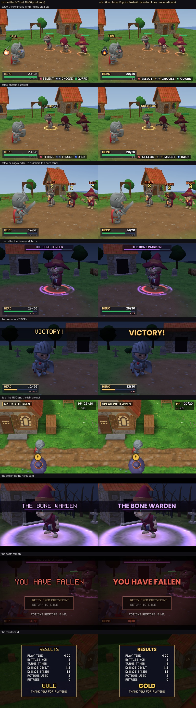
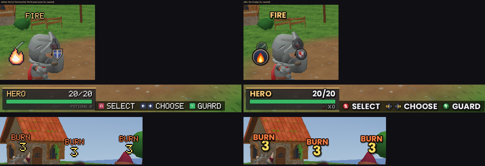
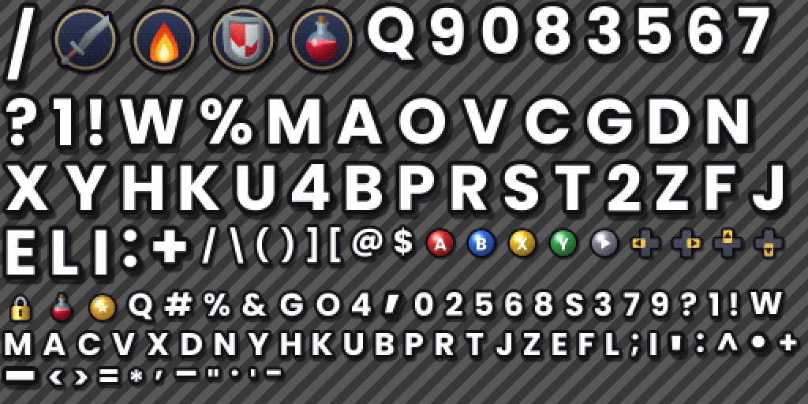

# UI art pass: the last artifacts of the 2D battle engine

> **Status:** done on the host; the Dreamcast run is the user's (checklist in §6). The default build ships it.

**Problem.** The 3D game still drew its HUD, battle UI and screen titles with the 2D battle engine's assets: a 5x7
bitmap font (`romdisk/font.png`, drawn at 2x-6x, every outlined word drawn five times to fake an outline) and 16x16
pixel icons (`romdisk/ui_icons.png`, magnified 2-3x with nearest filtering). Damage numbers, the HP panels, the command
ring, the button prompts, VICTORY, the boss's name, the title's PRESS START, the death screen and the results card all
looked pixelated next to the 3D scene.

**Fix.** One new asset, `romdisk/ui/ui.uia` (built by `tools/ui/make_ui_atlas.py`): a 512x256 ARGB4444 atlas with
* an **anti-aliased UI font** - Poppins Bold (SIL Open Font License 1.1, `assets/fonts/Poppins-Bold.ttf` +
  `Poppins-OFL.txt`), rendered at 4x and filtered down, with its **dark outline and drop shadow baked in** - in two
  sizes: S (14 px capitals: the HUD, prompts, labels) and L (28 px capitals: damage numbers, banners, titles);
* **16 icons**: the four battle commands on a dark medallion - the **sword and shield rendered from the game's own
  weapon models** (`w_sword.dmf`, `w_shield.dmf`, the knight's texture) and a painted flame and potion - the
  Dreamcast's A/B/X/Y buttons in their colours, Start, the d-pad directions, a padlock, a small potion and Wren's
  token; all with the same light, outline and shadow, colours dithered before the 4-bit quantisation.

Drawn by `src/uitext.*` (`ui_text`, `ui_text_px`, `ui_icon`) with bilinear filtering; text lands on whole pixels at
scale 1 (crisp) and scales smoothly otherwise (damage numbers pop in and ease back). The 3D game no longer calls the
5x7 font or the pixel icons (a suite check); they remain for the legacy 2D battle view (`--view2d`, the rule goldens)
and as the **fallback** if the atlas is missing (the game never shows nothing).

*The same frames before and after (host renders of frame dumps, `tools/ui/ui_sheet.py`): the command ring and prompts,
targeting, damage and burn numbers, the boss bar, VICTORY, the field HUD, the name card, the death screen, the results.*

*2x crops of the battle, nearest-neighbour (the pixels as the TV gets them): the command ring, the hero panel and the
prompts, the burn numbers.*

*`romdisk/ui/ui.uia` at 2x over a checkerboard: the L font, the command medallions, the S font, the pad buttons, the
d-pad, the lock, the small potion, the token.*

## 1. What changed

| Where | Before | After |
|---|---|---|
| Battle: hero panel | HERO, HP (5x7, 2x), GUARD/BURN/POTIONS (5x7, 1x: 7 px) | S font; a potion icon + count |
| Battle: damage / heal / status numbers | 5x7 at 3x (4x for 4 ticks), 5 draws per glyph | L font at 24 px capitals, popping 1.35x -> 1x over 6 ticks, 1 draw per glyph |
| Battle: command ring | 16x16 pixel icons at 32 / 48 px | 48 px medallions (the rendered sword and shield), unselected ones dimmed less (dark medallions) |
| Battle: prompts (SELECT, CHOOSE...), SKIP | 16 px pixel pad icons + 5x7 | 22-24 px Dreamcast-coloured buttons + S font (`prompts()` in `battle3d_draw.cpp`; the 2D view keeps `ui_draw_prompts`) |
| Battle: target name, ring label, ALL ENEMIES, captions | 5x7 outlined | S font |
| Battle: boss name + bar, name card, VICTORY / DEFEAT | 5x7 outlined at 2x / 4x | S / L font; VICTORY pops in |
| Field HUD | HP (5x7), potions (pixel icon + 5x7), token (dialog-atlas pixel icon), objective (dialog font) | S font, the small potion and token icons; the objective in the S font (the HUD is one style) |
| Talk prompt | pixel A + "Talk" (dialog font) | the A button + TALK (S) |
| Title, cards, death, results (titles), DEMO, SKIP, the load-error screen | 5x7 outlined at 2x-6x | S / L font by size (`outline_text` -> `ui_text_px`) |
| Unchanged (deliberately) | the dialog boxes, T2's card text, the credits, the results' rows, menus: the dialog font (the GDD's pixel font, with the script linter's metrics parity); the title logo (`logo.tex`); dialog emotes and markers | |

## 2. Performance (the brief: "make sure the fixes pass performance tests")

All 2D: the 3D frame cost is untouched (the battle budget runs' worst frames are identical to the vertex). The 2D cost
**drops**, because a baked outline is one sprite where the old outlined text drew five, and the old shadowed text two.
Sprites per frame (each ~60 game-code + ~200 KOS submission instructions, `tests/dialog/sh4_model.py`), measured with
`tools/ui/sprite_cost.py` against the build before the pass:

| Scenario | Before: worst / mean | After: worst / mean | Worst-frame 2D cost |
|---|---:|---:|---:|
| Battle UI (command ring, targeting) | 120 / 90 | **45 / 34** | 31.6k -> 12.2k instructions |
| Battle: squad (damage numbers) | 148 / 47 | **53 / 16** | 38.7k -> 14.0k |
| Battle: the Bone Warden | 301 / 121 | **82 / 31** | 78.6k -> 21.7k |
| Playthrough (title -> results -> title) | 693 / 132 | 689 / **87** | 180k -> 179k (the worst frame is the credits, dialog font) |
| Death screen route | 693 / 130 | 689 / **73** | 180k -> 179k |

| Budget | Before | After | Limit |
|---|---:|---:|---:|
| Texture slots | 28 | 29 | 30 (suite) / 32 |
| Texture VRAM | 980 KiB | 1,236 KiB | **1,280 KiB** (raised from 1,024: the atlas is 256 KiB; the PVR has ~4.4 MiB for textures; VRAM does not cost frame time) |
| Romdisk (in RAM) | 2.96 MB | 3.01 MB | **3.1 MB** (raised from 3.0: the atlas, LZ16-packed to 50 KB; the cel-study hulls, 79 KB) |
| Main RAM at run time | - | +0 (the atlas's 256 KiB of texels are unpacked into a boot-time buffer and freed after the upload) | |
| Heap after boot | 0 | 0 | 0 |
| 3D vertices / SH4 estimate per frame | unchanged | unchanged | 18,000 / 1.60 M |

**A hardware-only bug found and fixed on the way.** KOS queues sprites per texture in `std::vector`s reserved at boot
(640 nearest / 64 bilinear for an alpha texture). The credits roll queues **684** dialog-font glyphs in one frame: on
a Dreamcast that vector would grow - a heap allocation after the boot, which the host's allocation counter cannot see
(the host has no queues). `eng::sprite_reserve(s, nearest, bilinear)` now reserves 1,024 for the dialog font (nearest)
and the UI atlas (bilinear), and the host mirrors the KOS queues: `--sprite-queues` reports each texture's peak per
frame against its reservation and the draws that would have grown a queue (0 over the playthrough, the boss retry,
the demo and the battles).

## 3. Tests

New suite `tests/ui/run.sh` (13 checks): 0 warnings, the KOS backend in 5 flavours against the stub headers, the
atlas reproducible byte for byte (LZ16 round trip asserted), the atlas loads (budgets), **the fallback** (the
playthrough without the atlas runs on the old font, state trace identical), float == double, the 3D game no longer
calls the old font or icons, **sprites per frame no more than before** (frozen baseline, per scenario), **no KOS
sprite-queue growth**, **the battle worst frames identical to before** (17,422 and 14,609 written vertices), 0 heap
allocations after the boot. The other suites: unchanged except the VRAM (1,280 KiB) and romdisk (3.1 MB) budget lines
of `tests/barrow` and `tests/dialog` (section 2).

## 4. Files

| File | What |
|---|---|
| `tools/ui/make_ui_atlas.py` | the atlas: fonts (4x supersampled, outline + shadow baked, box-filtered), icons (weapon models rendered by `tools/battle3d/raster.c`; painted ones), shelf packing with 2 px gaps (bilinear), ARGB4444, LZ16; `--check`, `--preview` |
| `romdisk/ui/ui.uia` | the atlas + metrics (format in the tool's docstring) |
| `src/uitext.*` | `ui_init` (boot), `ui_text`, `ui_text_px` (by cap height: S up to 17 px, L above), `ui_text_width`, `ui_icon`; the fallback |
| `src/engine.h` `sprite_reserve` | KOS: reserves a texture's sprite queues at boot; host: the queue mirror's capacity |
| `platform/host/host_engine.cpp`, `trace_main.cpp` | the KOS queue mirror, `--sprite-queues` |
| `tools/ui/ui_sheet.py`, `tools/ui/sprite_cost.py` | the before/after sheet; the 2D cost comparison |
| `assets/fonts/Poppins-Bold.ttf`, `Poppins-OFL.txt`, `README.md` | the font source and its licence |

## 5. How to change it

* **A glyph size or style**: `FONTS` in `make_ui_atlas.py` (em, outline, shadow; `L_CHARS` = the L font's set - a
  character L lacks is drawn from S at twice the scale). Rebuild, check the atlas still fits (the tool stops if not).
* **A new icon**: append to `ICONS` (name, cell, outline) **and** to `enum UiIcon` in `src/uitext.h` in the same order;
  add its art in `icon_art()`; draw it with `ui_icon(UI_..., cx, cy, size, argb, z)` (crisp at size == cell).
* **New text in the 3D game**: `ui_text(UF_S | UF_L, x, y_cap_line, text, argb, z, scale, align)`; not `font_draw`
  (the suite fails).
* After any change: `python3 tools/ui/make_ui_atlas.py`, `tests/ui/run.sh`.

## 6. On the Dreamcast (checklist)

| # | Check | Expected |
|---|---|---|
| U1 | Boot log | no `ui: /rd/ui/ui.uia missing or invalid` line (else the old font shows: the fallback) |
| U2 | The battle: damage numbers, HP panel, ring, prompts; on a TV | smooth, outlined, legible at 14 px; no fringes around glyphs (if a thin line shows at a glyph's edge: the 2 px atlas gaps are too small for the PVR's bilinear - raise the gap in `pack()`) |
| U3 | The ring's medallions over the scene | readable unselected, bright when selected; the sword and the shield look like the hero's |
| U4 | DIAG heap line over the credits | `+0` (the dialog font's queue no longer grows) |
| U5 | Frame time in battles (DIAG) | equal to or better than before (fewer sprites) |
